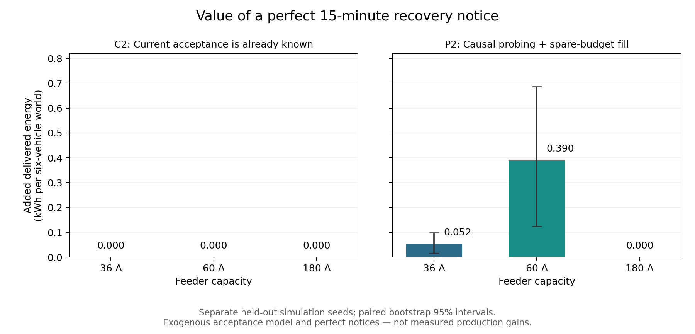

# ACN 请求核查、强基线和恢复预测价值

历史阶段C2/P2记录。**最新R1已完成真实预测器和Caltech/JPL外部验证，未复现完美通知收益**；见[LEARNED_RESULTS.md](LEARNED_RESULTS.md)。以下保留当时的完美信息结果及判断，不应作为目前已验证的学习预测收益。

## 结论

本轮找到了**有限、条件性的仿真价值**：当控制器不知道车辆当前能否取电时，提前恢复通知可以减少无效探测和恢复迟滞；在当前状态已经知道时，单独增加恢复时刻并未带来稳定的排程收益。真实数据确认恢复现象及部分尚未满足的声明需求，修正后的作者优化器和常规强基线也已实际跑通，但尚未证明真实场站收益，尚未实现可达到这些完美通知效果的预测器，机制新颖性也未得到确认。

## 真实数据：现象与可服务需求分别核查

实际获取固定镜像的 60,333 个 ACN 会话请求记录；官方 demo API 在本轮多次有界访问超时，镜像与原服务器的字节相同性没有得到确认。原格式请求经常晚于连接提交，也会修订，因此所有告警输入使用当时已经提交的版本，不能回填最终请求或最终交付电量。[官方字段说明](https://ev.caltech.edu/dataset)

全部 1,474 个 office 静态录制、7,592,347 行已核验。首告警后 206 个会话恢复取电，593 个未观察到恢复即断开，39 个删失；其中恢复会话的 52 个在告警时已有请求，41 个同时有至少 0.1 kWh 声明剩余需求及未来声明离开时间，9 个在该期限前的连续观测窗口内又交付至少 0.1 kWh。新增 1,346 个文件与开发样本分开汇报，但不是新场站。详见 FULL_OFFICE_AUDIT.md。

“9 个”是满足已定义观测条件的数量，不是价值上界或总体发生率。用户意图不等于电池物理需求；没有完整部署容量、实时接收时间和可识别的车辆响应模型，无法用现有日志估计新策略的真实因果收益。

## 强基线：真实求解与修正

固定 ACN-Sim/AdaCharge 源码与依赖，实际执行 CLARABEL 和动作—响应循环。修复 session/station 键不一致；接口只向控制器暴露声明离开时间；加入 6A 档位一致的常规探测/恢复；修复重分配的浮点严格比较。补丁和前后 SHA256 公开，作者源码 checkout 未改。

后一问题经负对照定位：35.99999999A 的浮点总和导致本可行的 36A 离散动作被拒绝，只用 30A。加 1e-5A 比较容差并保留独立物理约束后，新的无暂停留出对照中，原生基线在 36/60/180A 三档的总交付都达到同模型离线最优。不能把原缺陷造成的差距当成预测收益。

原论文已有量化处理、反馈容量回收与逐步恢复，因此这些修正属于基线工程，而非新研究机制。[ACN 作者论文](https://arxiv.org/html/2012.02636v1)

## C2：固定新种子的结果

在 C1 发现数值缺陷后保存旧结果，修正并重新冻结协议，使用新的种子 300–319。六车、5 分钟调度、三档容量、暂停与无暂停共 120 个仿真场景，1080 次策略运行，2447 次原生非空求解。没有跳过失败场景，全部完成并通过能量、动作、容量和离线界检查。开发集选定的因果对照为 EDF，所有评估 MPC 共用开发选定的持续时间假设。

下表是暂停场景，每格是 20 个六车场景的平均交付 kWh；当前状态 MPC 在动作前知道潜在可充状态，是有意设置的信息参照，不是可直接部署的传感器。

| Feeder | 修正原生 MPC | 因果 EDF | 当前状态 MPC | 再加精确恢复时刻 | 同动作离线最优 |
|---|---:|---:|---:|---:|---:|
| 36A | 12.7920 | 13.1820 | 13.9828 | 13.9828 | 13.9828 |
| 60A | 20.9924 | 21.3356 | 22.8540 | 22.8540 | 22.8904 |
| 180A | 27.7680 | 28.3296 | 28.7248 | 28.7248 | 28.7248 |

提前 5 分钟、15 分钟或暂停期间即提供精确恢复时间，60 个暂停场景相对同一当前状态 MPC 的总能量增量均为零。通知确实进入调度：完整恢复 oracle 分别在 36A 的 17/20、60A 的 19/20 个世界改变了动作，仍没有提高交付，不能把零增益解释为“信息未接入”。180A 容量充分时动作本身也不变。

36A 与 180A 当前状态 MPC 已达到离线最优；60A 只剩平均 0.0364 kWh 差距，只有 1/20 个世界还有空间。离线参照知道未来暂停开始时刻，信息比单独恢复预测更丰富；网络流整数性保证它使用相同离散动作，不是连续松弛。这里的界只约束本模型、本目标、本批场景。

相比因果 EDF，当前状态 MPC 的平均优势为 0.8008、1.5184、0.3952 kWh，配对 bootstrap 95% 区间分别为 [0.5668,1.0660]、[1.2844,1.7836]、[0.2600,0.5252]。其中还可能混有控制器优化差异，不能全部称为纯信息价值，更不能全部归给提前预测。

## 快速反馈并未解决全部差距

按提前冻结的协议，在相同物理请求、暂停时刻和种子下，把控制周期改为 1 分钟，共 240 次策略运行。EDF 与当前状态 MPC 的平均差距由 0.8008/1.5184/0.3952 kWh 缩为 0.5720/1.02232/0.07488 kWh，缩小约 29%/33%/81%。容量拥挤时仍有明显差距；36A 的两个种子里固定 EDF 甚至因调度改变而略差，不能声称更快更新必然获益。

原因之一是持续 6A 探测仍预留容量，频率提高并不会自动消除整个暂停期间的资源占用。这里同时改变反馈和动作时间粒度，不能解释为只改变传感延迟。完整精确恢复通知相对当前状态 MPC 的增量仍全部为零。

为避免过早排除实用预测价值，另固定 PROBING_PROTOCOL.json：增加周期为 1/2/4 槽和指数退避的常规探测基线，开发集选择后使用新的 400–419 种子；恢复通知只在历史正 pilot 已产生零 actual 后可用，不赠予当前可充状态。该补充检验“预测能否替代部分探测、及时恢复额度”，与前面的纯提前信息增量是不同问题。

## P2：实际控制接口下仍保留的条件性收益

P1 先发现正收益，也暴露了容量充足时仍不必要限流的基线弱点。P2 给全部比较策略增加相同的普通规则：活动车辆/计划探测分配完后，把无人使用的剩余 pilot 预算分给仍连接且请求未满足的车辆。该规则只看已知请求、约束和历史，不看潜在可充状态。它消除了低负荷下被基线人为制造的预测优势。

在开发集上从每 1/2/4 槽探测、指数退避中选出全局每 4 槽（20 分钟）探测；实际有空余容量时仍可随时取电。随后冻结设置，在新的 500–519 种子、三容量、暂停/无暂停共 120 场景中完成 720 次策略运行。没有在测试场景逐个择优。

| Feeder | 因果强探测基线 kWh | 完美提前 15 分钟通知的增量 kWh | 配对 95% 区间 | 全程精确恢复通知的增量 kWh |
|---|---:|---:|---:|---:|
| 36A | 13.6136 | +0.0520 | [0.0156, 0.0988] | +0.0624 |
| 60A | 21.1380 | +0.3900 | [0.1248, 0.6864] | +0.4004 |
| 180A | 28.8028 | 0 | [0, 0] | 0 |

单位是每个六车、最长两小时的模拟世界。15 分钟通知在 36A 的 6/20、60A 的 8/20 个世界增加交付，其余打平；该批没有负值。60A 平均约提升 1.85%，36A 约 0.38%。无暂停对照全部零通知增益；180A 下所有因果与通知策略都达到离线最优。

这才是目前有实验支持的候选价值来源：**指令感知的潜在可充状态估计（command-aware latent availability estimation），与有资源成本的探测/额度恢复联合决策（probing and rate restoration）**。目前实现的是常规探测和完美通知诊断，不是新的预测算法；这些术语也不是新颖性声明。下一步需要在实际历史可用信息上预测恢复，并证明误报/迟报后的净收益仍能超过上述基线。不能直接把完美通知的收益写成真实模型性能。

## 当前能支持与不能支持的判断

- 可以支持：用户请求不是完全缺失；时点与修订必须处理。恢复现象中确有仍有声明需求的子集。作者完整闭环可部署，几个基线缺陷会显著放大所谓预测优势。强化常规基线后，资源拥挤条件下完美恢复通知仍保留较小的模型内收益。
- 不能支持：真实场站因果收益、经济收益、一个已实现且可靠的新预测模型、独立站点泛化，或该候选机制足够新颖可发表。误差鲁棒性、现场容量/策略、非恢复事件、独立场景和实际响应识别仍缺证据。
- 研究判断：值得把下一步问题缩到“什么时候探测、何时恢复额度，以及预测错误造成的资源损失”；当前证据不支持继续单凭“增加状态/预测恢复时间”命名一个新架构并宣称优越。

## 失败记录与解释边界

- C1 同样没有稳定提前增益；60A 完整恢复 oracle 为 +0.0104 kWh，区间跨零，有限提前通知出现负值。旧原生量化缺陷已另列，原结果未覆盖。
- 安装旧作者代码遇到 setuptools 的 pkg_resources 缺失，固定兼容版本。
- 重装补丁遇到同秒、同大小文件替换导致旧 pyc 被加载；行为测试发现后，整轮无效开发结果隔离，setup 删除相应缓存并在新解释器验证实际函数行为。
- C2 的一个可行网络流问题被 HiGHS presolve 返回 Unknown 状态。保留相同目标/约束，关闭 presolve 后重新求解到 Optimal，并再次检查整数性和可行性；没有把 Unknown 当成成功或删去样本。输入与状态保存在 solver_diagnostics_evaluation.json。
- 仿真使用外生二值可充状态、准确请求、同步到达和全部最终恢复的暂停；没有识别真实电池响应、三相约束、费率、请求误差或动作诱发的恢复。它比真实数据更有利于寻找恢复机会，仍不足以给出真实部署收益。
- 当前状态 oracle 的“无额外提前增益”不等于现实里预测没用：没有这个 oracle 的实际控制器可能从预测中获得更好的状态估计或更及时的恢复发现。本轮没有训练或验证这样的可实现预测器。

设计与数学边界见 VALUE_MODEL.md；各阶段失败和修正见 RESEARCH_LOG.md。当前状态/纯提前信息结果以 reports/c2/ 为准；实际接口探测比较以 reports/probing_p2/ 为准；根 reports/ 下的 value_* 和 reports/probing/ 分别保留 C1、P1 诊断结果。
