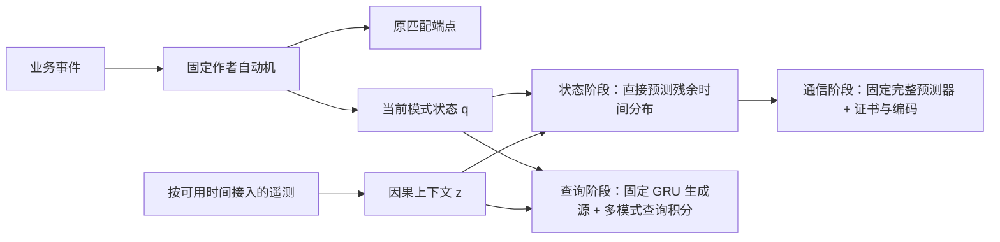

# 给 GPT‑6 Pro 的研究指导请求（可直接复制）

你是这项研究的独立导师和严格评审。请阅读随后附上的 Wayeb 项目交接材料；若有 ZIP，请先查看其中的 README、PROJECT_DOSSIER.zh-CN.md、AUDIT.json、协议和相关实现。你的目标是帮助执行代理决定哪些主张成立、哪些必须放弃，以及下一步最值得做的可证伪研究。不要把已有代码、正面点估计或数学正确性自动视为论文新颖性。

背景：我们从 Elias Alevizos 等人的 Pattern Markov Chains / Wayeb 出发，最初研究“保持业务事件模式不变，利用连续遥测改善完成概率预测”。随后经历状态增强生存预测、复杂模式通信编码和固定神经源下的多模式概率查询三个研究阶段。所有失败均保留。状态预测在 MetroPT 2022 的特定任务上得到确认收益，但组合新颖性不足；通信四个候选未过主要门槛；查询 Q1–Q4 未建立完整优势，Q5/Q6 未完成。研究当前暂停，你的答复供我审阅后交给执行代理；这份请求不授权自动启动实验或访问剩余测试年份。

请完成以下工作，并用中文写作，重要术语附英文：

1. **先审计事实。** 区分作者方法、本项目实现、历史完整结果、开发集结果、部分检查点和未做实验。指出文档与代码可能不一致之处，尤其是观测时钟、首次命中、overlap/non-overlap、预算计数、无偏性、一致性和冻结边界。材料不足时明确说缺什么，不猜测结果。文件引用写出路径和函数；论文引用给原文链接及支持的位置。
2. **再做最接近文献检索。** 优先读原论文、作者代码和出版页，核实材料中的题名、日期和覆盖范围。重点包括神经序列概率查询、weighted ensemble/SMC、cube/balanced sampling、moment-preserving resampling、potential control variates、POMDP/PSR/value-directed compression、有限期限自动机等价、统计模型检查。明确“完全已有”“已有方法的直接组合”“可能有差别但价值待证”三类，不以检索不到相同措辞作为首创证明。
3. **严格检查 Q5/Q6。** Q5 用重叠的每模式吸收 DFA 占用量（可交叉最后符号）约束原始神经历史的正权随机压缩；Q6 按剩余期限编译逐后缀函数等价商。审查低阶时间非齐次源的闭合精确性、一般 GRU 源的无偏性、完整合法路径凸组合、控制秩条件、浮点秩容差和静默补齐论证。给出反例或证明摘要。特别判断“保留完整历史 + 多组重叠控制 + 随期限变化”的组合是否已被既有工作直接覆盖，是否只是工程实例化。
4. **重新评估证据。** 原 Q3 的 70.60%/53.12% 改善只相对旧 IID 势基线；后来完成的一阶 Markov-LHS 基线更强。Q5 仅有各 42/48 起点，Q6 各 19/48；按共同 19 起点比较，Q6 的 MSE 点估计比 Q5 一阶占用量更高，不能套用两起点 pilot 的好结果。尚无串行计时、Q5/Q6 完整统计或独立确认。请检查比较是否公平，包括实际调用数与预算上限、源查询成本与线性代数成本、起点相关性、多次开发选择和未完成运行的选择效应。
5. **给出路线选择。** 最多提出三个有实质区别的方向，可以要求放弃当前方向。每个方向必须列出：准确研究问题；相对最接近工作的最小新差别；机制为何必要；可证明命题与假设；最小反例；同信息最强基线；一个能尽快否定它的实验；所需数据/计算；停止规则。不要用加层、调参、换种子或换个名称代替新机制。若所有方向都缺乏可辩护新颖性，请直接建议整理负结果或回到应用问题。
6. **输出执行指令。** 最后给执行代理一份可逐项实施的计划，分为“必须先纠正”“最小反证实验”“仅通过后才扩大”“论文仍缺的证据”。写明应新建/修改哪些模块、保留哪些冻结文件、如何记录失败和阶段 push。任何新门槛应在结果前登记；不得把 Air 2016/Power 2009 再称未见测试，Air 2017/Power 2010 在批准的新协议冻结前继续关闭。

请给可核查的设计理由、证明概要和决策依据。不要编造运行结果、假装已打开本地路径，也不要为了回应“直到能发论文”而保证成功。论文方向建议应说明证据等级；不需要现在替我们写一个夸大结果的摘要。若你无法解压附件或浏览，请先列出实际可读材料，再在这个范围内评审。

建议输出顺序：事实审计表 → 最近邻文献差异表 → Q5/Q6 数学与代码问题 → 路线去留排序 → 最小反证实验 → 给执行代理的具体指令。你可以先独立形成判断，再与交接文档中的开放问题对照，避免被已有候选名称引导。


---

# Wayeb 项目完整研究交接：结构、依据、失败、修正与现有证据

整理日期：2026-10-23（America/Los_Angeles）。研究代码基准：`96751ca`。本次工作只读取现有文件、统计已保存结果并制作交接材料；未恢复训练或采样，未打开储备年份，未重跑性能测试。本文中的过程按“问题—依据—设计变更—检验—结论”组织，便于外部导师审查。

## 1. 阅读入口与当前判断

仓库：[roy-pyke/wayeb-event-forecasting](https://github.com/roy-pyke/wayeb-event-forecasting)。本地根目录：`/Users/ruiwang/Desktop/Library/research/projects/Wayeb/`。本文引用路径若无特别说明，均相对于这个根目录；ZIP 内保留相同目录结构。

**原型可运行和部分预测有效已有证据；新算法论文所需的新颖性、强基线优势、成本与独立确认尚未共同成立。** 这不是一套不断升级后已经统一验证的算法，而是四层相互复用资产、研究目标不同的工作：

| 层次 | 目录 | 实际研究/工程目标 | 当前证据 |
|---|---|---|---|
| 作者实现部署 | 根目录、`upstream/` | 安装固定版本 Wayeb、PST 与 RTCEF | 部署、识别与服务流程验证完成；不等于论文原实验复现 |
| 连续状态预测 | `state_forecasting/` | 固定加载周期模式，预测未来 30/60/120 秒完成概率 | MetroPT 2022 确认有效；新颖性不足、跨设备未证实 |
| 复杂模式与通信 | `pattern_forecasting/` | 同信息预测器下，用模式结构降低辅助消息成本 | 四个主要机制未通过门槛；三族、跨年/未见站点负结果完整 |
| 神经源概率查询 | `query_forecasting/` | 对同一个冻结 GRU 同时求多模式/多期限概率 | Q1–Q4 未建立完整优势；Q5/Q6 部分完成，尚无独立确认 |

随附文件：

- `GPT6_PRO_PROMPT.md`：直接发给 GPT‑6 Pro 的评审任务。
- `SEND_TO_GPT6_PRO.md`：prompt 与本交接正文的合并版，单文件即可提供主要上下文。
- `SOURCE_DOCUMENTS.md`：原有设计、研究日志、结果、文献和复现文档逐字汇编；保留历史时点的表述，不代表所有“正在运行”现在仍在运行。
- `FILE_INVENTORY.md`、`FILE_MANIFEST.json`：全部本仓库文件及上游固定版本的文件清单；关键 Python 符号索引帮助定位实现。
- `COMMIT_HISTORY.md`：交接前完整提交顺序。登记在前、实现/结果在后的证据可沿提交核对。
- `AUDIT.json`、`QUERY_RESULT_TABLES.md`：本次对已有报告及 NPZ 检查点的读盘核验，包含部分运行的明确标签。
- ZIP 中保留本仓库全部已追踪代码、配置、测试、紧凑报告和图表；不捆绑虚拟环境、原始大数据或作者子模块源码。作者源码通过固定 SHA 恢复；模型通过已有 Release 恢复。

**证据优先级：** 原始协议/冻结清单和代码 → 原始逐起点检查点/完整报告 → 本次审计 → 历史叙述。文档如互相冲突，应检查版本和数据范围，不能选更有利的说法。

## 2. 原始问题与概念边界

用户最初建议：保留业务事件模式（event pattern），同时让预测器读取连续进度、速度、负载、遥测新鲜度等信息；新增小事件可以只用于预测，而不成为模式必须经过的步骤。核心动机是**识别充分性（recognition sufficiency）不同于预测充分性（predictive sufficiency）**。

两个实例可能都在“等待 Finish”的同一 DFA 状态，但一个进度 20%，一个 90%，未来分布不同。因此扩充条件信息为 `(q_t, history_t, z_t)` 有合理动机，但“多加传感器”并不自动提供新颖性，也不自动保证增广过程满足马尔可夫性。



图表示共享设计与研究分工，不表示三个研究阶段已串成一个经过端到端验证的生产系统。

三个必须区分的预测量：

1. 作者 PMC：未来多少个事件/转移步骤后首次匹配，不自动等于秒。
2. 状态预测阶段：在同一个真实时间窗口内，当前加载周期是否结束。
3. 查询阶段：给定已经训练好的条件生成模型，模式在未来固定原生 tick 内命中的**模型概率**；主要误差是积分误差，不是对现实标签的预测误差。

辅助流投影不变式：`Matches_new(w) = Matches_Wayeb(alpha(w))`，`alpha` 删除只供预测的遥测，保留业务事件、时间戳和实例归属。对严格邻接模式，直接把遥测插入业务流可能改变语义，故不能只保留正则表达式文字就称语义不变。

所有上下文按实际可用时刻处理；不能事后根据 Finish 倒推进度作为实时输入。公开实流没有网络到达时间，主实验采用采样即到达；延迟场景单列压力测试。没有实现任意乱序业务事件、生产故障恢复或完整分布式协议。

## 3. 完整目录与模块分工

```text
Wayeb/
├── upstream/Wayeb/             作者 Scala 项目（Git 子模块，固定 SHA）
├── upstream/rtcef/             作者 Python/Kafka 自适应系统（固定 SHA）
├── build/                     隔离 sbt 构建；stateBridge、patternBridge 导出 DFA
├── scripts/                   部署、数据/demo、Kafka、RTCEF 服务包装
├── configs/                   demo、锁定依赖、日志配置
├── reports/                   核心部署、重复运行、RTCEF 验证
├── docs/                      作者论文地图、部署经过、复现边界
├── .github/workflows/         部署与各研究层的 CI
├── state_forecasting/
│   ├── src/stateforecast/     因果实例数据、危险率、校准、反馈组合、在线接口
│   ├── scala/                 作者 DFA 导出桥
│   ├── configs/               原协议、2020/2022 冻结、模式、依赖锁
│   ├── scripts/ tests/        训练/确认/在线回放/压力/等价执行检查
│   └── docs/ reports/         R0–R7 设计、失败、确认与图表
├── pattern_forecasting/
│   ├── src/patternforecast/   模式产品、可行标签、预测器、证书、字节编码
│   ├── scala/                 多模式导出
│   ├── configs/               nested、directional、multisignal 与各轮协议
│   ├── scripts/ tests/        数据、训练、通信、码本、确认、证据整理
│   └── docs/ reports/         P0–P7 完整负结果与研究稿
├── query_forecasting/
│   ├── src/queryforecast/     冻结源、数据入口、监控器、原始估计器
│   ├── experiments/           Q2 分组与较强采样对照
│   ├── audits/                混合搜索、方差分解、抽象分组反证
│   ├── compositional/        Q3 36 维查询监控、完整历史传播、矩压缩
│   ├── overflow/             Q4 超预算处理、共享任务/精确参考入口
│   ├── occupancy/            Q5 占用量、局部基刷新压缩、传播
│   ├── markov_control/       时间非齐次一阶代理、CV/LHS/平衡传播
│   ├── particle_controls/    系统/分层/离散粒子及排序对照
│   ├── engineering/          精确删除常数控制列的实现审计
│   ├── finite_control/       Q6 按剩余期限的后缀函数等价商
│   ├── configs/              每轮结果前登记；新模式 DFA
│   ├── scripts/ tests/        实验入口、下载、重训、汇总、数学/路径检查
│   └── docs/ reports/         Q0–Q6 依据、已完成报告及预检报告
├── handoff/2026-10-23/         本次交接包
├── .cache/                    忽略：原始数据、特征、模型、逐起点检查点
├── runs/                      忽略：执行日志、旧阶段训练/在线结果
├── .venv-state/.venv-pattern/.venv-rtcef/   忽略：环境
└── .tools/ artifacts/         忽略：构建工具、大型生成物
```

关键实现定位：

| 目录 | 文件 | 实际责任 |
|---|---|---|
| stateforecast | `data.py`、`metro2022.py`、`stream.py` | 周期识别、因果前缀、观测覆盖、右删失（right censoring） |
| stateforecast | `model.py`、`rolling.py` | 区间危险率、共享保序校准、按更新时刻截断训练标签 |
| stateforecast | `mixer.py`、`adaptive_pool.py`、`fast_feedback.py` | 两专家到多专家、真实成熟标签、快反馈计数 |
| stateforecast | `online.py`、`online_fast.py`、`serving.py` | 原在线接口、最终 FastStateSidecar、等价批量执行 |
| patternforecast | `automata.py`、`oracle.py` | 导出自动机、产品状态、max-plus 可行未来优化 |
| patternforecast | `polytope.py`、`certificates.py` | 联合概率可行凸包、最坏 Brier 增量证书 |
| patternforecast | `models.py`、`data.py` | 同信息 HGB/ExtraTrees/注意力 GRU、训练因果管线 |
| patternforecast | `communication.py`、`refresh.py` | 辅助上下文发送、精确/贪心选择坐标 |
| patternforecast | `affine.py`、`wire.py`、`safe_codebook.py` | 独立概率坐标、真实二进制消息、安全码本在线选择 |
| queryforecast | `model.py:WorldModel/Source` | 每行调用包括递归隐状态更新和 5 类条件概率 |
| queryforecast | `data.py:load` | 只接受 train/calibrate/development；拒绝 confirmation/reserve |
| compositional | `monitor.py:JointMonitor/HarmonicPotential` | 四族组合、期限输出、IID 调和控制量 |
| compositional | `propagation.py`、`compress.py` | 真实源分支、WE/CV、旧 Q3 零空间压缩 |
| occupancy | `features.py`、`recombine.py`、`propagate.py` | 吸收占用量、更新压缩内核、秩不足显式失败 |
| markov_control | `potential.py`、`methods.py` | 计费的一阶代理、同势加性与正权基线 |
| finite_control | `finite_features.py`、`finite_method.py` | 有限后缀等价特征、独立接入 Q5 传播 |
| query scripts | `summarize_evidence.py` | 旧汇总覆盖 Q3/Q4/Q5 和常规对照；尚未纳入 Q6 新门槛 |

## 4. 作者代码部署：完成了什么

固定来源：Wayeb `b58a0cbe8c2c174d19394153c03504031ac57465`；RTCEF `9bf8796b223a1a657bc51f49475d6d4fbf616172`（v1.0.0）。本次再次核对 SHA 与工作区，作者子模块未修改。

论文脉络：PMC（2017）→ Wayeb 符号自动机（LPAR 2018，arXiv 2019）→ PST（2021 技术报告/2022 VLDBJ）→ 寄存器自动机、2022 优化、2024 寄存器转换器 → RTCEF（DEBS 2025）→ 2026 edge-to-cloud 集成。完整题名和链接见 `docs/LITERATURE.md`。这是直接相关技术线，不是对所有作者全部论文的穷举。

工程选择：JDK 11，保留 Scala 2.12.10 和作者算法依赖，通过隔离 sbt overlay 替换过时打包插件；没有改作者算法。主 full-order forecasting 使用 DSFA，不能把寄存器支持与当前主预测路径混淆。

验证：独立 6,000 训练/2,000 测试事件，固定 `A(B|C)`；631 次匹配与独立 oracle 端点一致；两次预测指标差不超过 `1e-12`；三项作者单元测试通过。RTCEF 启动五个作者服务、本地 Kafka 3.4.0，初始训练、重训、三次贝叶斯优化、两次模型切换均完成；控制分数明确标记为人为注入，用于触发流程。重复运行的输入/窗口哈希、计数、模型版本一致，候选参数和评分差不超过 `1e-10`。

边界：没有复现原论文真实数据准确性/吞吐/漂移结果；RTCEF 候选工厂在训练数据上评分，额外 held-out 检查没有改变该上游行为。许可分别保留：Wayeb 特定双许可，个人非商业研究路径含 CC BY-NC-SA 4.0 及附加条件；RTCEF 顶层 LGPL-3.0，嵌入 Wayeb 保留自己的声明。

## 5. 状态预测架构：公式与实际接口

目标模式 `LoadStart → LoadEnd`。公开 `COMP` 信号 1→0 产生开始，0→1 产生结束；预测加载周期结束，不是故障、事故或剩余寿命。每 20 秒以上的地标查询，未来窗口 30/60/120 秒，缺口超过 60 秒删失/重置。

状态基线 M0：年龄、上一周期时长、前三个已完成周期均值、时钟 sin/cos。M1/M2 再加同样的七个传感器 `TP2, TP3, H1, DV_pressure, Reservoirs, Oil_temperature, Motor_current` 及其七个过去变化率。M1 为训练分位数分箱（4/8/16 选择后为 16），M2 保留数值精度；树内部仍有离散化，不应描述成无限精度。

残余时间危险率（discrete-time hazard）：

\[
h_k(x_t)=P(b_{k-1}<T-t\le b_k\mid T-t>b_{k-1},\mathcal F_t),\quad
F(b_k\mid x_t)=1-\prod_{j\le k}(1-h_j(x_t)).
\]

边界 `10,20,30,45,60,90,120,180,300` 秒。只训练已观测风险区间；未知未来不标负例。共享单调保序映射校准，保留 CDF 单调性，但不提供漂移下覆盖保证。所有实例总权重相同，实例内多次查询合计权重 1。

最终 F2 是五专家凸组合：原始/校准业务危险率，原始/校准数值状态危险率，快业务结果专家。F0 同样获得快专家和原始/校准业务版本；F1 只把状态换成 16 档，避免把额外适应能力偷算成传感器收益。

日级模型使用过去 14 天、最近 2 天仅校准；先预测后更新（prequential）。快专家按年龄和前周期时长固定档位分组，对真实成熟结果更新 `A←.98A+y, N←.98N+1, p=(A+1)/(N+2)`；正反馈必须已完成，负反馈必须完整窗口结束，缺测没有反馈。专家按 Brier 指数加权，`eta=2, share=.02`，共享窗口权重保持 CDF；缺失/陈旧遥测退回 F0。参数不是为了保留段逐次搜索出来的。

## 6. 状态阶段的失败与修正（R0–R7）

| 阶段 | 观察与依据 | 采取的修正 | 最终判断 |
|---|---|---|---|
| R1 固定训练/校准 | 2020 开发 M0 .318547，M2 .311510，仅改善 2.21%；ECE .39190。周期中位数从 2 月 109 秒、3 月 139 秒变为 4 月 13 秒；校准反而恶化 | 每日因果滚动训练 | 静态模型失败，校准分布变化是真实风险 |
| R2 日级重训 | M0 .076316，M2 .196715；4/17 状态模型 Brier .632，业务 .042；不能删除突变日 | 延迟反馈专家组合 | 多数天好不足以抵消突变日严重损失 |
| R3 两专家 | 开发 G2 .047427，改善 37.85%，ECE .046278 | 冻结并打开 2020 保留段 | 开发通过不等于确认通过 |
| R3a 程序边界 | 两天校准窗无完整实例导致空数组错误，尚未汇总保留成绩 | 空校准返回原 CDF，记录 null，增加测试再冻结 | 边界修复公开记录，未改变正常分支/参数 |
| R3b 保留失败 | 10,880 实例、73,884 查询；M0 .179358，G2 .161847，仅改善 9.76%；ECE .160949 | 保留失败，此后该段降为诊断 | 未过 20%/ECE 门槛 |
| R4 原始/校准多专家 | 诊断改善 11.17%，ECE .148339；6/12 实际完成率约 98.1%，组合仅约 10.8%，原始模型也失败 | 引入不同信息更新速度的专家 | 凸组合无法超出所有专家的共同错误范围 |
| R5 快反馈 | 已曝光数据 F0 .046147、F2 .029925，改善 35.15% | 公共快业务专家给所有对照；另冻结 MetroPT 2022 | 诊断改善不能再称独立验证 |
| R6 2022 确认 | 10,326 实例、68,197 查询、137 天，五个月均改善 | 保留冻结结构，压力测试与重复训练 | 特定任务达到原型标准 |
| R7 Linux 延迟 | 原 p95 38.87 ms 超 20 ms；每查询 18 次树 API 调用 | 同树区间输入批处理为 2 次调用，逐条要求结果完全相同 | 纯执行优化，原失败和修复证据分开 |

最终确认（2022-01-15 至 05-31，前 14 天预热）：

| 方法 | 平均 Brier | 60 秒 ECE |
|---|---:|---:|
| F0 加强业务基线 | 0.042777 | 0.008131 |
| F1 16 档状态 | 0.029222 | 0.012796 |
| F2 数值状态 | 0.027982 | 0.012288 |

F2 对 F0 相对 Brier 降低 **34.59%**，按天块 bootstrap 的绝对改善 95% 区间 `[.013386,.016295]`；对 F1 仅 **4.24%**，差值区间 `[.001038,.001439]`。F0 校准 ECE 更低，不能声称 F2 所有指标最优。

本机重训所有概率/权重逐元素一致；跨平台存在微小数值差异，平均 Brier 差 <.000005。等价批处理本机 p95 1.96 ms、Linux 4.23 ms；411 个日模型的全部原始/校准输出保持不变；两个危险率模型约 .662 MiB。27 项测试、作者端点差分、压力和在线回放已记录通过，**此次交接没有重新运行**。

限制证据同样重要：完全缺失退回 F0（.042777）；状态延迟一查询后 .042220，主要收益消失；日内打乱状态 .043773，略差于 F0。结果支持新鲜正确关联遥测有价值；不支持一般延迟鲁棒性、跨设备/车队或故障预测。Dynamic-DeepHit、landmark survival、data-aware process remaining time、DWM、RTCEF 已覆盖主要组合思想，因此不能由 34.59% 自动推出新论文机制。

## 7. 复杂模式、数据与强预测器（P0–P7）

目标改为每个固定流模式的**严格未来首次匹配端点**。不再是带固定 Start 的同一业务实例。字母表 A–D，静默原生 tick 推进时间且不重复报告接受端点。

| 模式族 | 模式（常用正则表示） | 可达联合状态 |
|---|---|---:|
| nested | `ABCD`, `A(B|C)+D`, `A(A|B|C)*D` | 11 |
| directional | `A(B|C)+D`, `D(B|C)+A`, `(A|D)(B|C)+(A|D)` | 15 |
| multisignal | `AB+C`, `AB+D`, `AB+(C|D)` | 6 |
| heldout_structure（查询阶段新增） | `A(B|C)*DA`, `(AB|BA)+(C|D)`, `(A|B)C+(A|B)` | 以导出 DFA 为准 |

前三族 36 次作者 CLI 检查、最后一族 9 次，均逐匹配端点零差异。不能凭语言包含关系代替实际匹配语义：默认 non-overlap 会在匹配后重置；方向族查出这一问题后明确编译为 overlap，重新生成数据/核对；旧失败报告保留。

数据切分按左闭右开时间区间。阈值/归一化只拟合训练期；缺失目标切断覆盖并重置自动机：

| 数据 | train | calibrate | development | 已打开确认 | 仍未评估储备 | 原生 tick |
|---|---|---|---|---|---|---|
| UCI Beijing 多站空气 | 2013-03–2014-09 | 2014-10–12 | 2015 | 2016，12 站，6 站未参加训练 | 2017-01–02 | 1 小时 |
| UCI 家庭用电 | 2007-01–09 | 2007-10–12 | 2008 | 2009 | 2010-01–11 | 1 分钟 |
| MetroPT 2020 | 02–03/14 | 03/15–03/31 | 04 | 05–08 已曝光 | 本研究无新确认意义 | 约 10 秒，实际时间戳为准 |

长窗口原协议：空气/Metro 为 3/6/12 样本，用电 5/15/30；后续另登记短窗口 1/2/3。用电查询每 5 样本，但未来事件按原生分钟演化，不能把查询频率当生成步长。

预测器共享业务元数据、DFA 状态、八步遥测历史、训练查询预算和一致性投影：HGB 离散危险率、ExtraTrees 危险率、注意力 GRU 删失事件分布。GRU 是 Dynamic-DeepHit 风格任务适配，不是作者论文原软件完整复现。20000 查询各以完整和一个随机缓存年龄生成两视图；候选容量网格及三种子提前登记，按开发选择。另含仅业务、去显式状态 one-hot 消融；后者仍有业务历史和状态年龄，不能说完全无状态。

90 模型已发布并在空目录下载恢复 SHA 验证；空气 GRU 独立重训的 2000 开发预测逐位一致。没有一个预测器在所有族/领域胜出，因此通信机制用固定预测器比较，不能偷换预测器归因。

## 8. 四个通信候选的机制、失败与解释

### 8.1 联合可行标签证书

令 `Y(q)` 是当前自动机状态/期限下的可行未来标签，`f` 为完整上下文预测，`p` 为接收端预测，`L(p,y)=Σ_i w_i(p_i-y_i)^2`。证书为：

\[
C_Y(q,p,f)=\sum_i w_i(p_i^2-f_i^2)+\max_{y\in Y(q)}[-2\sum_i w_i(p_i-f_i)y_i].
\]

若 `C≤ε` 则可不发送，否则在评分前可靠送达更新。证书只界定**相对同一完整预测器的 Brier 增量**；不保证模型真实性、校准、丢包或延迟鲁棒性。max-plus DP 用 `(联合 q, 已命中 mask)`，仍有产品状态与 `2^P` 指数成本。

失败证据：长窗口 nested 的 11 个状态都得到同一 20 标签集合，等于静态包含约束；空气相对单模式 CDF 仅省约 .06%–.30% 包，严格收紧不足 .7%。不能把相对全量发送的大节省归给动态结构。

### 8.2 精确稀疏刷新

选择同证书下最少更新坐标，实际计算头部/掩码/数值字节，给基线相同动作集合。短期限、方向模式、双传感器模式依次检验，不删除上一轮。

空气 nested 5.568 对静态 5.601 B/query，仅 .59%；directional 15.135 对 15.207，仅 .47%；同证书精确选择对贪心仅约 3.11%；multisignal 空气/用电动态对静态约 .31%/.34%，用电精确对贪心约 2.27%。均没有通过登记的 5% 主要优势要求。

### 8.3 独立概率坐标编码

把可行标签组成矩阵 `Y_q`，选独立列 I、求 `Y[:,I]B=Y`，则一致预测 `f=f_I B`。用 max-plus 见证也能发现线性包；QR、线性代数与 PSR 思想属于既有工具。候选、全坐标、静态坐标、零坐标省略统一得到 8/16/32/64 位量化、稀疏更新、投影和同证书。

multisignal 短窗口秩 2/4/6 而非零坐标 3/6/9，形式上确能少发数值；directional 秩等于非零坐标，是应无额外收益的负对照，实测结果完全相同。

独立**诊断**复验（开发门槛已失败后明确按诊断冻结，并非事后恢复成功）：主种子 20261022、ε=.002、同 GRU。

| 领域 | 全坐标 B/query | 独立坐标 | 节省 95% 区间 | Brier 差（候选−基线） |
|---|---:|---:|---|---:|
| air 2016 | 7.518 | 7.493 | .34% [-.32%,1.00%] | -.000187 |
| power 2009 | 10.795 | 10.726 | .64% [-1.18%,2.37%] | -.000306 |

三种子都未过 5%；主区间含零。次要总体 Brier 改善仅约 1.05%/1.51%，不是准确率提高一半。199,555 个主比较完整查询未见证书/ε 违反；这验证实现边界，不证明通信优越性。

为什么秩减少不等于成本减少：27 字节左右固定头部已占小包大部，量化/零值省略/部分更新已捕捉大量压缩空间，当前更短表示改变了未来缓存轨迹。应用消息字节不包括完整链路/ACK/握手，也不等于能耗或边缘计算节省。

### 8.4 闭环反例与安全码本

点态 `C_S≤C_W` 不能推出闭环发送更少：缓存策略不同后，下一步比较的 p 不同。精确有理数反例在二维互斥概率三角形内，交替序列使严格证书策略发送 2/20/200/2000 包、较松者始终 1 包。一般警示已有 window-based event-triggered control 先例，不能宣称首创；反例仅为该评分/缓存设置的可核查实例。

下一候选用训练码本 M=64，状态条件投影解码，当前安全索引集合及阶段交集，沿用经典 uniform MSS 随机策略。五种子、同码本最近/最小证书/无记忆随机/历史 4、16 步 minimax 全给同信息和退路。

空气候选 6.460 对最好历史参照 6.095 B/query，反而多 5.98%；用电 8.111 对 7.931，多 2.27%。Brier 有权衡，非全面支配。相对原全坐标编码的 16.61%/22.32% 节省被普通同码本方法解释，不能归给阶段机制。覆盖率约 89%，共同 fallback 占约 59%/47% 字节，限制索引策略的提升空间。失败后储备年份继续关闭。

该阶段还修复了真实工程问题：投影 30 次迭代不足精度，改为显式可行检查与最多 200 次；实体名称到整数映射采用确定映射和碰撞检查；oracle 字段按真实接口修正；手写数据 SHA 漏字按真实清单更正。没有为掩盖错误放宽保证。

## 9. 为什么转向概率查询，以及新任务是什么

四个通信候选显示：更紧结构不自动带来系统成本收益，继续微调 ε/码本/种子不能补上机制。新目录改问：**在一个固定、包含遥测的自回归源下，能否更有效计算大量模式/期限概率，并保留联合一致性？**

\[
\mu_{j,k}(x,q)=E_{P_\theta(\cdot\mid x)}[\mathbf1\{T_j\le H_k\}],\qquad
\operatorname{MSE}=\operatorname{mean}_{origin,repeat,j,k}(\hat\mu_{j,k}-\mu_{j,k})^2.
\]

这里参考 μ 是同一 GRU 的精确前缀枚举概率；不是观测标签 y。源模型误设不因积分更准而消失。模型 NLL、现实 Brier、积分 MSE 必须分开。

源：查询上下文（业务特征、八步遥测、缺失 mask）归一化后线性→tanh 初始隐状态；6 类 embedding（含 BOS）维 8，GRU hidden 48，输出 5 类 A/B/C/D/静默 softmax。训练输出 12 原生 tick；20k train、4k calibrate、12 epoch、batch 256、Adam lr .002、seed 20261023。校准只选 epoch；没有按新查询族重训。两源最佳 epoch 9；所有数据规则见 `configs/PROTOCOL.json`。

48 开发起点/领域在覆盖未来 12 tick 的集合中固定随机抽取，不按未来结果或模式进度挑选。覆盖筛选属于完整可评分子集，不证明缺测可忽略。Q1/Q2：3 族、每族 9 输出、期限 2/4/6，预算 128/512。Q3 起：4 族共 12 模式、期限 2/4/8，共 **36 输出，总预算** 512/2048，32 随机重复/起点。不得把前后任务或预算混成同一表排名。

代价按条件分布**行数（model rows）**，一次向量化 batch 有多行；树展开、代理构造、尾部查询都计入。同查询可缓存完全相同前缀，不把仅 DFA 相同的不同神经历史合并，不跨方法/随机重复偷用模型结果。耗时另报；不少 CV 方法实际少于上限，必须审查“等上限”是否还需补等时间/等实际调用前沿。

## 10. Q1–Q4：机制如何被依次否定

Q3以后的共同执行骨架如下；它帮助区分“源模型”“控制特征”“压缩算法”三项不同选择：

```text
输入：当前因果上下文 x、12 个模式的当前状态 q、期限、总调用预算 B
初始化：完整神经历史粒子，质量为 1；编译当前控制特征
逐未来 tick：
    对每条活粒子调用原始 GRU；按5种符号精确分支并更新原监控器
    输出已全部确定的分支可直接累积质量；其余保留完整历史
    根据剩余调用预算计算允许保留的粒子容量
    构造 A = [总质量；当前控制量]，检查实际控制秩是否放得下
    若不够：明确记录不可行；否则用非负、条件均值不变的压缩
    保留已经过期查询的输出位，继续到最大期限
返回：合法路径指标向量的正权和，以及调用数、矩误差、秩与路径证据
```

Q3用代理调和势，Q5用完整占用量，Q6用有限期限占用量；Q4的分组过程与普通粒子对照另有实现，不应说所有方法都使用完全相同压缩内核。

| 阶段 | 设计变化及依据 | 完整证据 | 应保留的结论 |
|---|---|---|---|
| Q1 语义优先级 | 前缀层质量 p，未定坐标数 r 给方差上界 r/4；按 p√(r/4) 展开/分配 | 48×32，预算512；相对质量优先分层 MSE 降 13.43%（3.28–23.38%）/12.04%（6.41–17.56%） | 小改善有证据，但未过两域20%；每活前缀至少一次尾样本仍限制预算 |
| Q2 完整输出支持分组 | 将不同神经历史按相同可能输出集合聚合，抽取原历史后续写，不平均隐状态 | 对旧最强 Q1 降59.33%/59.87%；增加 monitor_state 消融后反而误差高35.25%/24.69% | 原正比较真实，但不能归因于完整联合输出语言；支持集相同不等于期望相同 |
| Q3 调和势正权传播 | 真源五符号精确分支，保留 IID 代理每查询势 φ 的随机矩压缩；12 模式一起 | 48×32、2048，对旧同势LHS投影降70.60%/53.12%；并发耗时比6.12/3.89 | 没有通过成本门槛的证据；更强Markov对照还进一步否定其误差领先 |
| Q4 仅超预算分组压缩 | 监控状态 bins 能装下时保持WE，只有G>N才压缩bin质量后组内抽原历史 | 空气比known_bits差12.38%（改善CI −27.07–5.07%）；用电比uniform仅好3.08%（−2.93–8.73%） | 自己的控制已否定≥20%机制收益；逻辑一致≠有效 |

Q2 修正过程值得保留：最初解释“释放最低配额，树能更深”，随后精确方差诊断发现 Q1 平均已展开125.31/115次，Q2 128，中位数都128，不能把收益全归给树深。组方差同时含原尾方差和组内条件均值差异：

\[
\frac{P_G^2}{n_G}\left[\sum_s w_s v_s+\sum_s w_s\|\mu_s-\mu_G\|^2\right].
\]

最后一步做过 Rao–Blackwell，实际估计量的二阶矩不再是简单 Bernoulli `E[Y²]=E[Y]`。该错误解释被修正，代码用精确尾枚举审计。新增长窗口/新模式 12 个预定起点比较对旧 Q1 仍好59.38%/47.65%，但没有包含更强 monitor_state，不能挽救 Q2。

Q3 数学核心是经典平衡抽样（balanced/cube sampling）：特征矩阵 A 含常数和控制量，选 `Au=0`；到非负边界距离 α、β，以概率 `β/(α+β)` 取 `w+αu`，否则 `w−βu`。于是 `Aw'=Aw, w'≥0, E[w'|w]=w`，每次去掉至少一个支持点。它带来无偏性和正路径凸组合，但不是新重采样定理。

Q3 的代理 φ 由当前根分布 p0 当作未来 IID 分布做 DP；当真源正好等于代理，调和性使每次结果精确；一般 GRU 存在残差方差。加性 CV/LHS 使用同一个 φ、包括原始带符号输出与族内投影，不能因为保证不同就删除更强参照。族内投影只证明每族一致，不是全36维联合证书。

## 11. Q5：重叠转移闭合占用量

Q2 只看支持集，丢失转移；Q3 依赖单个 p0 代理；Q4 在组内抽样时丢失神经历史差异。Q5 保存每个模式的首次命中吸收 DFA 状态占用量，控制量互相重叠，同一路径同时约束多个模式；完整联合路径与原神经状态始终保存。

- 零阶：每模式尚未命中状态一热与吸收 hit，加过去期限输出。
- 一阶：尚未命中状态交叉最后源符号，hit 无需最后符号；过去输出继续保留。
- 维度按各模式状态数之和增长，不显式构造控制特征的全模式笛卡尔积；但矩秩、粒子数、完整历史数量仍可能很大。

在时间非齐次 IID 源 `p_t(a)` 下，零阶占用量线性闭合；在时间非齐次一阶源 `p_t(a|last)` 下，一阶占用量线性闭合。五符号真源分支加精确保矩压缩，归纳得到每期限接受概率精确，前提是粒子容量≥当前控制矩阵秩。一般 GRU 不闭合，仍由原隐状态驱动，无偏来自随机压缩条件期望而非状态近似。

**边缘量是约束，不是独立因子。** 没有把各模式边缘相乘或重组为不存在的历史，故与 Factored Particles 的有偏 project-join 不同。但 Poupart–Boutilier 的不变空间/self-sufficient marginals、MPCR、cube thinning 已有直接来源，不能把闭合归纳本身称为新理论。

完整合法路径的非负加权组合给联合一致性；秩不足抛出 `InfeasibleRank` 并报告失败，不能截掉约束然后悄悄保留原精确性声明。数值实现仍有秩阈值（约1e−11）和矩误差容差（约2e−9），理论精确算术与浮点保证必须分开。

工程迭代：v1 空气两起点一阶约2.37秒，用电SVD不收敛；新 `occupancy/recombine.py` 用局部基逆刷新、秩退化时才重新分解、gesvd备用。属于实现修正；基选择影响随机分布，uniform/known_bits/原调和势也用新内核重跑。经验无偏测试一度用极小 Dirichlet 权重导致零样本方差，改为适合经验检验的均匀权重，逐次矩守恒保留；无偏证明仍来自端点随机移动恒等式。

v2 预检（2起点×8重复）空气/用电一阶 MSE `3.64e−8/5.81e−7`，耗时 `.414/.433s`；零阶 `.186/.196s`。后续性能分析压缩约89%、SVD约27%。仅删常数控制列 v3 空气略快、用电几乎没变；改变选基平局也改变估计量，不能套用旧MSE。所有预检与失败已保留。

本次检查：Q5-v2 **每领域42/48** 完整起点，32重复/两预算，最后完整报告尚不存在。对这42个保存起点，一阶 MSE 空气 `1.4656433e−7`、用电 `4.3115349e−7`；零阶 `2.6240655e−7/9.7243175e−7`。这些是未完成前缀统计，不能当完整开发结论，更不能直接与别人的48起点均值比较。完整时间条件仍未验证。

## 12. Q6：有限期限后缀函数等价商

动机：Q5 保存无限未来都能区分的状态，但查询只看剩余R步；不能在R步内命中的分支无需保留所有区别。Q6 只缩小控制空间，原业务识别状态、原GRU历史不变。

定义吸收DFA的 `f_R(q,w)` 为读入长度R后是否已命中：

\[
q\sim_R q'\iff \forall w\in\Sigma^R,\ f_R(q,w)=f_R(q',w).
\]

从R=0的hit/未hit划分递推，以五个符号后继类元组作为签名；`q∼_Rq' ⇒ δ(q,a)∼_{R−1}δ(q',a)`。静默消耗tick、保持状态、不产生新命中；较短词补静默可扩为长度R，因此保留所有更近期限输出。若引入静默导致过期的时间窗，这个证明失效，必须重建状态与论证。

Q2 是“存在什么可能输出”的集合相同；Q6 是“同一条未来词会输出什么”的函数相同。等待A和等待B的状态都可能输出{0,1}，却能被词A区分，不能像Q2一样合并。已hit与已不可能及时hit是常量类，不交叉最后符号；其余类交叉。过去期限bits另保存。

该控制空间是Q5空间的子空间；一阶时间非齐次源仍闭合且精确，一般GRU仍无偏，但减少约束可能增加一般源方差，不证明必然更准。有限语言划分与不变空间都是经典工具，剩余可能贡献只能在具体神经多查询用途、必要性和成本/误差收益中成立。

`finite_method.py` 以try/finally临时替换occupancy模块的特征与压缩器，然后恢复；当前脚本独立进程运行。这个接入方式在并发线程/嵌套调用下有风险，外部导师应明确审查，不能据离线脚本说已是线程安全服务。

`FINITE_CLOSURE.json` 在结果前另登记：2048预算对最佳常规对照两域≥20%MSE改善、配对95%下界>0；对完整Q5一阶方案，误差增加的配对95%上界≤5%；串行耗时至少省20%，且≤最佳常规MSE参照的2倍；无秩失败、正路径一致。它检验“保留精度并省成本”，不是重新命名Q5失败。

两起点预检较好（空气/用电MSE `2.80e−8/4.02e−7`，`.290/.305s`）不能外推。当前Q6每领域**19/48**起点。对Q5/Q6共有19起点：

| 方法（2048，总36输出） | air MSE | power MSE |
|---|---:|---:|
| Q5 零阶占用量 | 3.6863746e−7 | 1.1847333e−6 |
| Q5 一阶占用量 | 2.1468590e−7 | 5.5365621e−7 |
| Q6 有限期限 | 2.2032631e−7 | 6.2683958e−7 |
| 常规一阶Markov-LHS族内投影 | 1.2959803e−6 | 1.8542652e−6 |

Q6相对Q5一阶的MSE点估计增加约**2.63%/13.22%**，用电已有非劣性风险。这只是暂停时已有文件的描述性重算，未进行新的随机试验或最终区间检验；不能宣布通过或以部分前缀完成正式拒绝。主统计须完成固定48起点、按原门槛处理，不能挑掉后续不利起点。

## 13. 后来补入的常规强基线：改变了哪些判断

一阶时间变化代理沿确定的贪心代表历史，查询所有5种末符号，8步需 `1+5×7=36` 真源行，全部计入预算。支持平衡正权传播、加性CV、LHS、族内投影。它属于传统控制量基线，没有另包装成新贡献。

普通粒子参照包括systematic、stratified、Fearnhead–Clifford离散重采样（重权保留、轻权等阈值、不重复）、按查询势排序版本。优化权重误差不等于优化每个查询误差；排序适配也不等于作者软件完整重现。

两类对照均已有**两域48起点×32重复完整结果**。一阶Markov报告停下时还没提交，本次交接将原文件原样纳入证据归档。原`evidence-summary.json`仍标Markov缺失，属于旧汇总；本次表以原报告和NPZ为准，不覆盖历史文件。

| 方法（2048上限，48起点） | air MSE | power MSE |
|---|---:|---:|
| Q3 原调和正权传播 | 2.3601456e−6 | 1.8548695e−6 |
| Q3 原IID势LHS族内投影 | 8.0274041e−6 | 3.9563639e−6 |
| 一阶Markov平衡传播 | 1.3059886e−6 | 2.6058875e−6 |
| 一阶Markov-LHS族内投影 | **9.2154808e−7** | **1.6860955e−6** |
| 普通排序离散粒子 | 5.2757623e−6 | 1.4978999e−5 |

因此Q3对原IID参照的70.60%/53.12%改善不能再说成对当前最佳常规基线的领先；对新Markov-LHS，Q3 MSE点估计反而高约156.11%/10.01%。这是读现有完整报告的比较，不是新置信区间或新的独立确认。

预算公平性也应正面审查：新Markov-LHS实际平均行数约800/1265，平衡候选接近2048。预先按最坏唯一前缀上限设样本数避免随机耗尽预算引入偏差，但没有把所有方法的实际调用数填满。需要额外等时间/等实际成本前沿，不能只用一个预算点决定实用优越性。

## 14. 现有数学资产与不能夸大的范围

| 资产 | 支持的陈述 | 不能据此推出 |
|---|---|---|
| 业务投影不变式 + 作者端点差分 | 当前纯事件类型、无寄存器/窗口模式下识别不变 | 任意符号/寄存器/时间窗的通用执行器 |
| 单调危险率CDF、因果反馈 | 输出形式一致、已测试信息时序 | 任意漂移校准或分布无关覆盖 |
| 最坏Brier增量证书 | 正确状态/可靠即时交付下相对完整模型的有界退化 | 真实模型正确、网络可靠、节能 |
| 独立坐标编译 | 可行概率的线性精确重建及秩下界 | 任意非线性编码全局最优或总字节必降 |
| 闭环有理数反例 | 点态证书支配不推出包数支配 | 真实实验全部损失的唯一因果解释或一般现象首创 |
| 正权随机矩压缩 | 条件期望保质量、完整合法路径的凸组合 | 有限样本必准、任意控制空间低成本 |
| Q5/Q6闭合 | 指定低阶时间非齐次源、足够秩预算下精确 | 一般GRU零方差、对Markov精确DP的优势 |
| 同平台字节相同重训 | 该环境确定性 | 跨平台位级一致或论文优越性 |

当前35项query测试的历史记录包括：小规模精确枚举、零空间保矩/非负、toy源无偏经验检查、IID/Markov特例精确、合法路径回放、Q4不溢出等同WE、Q6逐词与较短期限等价、常数删除全矩复核等。测试通过不构成新颖性或性能门槛通过；本次只核验文件/结果，未重新执行这些测试。

## 15. 最近邻文献与已放弃的宽泛主张

下表沿用2026-10-22项目原始文献记录，不把本次文档整理冒充新一轮穷尽检索。GPT‑6 Pro应重新检查原文/版本及实际覆盖；尤其近期预印本的题名、日期、定理条件需独立核实。

| 方向/主要来源 | 对新颖性判断的约束 |
|---|---|
| [Polato et al. 2014](https://andrea.burattin.net/public-files/publications/2014-ijcnn.pdf)、[Dynamic-DeepHit](https://pubmed.ncbi.nlm.nih.gov/30951460/)、[RTCEF 2025](https://cer.iit.demokritos.gr/publications/papers/2025/debs2025.pdf) | 数据属性+过程状态、动态事件时间分布、CEF在线适应均已有 |
| [Predd et al.](https://arxiv.org/abs/0710.3183)、PSR/POMDP、geometric monitoring、MSS | 一致性修正、独立未来概率坐标、安全区域、阶段随机切换均已有 |
| [Boyd NeurIPS 2022](https://ics.uci.edu/~smyth/papers/prob_seq_queries_NeurIPS_2022.pdf) §4.2–4.3；[作者代码](https://github.com/ajboyd2/prob_seq_queries/blob/main/seq_queries/sample.py) | 搜索/IS混合、神经序列概率查询、多查询复用已有；本项目hybrid未复现完整tail-splitting |
| [Boyd AISTATS 2023](https://proceedings.mlr.press/v206/boyd23a.html)、[Liang ICML 2020](https://proceedings.mlr.press/v119/liang20b.html) | 连续时间命中查询、正则范围查询变量跳过已有 |
| [Re et al. potentials](https://arxiv.org/abs/2610.11399)、[Randhawa–Juneja](https://randhawa.us/files/tomacs.pdf) | 前缀势、加性无偏修正、理想势零方差/时序差分控制变量已有 |
| [STMC CAV2020](https://lagrange.mechse.illinois.edu/pubs/RoWaWeDuVi2020/RoWaWeDuVi2020.pdf)、[Semantic IS TACAS2015](https://chaki.bitbucket.io/publications/TACAS-2015.pdf)、[qCORAL](https://ntrs.nasa.gov/api/citations/20150004088/downloads/20150004088.pdf) | 分层模拟、语义区域、路径约束采样已有 |
| [Arithmetic Sampling](https://arxiv.org/abs/2210.15458)、[DAST](https://arxiv.org/abs/2609.33038)、[Liu et al. WE](https://arxiv.org/abs/2610.19202) | 前缀排序、动态分裂/合并神经历史已有直接近邻 |
| [Cube method](https://libra.unine.ch/entities/publication/f0a9a172-55e3-4763-b37c-f004ad27891b)、[Cube thinning](https://pmc.ncbi.nlm.nih.gov/articles/PMC8393937/)、[MPCR](https://arxiv.org/html/1702.05198v3) | 无偏保矩抽样、压缩和重采样不是本项目发明 |
| [Poupart–Boutilier 2002](https://proceedings.neurips.cc/paper_files/paper/2002/file/14ea0d5b0cf49525d1866cb1e95ada5d-Paper.pdf) §2.3/3.1/3.2 | 不变/Krylov子空间、self-sufficient marginals直接约束Q5/Q6理论创新 |
| [Value-Directed Sampling 2001](https://arxiv.org/pdf/1301.2305)、[Factored Particles 2002](https://arxiv.org/pdf/1301.0590) | 面向任务粒子预算、边缘投影/重组已有；须解释完整历史保留的实质区别 |
| [Li–Wang–Deng–Liu SMC](https://wenshuow.github.io/research/files/SMC_LWDL.pdf)、[Fearnhead 2004 §3.1](https://people.eecs.berkeley.edu/~jordan/sail/readings/Fearnhead04%20-%20Particle%20Filters%20for%20Mixture%20Models%20with%20and%20Unknown%20Number%20of%20Components.pdf) | 排序分层、平衡抽样联系、离散最优权重重采样必须进入基线 |

目前**没有**证据允许主张“首创连续状态事件预测”“首创语义采样”“首创势函数无偏控制”“首创多查询复用”“首创转移闭合占用量”或“首创有限期限自动机等价”。具体组合即使没找到完全相同标题，也需要证明新约束/机制、不可被标准方法直接吸收以及实际价值。

未做的设想也需明确：有界权重/capped cube、最小可观察Krylov控制、H>8的大规模神经精确参考等没有完成实现或实验；不能把讨论过的方向加入成果表。最小不变空间本身已有Poupart近邻，不应再换名包装。

## 16. 冻结、数据访问与复现资产

本次审计逐SHA确认：旧state冻结9文件、2022冻结19文件，pattern三族各46文件全部一致；Q3/Q4/Q5/Q6/Markov/particle检查点记录的源哈希与当前文件核对，详见`AUDIT.json`。NPZ均可按`allow_pickle=False`读取。共有起点精确参考向量跨模式实验一致；各完整报告MSE与保存估计重算一致至浮点舍入。

两query神经源：

```text
air   0b0b1a6f23cf364d67bfc06dcc70a80b6633006fd141517b4c70845fe624a5a5
power 71642db6ca8d905d85a214cd9005e40495742d878855d36af3e796934bd8c81b
```

独立重训模型文件、参数、12轮损失日志均相同。模型Release：[query-sources-20261022](https://github.com/roy-pyke/wayeb-event-forecasting/releases/tag/query-sources-20261022)，归档SHA `b93c3f2270fd855984b3196766c98cbbc9030d8eaf51f04e616f539b4ea5e8cd`，已实际冷恢复核验。pattern的90模型Release：[pattern-research-20261022](https://github.com/roy-pyke/wayeb-event-forecasting/releases/tag/pattern-research-20261022)。

本机环境记录：macOS arm64，Python3.12.7，numpy1.26.4，scipy1.12，pandas2.2.2，sklearn1.4.2，torch2.5.1，pytest8.3.5。`.venv-pattern`运行查询研究。BLAS/OpenMP线程与硬件影响耗时；所有当前长实验计时为并发条件，最终串行计时未做。

恢复命令文档分别在根`docs/REPRODUCIBILITY.md`、state`docs/REPRODUCIBILITY.md`、pattern/query`docs/REPRODUCTION.md`。以下是供以后明确恢复时使用的入口，**本次没有执行**：

```bash
git clone --recurse-submodules https://github.com/roy-pyke/wayeb-event-forecasting.git
./reproduce.sh                       # 作者部署；不是论文原实验
./state_forecasting/reproduce_2022.sh # 已冻结状态确认，体量较大
./query_forecasting/run.sh -m pytest query_forecasting/tests -q
./query_forecasting/run.sh query_forecasting/scripts/download_sources.py
./query_forecasting/run.sh query_forecasting/scripts/moment_basis_experiment.py air
./query_forecasting/run.sh query_forecasting/scripts/finite_closure_experiment.py air
```

后两者同样有power；原样运行会按起点续跑，但必须先确认协议/源码/模型identity一致、保存文件完整。修改受记录目录中的任何Python文件都可能改变run identity；应新协议/新缓存目录，不能把新结果追加到旧实验。当前汇总脚本未包含Q6，若未来恢复须先补明确的新统计入口，保留旧摘要。

Air2016/Power2009已在pattern阶段曝光，query不能称它们新确认；Air2017/Power2010仍无模型结果/指标评估。原数据归档可能包含这些日期，并不意味着已经用来选择或评估；“封存”是禁止准备对应评估标签、查询和结果，不是声称原始下载包绝无这些字节。

## 17. 需要外部导师优先审查的问题

1. **贡献是否够窄且重要？** Q5/Q6究竟是已有不变子空间+平衡压缩的直接实例，还是神经多查询中有非平凡的新可计算约束？请给最接近工作的具体算法/定理对照。
2. **原应用关联是否已丢失？** 从真实预测到固定模型积分是实质换题。没有证明生成模型现实预测强、任务规模大或生产查询昂贵；数值MSE改善为何重要需要独立论证。
3. **保证与比较目标。** 正路径联合一致性是否必要？如果有偏投影CV更快更准，用户是否需要额外无偏/联合路径保证？不能只凭一个保证不同自动排除对手。
4. **统计效力与开发过拟合。** 48起点、32重复覆盖Monte Carlo噪声，不自动处理同一时间流/天气相关性；多轮在同一开发集改机制和选最佳基线造成选择效应。最终应怎样分块、设独立场景和多比较边界？
5. **真实成本。** 大量线性代数占优时源row预算可能不是主资源；CV保守预算未用满。等时间、等实际调用、编译摊销、峰值内存、端到端成本怎样公平比较？
6. **理论与数值。** 秩容差是否悄悄近似了理论空间？误差检查是否足以约束长传播？Q6静默补齐、期限bits、吸收态与首次未来命中的语义能否被反例推翻？
7. **实现接入。** 临时模块替换、缓存生命周期、脚本导入时执行、试验文件身份、在rank failure时正确记录而非drop、精确参考是否与目标相符，都应独立代码审查。
8. **Q6的必要性。** 两起点pilot乐观，共同19起点用电误差已增13.22%。有限期限删去理论冗余对低阶源无害，对GRU却可能损失控制能力；能否解释何时该删、何时不该删，而不是再调一个阈值？
9. **强对照是否仍缺。** Boyd作者完整tail-splitting、学习势、任务导向粒子方法等是否值得公平适配，哪些已有当前基线足以排除？不能把“适配器”说成完整作者重现。
10. **是否应停止追新算法？** 可以选择有清晰问题的应用研究、系统成本边界、可复现负结果；若继续新机制，应先有能被快速否定的命题，避免无界试验到偶然成功。

## 18. 交给下一执行阶段的边界

当前阶段应当是外部评审与路线选择。尚未完成：Q5剩6起点/领域、Q6剩29起点/领域、完整统一配对统计、Q6非劣性/串行成本、独立确认、最新方向的论文级规模/现实效用检验。已有35项测试和正面局部结果不能填这些空缺。

如果用户之后恢复，先保留快照、核对身份并明确采用外部指导；新研究问题/门槛先登记和push，再实现；继续区分历史对照与最终同任务比较。每个阶段保存失败原因、具体修正、测试与结果，按既有授权阶段提交push；不force-push、不覆盖冻结作者代码、不打开储备寻找好结果。

目前最准确的结论是：**已经建立了可复现的部署、预测与查询实验资产，并有充分证据拒绝多个表面合理的机制；最新占用量方向值得严审，但尚不能宣布具有论文所需的独立新颖性和完整优势。** 外部导师的价值在于判断去留和提出决定性反证，而非为已有名称寻找包装。


---

# 已保存查询结果的交接审计

日期：2026-10-23。只读已有 NPZ/JSON，不做新训练/采样/计时。MSE是对同一冻结神经源精确参考的均方误差。
预算均为2048 model rows；秒数来自原并发实验，不能用于最终串行成本验收。不同起点数的行不可直接排名。

## air：原始保存范围

| 阶段/方法 | 起点 | MSE | 并发秒/查询 | 实际平均源行 | 秩失败 |
|---|---:|---:|---:|---:|---:|
| balanced/harmonic | 48/48 | 2.36014555e-06 | 0.459859 | 2048.000 | 0 |
| balanced/mass | 48/48 | 0.00061494253 | 0.158838 | 2048.000 | 0 |
| balanced/monitor_we | 48/48 | 1.07687403e-05 | 0.040370 | 2048.000 | 0 |
| balanced/mc | 48/48 | 9.15474401e-05 | 0.014816 | 768.901 | 0 |
| balanced/potential | 48/48 | 1.56024303e-05 | 0.073920 | 768.901 | 0 |
| balanced/potential_lhs | 48/48 | 8.33403359e-06 | 0.074741 | 775.686 | 0 |
| balanced/potential_family_projected | 48/48 | 1.51286385e-05 | 0.074357 | 768.901 | 0 |
| balanced/potential_lhs_family_projected | 48/48 | 8.02740406e-06 | 0.075182 | 775.686 | 0 |
| balanced/independent_monitor_pool | 48/48 | 5.12401346e-05 | 0.096337 | 1685.424 | 0 |
| balanced/surrogate_only | 48/48 | 0.00651491936 | 0.000397 | 1.000 | 0 |
| overflow/harmonic | 48/48 | 3.27025688e-06 | 0.127006 | 2048.000 | 0 |
| overflow/mass | 48/48 | 2.95874756e-05 | 0.069998 | 2048.000 | 0 |
| overflow/known_bits | 48/48 | 2.91008446e-06 | 0.099622 | 2048.000 | 0 |
| overflow/uniform | 48/48 | 3.03125432e-06 | 0.127558 | 2048.000 | 0 |
| moment-basis-v2/harmonic | 42/48 | 6.19695157e-06 | 0.143591 | 2048.000 | 0 |
| moment-basis-v2/uniform | 42/48 | 3.79700655e-06 | 0.144093 | 2048.000 | 0 |
| moment-basis-v2/known_bits | 42/48 | 0.000208473155 | 0.127288 | 2048.000 | 0 |
| moment-basis-v2/occupancy | 42/48 | 2.62406549e-07 | 0.199477 | 2048.000 | 0 |
| moment-basis-v2/occupancy_symbol | 42/48 | 1.46564333e-07 | 0.434364 | 2048.000 | 0 |
| finite-closure/finite_occupancy | 19/48 | 2.20326305e-07 | 0.306857 | 2048.000 | 0 |
| markov-control/balanced | 48/48 | 1.30598856e-06 | 0.140406 | 2048.000 | 0 |
| markov-control/cv | 48/48 | 1.27643586e-06 | 0.072404 | 794.634 | 0 |
| markov-control/lhs | 48/48 | 9.2218005e-07 | 0.073108 | 800.492 | 0 |
| markov-control/cv_family_projected | 48/48 | 1.27621168e-06 | 0.072228 | 794.634 | 0 |
| markov-control/lhs_family_projected | 48/48 | 9.21548081e-07 | 0.073051 | 800.492 | 0 |
| particle-control/systematic | 48/48 | 1.40570889e-05 | 0.021617 | 1677.589 | 0 |
| particle-control/stratified | 48/48 | 1.91758271e-05 | 0.021205 | 1648.024 | 0 |
| particle-control/discrete | 48/48 | 1.02973162e-05 | 0.022073 | 2048.000 | 0 |
| particle-control/discrete_ordered | 48/48 | 5.27576232e-06 | 0.055888 | 2048.000 | 0 |

### air：只取全部阶段共有的 19 个起点

下面仍是不完整的前缀诊断，不能作为完整开发/非劣性/独立确认。未计算新的置信区间。

| 方法 | 相同起点 MSE |
|---|---:|
| moment-basis-v2/harmonic | 5.49282652e-06 |
| moment-basis-v2/uniform | 4.36465096e-06 |
| moment-basis-v2/known_bits | 0.000255417464 |
| moment-basis-v2/occupancy | 3.68637464e-07 |
| moment-basis-v2/occupancy_symbol | 2.14685902e-07 |
| finite-closure/finite_occupancy | 2.20326305e-07 |
| markov-control/balanced | 1.81135554e-06 |
| markov-control/cv | 1.64791718e-06 |
| markov-control/lhs | 1.29747803e-06 |
| markov-control/cv_family_projected | 1.6475916e-06 |
| markov-control/lhs_family_projected | 1.2959803e-06 |

共有起点精确参考向量最大差：0。

## power：原始保存范围

| 阶段/方法 | 起点 | MSE | 并发秒/查询 | 实际平均源行 | 秩失败 |
|---|---:|---:|---:|---:|---:|
| balanced/harmonic | 48/48 | 1.85486949e-06 | 0.449819 | 2048.000 | 0 |
| balanced/mass | 48/48 | 0.0019236749 | 0.155511 | 2048.000 | 0 |
| balanced/monitor_we | 48/48 | 9.68427286e-05 | 0.038930 | 2048.000 | 0 |
| balanced/mc | 48/48 | 0.000130355738 | 0.019553 | 1240.889 | 0 |
| balanced/potential | 48/48 | 6.19111435e-06 | 0.114905 | 1240.889 | 0 |
| balanced/potential_lhs | 48/48 | 3.95642897e-06 | 0.115512 | 1246.644 | 0 |
| balanced/potential_family_projected | 48/48 | 6.19098053e-06 | 0.115045 | 1240.889 | 0 |
| balanced/potential_lhs_family_projected | 48/48 | 3.95636385e-06 | 0.115587 | 1246.644 | 0 |
| balanced/independent_monitor_pool | 48/48 | 0.000126006375 | 0.104160 | 1630.954 | 0 |
| balanced/surrogate_only | 48/48 | 0.000995452773 | 0.000395 | 1.000 | 0 |
| overflow/harmonic | 48/48 | 2.62660605e-06 | 0.121512 | 2048.000 | 0 |
| overflow/mass | 48/48 | 0.00014319216 | 0.067304 | 2048.000 | 0 |
| overflow/known_bits | 48/48 | 4.1616164e-06 | 0.095578 | 2048.000 | 0 |
| overflow/uniform | 48/48 | 2.71003606e-06 | 0.121166 | 2048.000 | 0 |
| moment-basis-v2/harmonic | 42/48 | 4.58569107e-06 | 0.141770 | 2048.000 | 0 |
| moment-basis-v2/uniform | 42/48 | 7.66370232e-06 | 0.142299 | 2048.000 | 0 |
| moment-basis-v2/known_bits | 42/48 | 0.000385027895 | 0.127343 | 2048.000 | 0 |
| moment-basis-v2/occupancy | 42/48 | 9.72431748e-07 | 0.197291 | 2048.000 | 0 |
| moment-basis-v2/occupancy_symbol | 42/48 | 4.31153487e-07 | 0.436725 | 2048.000 | 0 |
| finite-closure/finite_occupancy | 19/48 | 6.26839577e-07 | 0.305085 | 2048.000 | 0 |
| markov-control/balanced | 48/48 | 2.60588751e-06 | 0.139942 | 2048.000 | 0 |
| markov-control/cv | 48/48 | 2.46795162e-06 | 0.112538 | 1258.667 | 0 |
| markov-control/lhs | 48/48 | 1.68618489e-06 | 0.113112 | 1264.660 | 0 |
| markov-control/cv_family_projected | 48/48 | 2.46788464e-06 | 0.112358 | 1258.667 | 0 |
| markov-control/lhs_family_projected | 48/48 | 1.68609555e-06 | 0.112870 | 1264.660 | 0 |
| particle-control/systematic | 48/48 | 2.87493573e-05 | 0.023628 | 1908.352 | 0 |
| particle-control/stratified | 48/48 | 3.91603862e-05 | 0.022776 | 1848.136 | 0 |
| particle-control/discrete | 48/48 | 2.6863289e-05 | 0.022568 | 2048.000 | 0 |
| particle-control/discrete_ordered | 48/48 | 1.49789993e-05 | 0.056893 | 2048.000 | 0 |

### power：只取全部阶段共有的 19 个起点

下面仍是不完整的前缀诊断，不能作为完整开发/非劣性/独立确认。未计算新的置信区间。

| 方法 | 相同起点 MSE |
|---|---:|
| moment-basis-v2/harmonic | 5.82538667e-06 |
| moment-basis-v2/uniform | 7.64420596e-06 |
| moment-basis-v2/known_bits | 0.00042305965 |
| moment-basis-v2/occupancy | 1.1847333e-06 |
| moment-basis-v2/occupancy_symbol | 5.53656206e-07 |
| finite-closure/finite_occupancy | 6.26839577e-07 |
| markov-control/balanced | 3.24190448e-06 |
| markov-control/cv | 2.60335681e-06 |
| markov-control/lhs | 1.85449072e-06 |
| markov-control/cv_family_projected | 2.60318775e-06 |
| markov-control/lhs_family_projected | 1.85426519e-06 |

共有起点精确参考向量最大差：0。

## 状态修正

旧 `query_forecasting/reports/evidence-summary.json` 生成时 Markov 尚未完成，因此标注缺失；现有原始报告已完整，本表补充它。
Q5/Q6 完整报告不存在，不能以汇总缺失为零误差，也不能将某个先完成起点的好结果替代48起点计划。
Q5/Q6 两领域各42/19个已保存起点都可读；本次没有恢复剩余运行。源码哈希、逐NPZ哈希及报告重算差异见 AUDIT.json。
