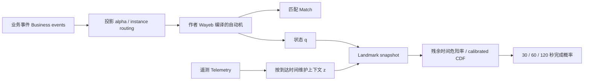
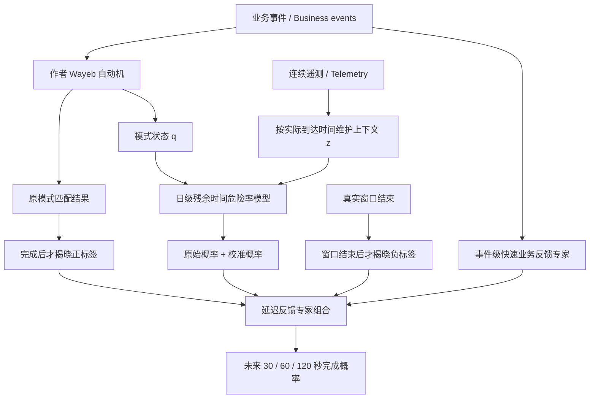

# 原研究文档逐字汇编

这是一份保留历史语境的原文附件。文中的“现在/继续/正在运行”属于当时阶段；当前所有实验暂停。
此汇编没有改写原文，也不自动修复旧 evidence-summary 的缺失项；以主交接文档和 AUDIT.json 的状态核对为准。
文献检索记录来自原阶段，本次整理未新作穷尽检索。所有路径相对于仓库根。

---

# 原文件：`README.md`
SHA256: `ed9b4e717615200047629d2b478eb837db047f9bf5bc78ac6a7e68e0fd790658`

# Wayeb event forecasting research deployment

[](https://github.com/roy-pyke/wayeb-event-forecasting/actions/workflows/reproduce.yml)

部署作者代码，研究从 **Pattern Markov Chains（模式马尔可夫链）** 到 **Prediction Suffix Trees（预测后缀树，PST）** 和 **RTCEF（运行时自适应复杂事件预测）** 的方法演进。

This repository deploys the authors' implementations. Author repositories are Git submodules pinned to exact commits; deployment tooling, configurations, and validation evidence live here. The separate [state forecasting research extension](state_forecasting/README.md) adds a context-based predictor while preserving the tested author's recognition semantics.

## 新研究扩展 / State forecasting

[`state_forecasting/`](state_forecasting/README.md) implements an independently documented dual-stream architecture: fixed Wayeb business-event recognition, causal numeric telemetry, real-time completion probabilities, daily model updates, and delayed-feedback expert aggregation. It includes real MetroPT 2020/2022 evaluation, retained failed experiments, frozen protocols, reproducible scripts and causal tests. The new 2022 confirmation shows a 34.59% lower Brier score against an equally adaptive business-history baseline; this is a new research task, not a claim to outperform the authors' original event-step forecasts. See the [results](state_forecasting/docs/RESULTS.md), [architecture](state_forecasting/docs/DESIGN.md), [research log](state_forecasting/docs/RESEARCH_LOG.md), and [reproduction guide](state_forecasting/docs/REPRODUCIBILITY.md).

## Sources

The subsequent [probability-query study](query_forecasting/README.md) investigates numerical inference for many event patterns under one frozen telemetry-conditioned neural source. It retains failed mechanisms, compares conventional query/particle/control-variate methods, and tests transition-closed occupancy constraints. This is ongoing research with no independent confirmation claim. [Source-model snapshots](https://github.com/roy-pyke/wayeb-event-forecasting/releases/tag/query-sources-20261022) and [reproduction instructions](query_forecasting/docs/REPRODUCTION.md) are available.

| Implementation | Fixed revision | Purpose |
| --- | --- | --- |
| [ElAlev/Wayeb](https://github.com/ElAlev/Wayeb) | `b58a0cbe8c2c174d19394153c03504031ac57465` | Full-order Markov forecasting, variable-order PST forecasting, symbolic automata and register transducers |
| [manospits/rtcef](https://github.com/manospits/rtcef) | `9bf8796b223a1a657bc51f49475d6d4fbf616172` (`v1.0.0`) | Run-time adaptation with Kafka, model retraining and Bayesian hyperparameter optimisation |

See [the literature map](docs/LITERATURE.md) for papers, their relationship, and the distinction between deployment validation and paper experiment reproduction.

## Deployment milestones

1. Source audit, pinned author code and public GitHub repository.
2. Isolated build, recognition, full-order and PST forecasting with separate training and test streams.
3. RTCEF environment and a bounded adaptation integration check.
4. Reproduction guide, recorded results and final verification.

Completed milestones are committed and pushed directly, as requested. Validation status will be recorded alongside each completed stage.

## Run Wayeb

Requirements: **JDK 11**, Python 3 for the standard-library runner, Git and curl. On macOS the scripts select an installed JDK 11; elsewhere set `WAYEB_JAVA_HOME` or `JAVA_HOME`.

```bash
git clone --recurse-submodules https://github.com/roy-pyke/wayeb-event-forecasting.git
cd wayeb-event-forecasting
./setup.sh
./run_demo.sh
./wayeb --help
```

`setup.sh` downloads a checksum-verified sbt launcher and compiles the pinned author sources using [an isolated build overlay](build/build.sbt). Algorithms and upstream sources remain unchanged. Both the original Scala version (2.12.10) and author library versions are retained; obsolete build plugins are replaced by the pinned packaging tools in [toolchain.json](toolchain.json).

The demo generates 6,000 training events and 2,000 independent test events with fixed seeds, compiles the pattern `A · (B | C)`, learns a full-order Markov chain and a PST, then runs both interval and binary-window forecasting. Parameters are in [configs/demo.json](configs/demo.json). Each `runs/demo-*/` directory contains data, a literal-pattern match oracle, configuration, commands/logs, trained models and `report.json`.

[The recorded validation](reports/core-validation.json) found 631 matches, exactly agreeing with the independent oracle. All forecasting metrics agreed within `1e-12` across two runs. Three author tests passed: waiting-time forecast interval construction, PST behaviour and register-automaton/regular-expression equivalence. These are deployment checks on a small synthetic process, not reproductions of the papers' real-world experiments or a fair benchmark between model families (their warm-up lengths differ).

```bash
./scripts/sbt.sh 'core/testOnly Specs.model.waitingTime.WaitingTimeSpec Specs.vmm.PST Specs.srem.NSRAeqSREM'
```

## Run the later RTCEF implementation

```bash
./setup_rtcef.sh
./run_rtcef.sh
```

This uses CPython 3.12 in `.venv-rtcef/`, the authors' separate embedded Wayeb engine and a checksum-verified local Kafka 3.4.0 broker. The bounded run starts all five author services, trains and evaluates an initial model, then injects explicitly labelled control scores to exercise retraining, three Bayesian optimisation trials and two engine model swaps. All started processes are stopped afterwards. It requires loopback ports 9092, 9093 and 25333–25336 to be free.

The service integration passed, including observed engine scores for retrained model 0 and optimised model 4; see [RTCEF validation](reports/rtcef-validation.json). This proves the exercised service flow works locally. It does not establish real concept-drift performance. The author's optimisation factory currently scores candidates on its training data; the separate held-out check does not change that upstream behaviour.

For all build/validation steps in sequence, run `./reproduce.sh` (`--core` for only standalone Wayeb). See [复现说明 / Reproducibility](docs/REPRODUCIBILITY.md) for environment choices, compatibility fixes and the limits of the validation.

The full RTCEF check also passed twice: input/adaptation-window hashes, held-out counts and model versions agreed, and all optimisation candidate parameters and metrics agreed within `1e-10`. [Validation index](reports/VALIDATION.md) links the compact evidence. The GitHub Actions workflow runs the full reproduction command on Ubuntu with JDK 11 and Python 3.12 after pushes and pull requests, and retains run reports/logs as downloadable artifacts.

## Research extension: complex patterns and forecast communication

The separate [pattern_forecasting/ study](pattern_forecasting/README.md) evaluates three complex-pattern families, same-information tree/neural baselines, actual message codecs, and frozen future-year/unseen-station tests. Its four candidate mechanisms did **not** pass their registered superiority gates. The primary independent-coordinate codec saves only 0.34%/0.64% of bytes on the two confirmation domains, with uncertainty intervals including zero; it has a small secondary Brier improvement. This is a reproducible research artifact with negative results, not an established new superior method.

[Results](pattern_forecasting/docs/RESULTS.md), [claim audit](pattern_forecasting/docs/PAPER_READINESS.md), [research draft](pattern_forecasting/docs/RESEARCH_NOTE.md), and [reproduction instructions](pattern_forecasting/docs/REPRODUCTION.md) document the evidence and limitations. All 90 model files are available in the checksum-verified [research snapshot](https://github.com/roy-pyke/wayeb-event-forecasting/releases/tag/pattern-research-20261022). The authors' pinned implementations and licences remain separate.

## Licensing

Wayeb has an author-specific dual licence: individual noncommercial research uses CC BY-NC-SA 4.0 with the additional conditions in [the author's licence](upstream/Wayeb/LICENSE.md), including public research results. RTCEF's top-level licence is LGPL-3.0; its embedded Wayeb code retains its own notices. Upstream code and publications keep their existing licences. This repository is public to share deployment and validation results. No private research data or local credentials belong here.


---

# 原文件：`docs/LITERATURE.md`
SHA256: `9b05e02badf13ab89f447cbadf2332200a0b463bac06b5a01f32f5763673bc7f`

# 论文与代码对应 / Literature and implementation map

Sources checked on **2026-10-22**: the [authors' publication list](https://cer.iit.demokritos.gr/publications/), [Wayeb](https://github.com/ElAlev/Wayeb), and the [RTCEF archived release](https://zenodo.org/records/15229227). This is the direct Wayeb/complex-event-forecasting line, not every publication by the three original authors.

| Year | Work and primary source | Relationship and code |
| --- | --- | --- |
| 2017 | Alevizos, Artikis, Paliouras, [Event Forecasting with Pattern Markov Chains](https://doi.org/10.1145/3093742.3093920) ([author PDF](https://cer.iit.demokritos.gr/publications/papers/2017/Forecasting-DEBS17.pdf)) | 起点 / Starting point: regular patterns, finite automata, fixed-order Markov models, first-passage waiting-time distributions and forecast intervals. Current Wayeb's FMM path is its descendant, not an archived copy of the 2017 binary. |
| 2018 | Alevizos, Artikis, Paliouras, [Wayeb: a Tool for Complex Event Forecasting](https://arxiv.org/abs/1901.01826) (LPAR-22, 2018; arXiv upload 2019) | 符号自动机 / Symbolic automata with predicates over event attributes; full-order Markov forecasting. Implemented in Wayeb. |
| 2021/2022 | Alevizos, Artikis, Paliouras, [Complex Event Forecasting with Prediction Suffix Trees](https://arxiv.org/abs/2109.00287) (extended technical report 2021; VLDB Journal 31, 157–180, 2022) | 变阶模型 / Variable-order Markov models using PSTs to retain informative history. Wayeb's `learnSPST` and `forecasting --modelType:vmm` implement this line. |
| 2021 | Alevizos, Artikis, Paliouras, [Symbolic Register Automata for Complex Event Recognition and Forecasting](https://arxiv.org/abs/2110.04032) | 寄存器自动机 / Register automata store past event values. Wayeb includes DSRA support; the author documentation recommends DSFA for the main forecasting route. |
| 2022 | Stavropoulos, Alevizos, Giatrakos, Artikis, [Optimizing Complex Event Forecasting](https://doi.org/10.1145/3524860.3539810) ([author PDF](https://cer.iit.demokritos.gr/publications/papers/2022/debs22.pdf)) | 超参数优化 / Hyperparameter optimisation of forecasting. Related optimisation code is supplied by the later RTCEF project; that does not establish byte-for-byte reproduction of this paper's experiments. |
| 2024 | Alevizos, Artikis, Paliouras, Complex Event Recognition with Symbolic Register Transducers ([authors' list and code link](https://cer.iit.demokritos.gr/publications/)) | 带输出的寄存器转换器 / Symbolic register transducers, an event-recognition extension. The authors link Wayeb. Recognition is distinct from the PST forecasting experiment. |
| 2025 | Pitsikalis, Alevizos, Giatrakos, Artikis, [Run-Time Adaptation of Complex Event Forecasting](https://doi.org/10.1145/3701717.3730539) ([author PDF](https://cer.iit.demokritos.gr/publications/papers/2025/debs2025.pdf)) | 运行时自适应 / RTCEF separates engine, observer, collector, controller/optimiser, and model factory over Kafka. [Author code](https://github.com/manospits/rtcef), [v1.0.0 archive DOI](https://doi.org/10.5281/zenodo.15229227). |
| 2026 | Ntouni, Banelas, Alevizos, Giatrakos, [Optimized Edge-to-Cloud Complex Event Recognition and Forecasting on Altair AI Studio](https://cer.iit.demokritos.gr/publications/papers/2026/mdm2026.pdf) | 边缘到云集成 / An Altair AI Studio integration of forecasting and deployment placement. Registered as a later systems extension; a local Wayeb/RTCEF check does not validate the Altair platform integration. |

## Scope and interpretation

The user's local 2017 PDF was checked for title, authors and DOI. The author checkout additionally supplies papers under `upstream/Wayeb/docs/papers/`; these are convenient reading copies from the authors' repository.

The forecast horizon is measured in **future event steps（未来事件步数）**. It is not automatically elapsed wall-clock time. Synthetic validation can establish a working installation and narrowly check algorithmic behaviour; it cannot establish the published real-data accuracy, throughput, concept-drift performance or a scientific superiority claim.


---

# 原文件：`docs/PROGRESS.md`
SHA256: `390ff5a543e38c46c81b9e073564bc2b08e5ee88ad90bb28027b265ffd7cd5d0`

# Milestones

## 2026-10-22 — 1. Source and project foundation

- Verified the local 2017 paper's authors and DOI.
- Located the authors' current Wayeb code and the later RTCEF v1.0.0 release.
- Pinned both author repositories as submodules; recorded paper lineage and licence boundaries.
- Created a separate deployment project under the research workspace's existing `projects/` directory.
- Planned independent training/test data and bounded integration validation.

Build and runtime claims are deferred to the subsequent validation reports.

## 2026-10-22 — 2. Author engine build and reproducible forecasting

- Built the author Wayeb 0.6 source into `artifacts/wayeb.jar` with JDK 11, original Scala 2.12.10 and a separate sbt 1.9.9 / assembly 2.2.0 overlay.
- Ran independent seeded 6,000-event training and 2,000-event evaluation streams through recognition, FMM estimation, PST learning and both interval/classification forecasting methods.
- Verified all 631 recognition matches with an independent literal-pattern check.
- Repeated the complete run and verified identical input hashes and all forecast metrics to absolute tolerance `1e-12`.
- Passed three author tests covering waiting-time intervals, PST and register-automaton semantics.
- Saved compact evidence in `reports/core-validation.json`; full run artifacts remain in ignored `runs/` directories.
- Also built RTCEF's separate embedded Wayeb engine and installed the isolated Python compatibility environment. Its service integration is the next milestone.

## 2026-10-22 — 3. RTCEF deployment and live service integration

- Installed CPython 3.12 compatibility dependencies and pinned all direct/transitive Python packages; selected kafka-python 2.1.5 after diagnosing collector startup with a newer client.
- Built the authors' embedded RTCEF Wayeb engine separately from standalone Wayeb 0.6; preserved both submodules without source edits.
- Installed and verified a local Kafka 3.4.0 distribution; no Docker daemon required.
- Ran real Kafka, two Py4J gateways, and all five author services on seeded synthetic data.
- Observed the collector/factory assemble stream data, observer-triggered retraining, three Bayesian optimisation trials, and engine score reports after model swaps to versions 0 and 4.
- Evaluated the initial model on a separate 400-record test stream; labelled injected adaptation scores and the author's in-sample optimisation scoring explicitly.
- Verified cleanup stopped all owned child processes; recorded compact evidence in `reports/rtcef-validation.json`.

## 2026-10-22 — 4. Reproduction entry point, documentation and CI

- Added `./reproduce.sh` for the complete build/test/forecast/service sequence and `--core` for the standalone engine.
- Fixed RTCEF replay/data-window barriers and verified a second complete run, including identical adaptation-window hashes and all candidate parameters/metrics within `1e-10`.
- Added the literature map, bilingual reproduction guide, validation index and compatibility/evaluation boundaries.
- Added GitHub Actions to run the full sequence on Ubuntu/JDK 11/Python 3.12, with report/log artifacts and actions pinned to commit SHAs.
- Added the project to the surrounding research workspace's local navigation README.


---

# 原文件：`docs/REPRODUCIBILITY.md`
SHA256: `46a1ea19a61efe1e3c82a84763bede2f4dc09ca4886eddade4346350e286587a`

# 复现说明 / Reproducibility

## 1. Get the exact sources and run

```bash
git clone --recurse-submodules https://github.com/roy-pyke/wayeb-event-forecasting.git
cd wayeb-event-forecasting
./reproduce.sh
```

The complete command builds both author engines, runs three author tests, runs the FMM/PST demo, installs RTCEF's isolated Python environment and runs the bounded Kafka integration. Use `./reproduce.sh --core` for just the original forecasting line. No Docker daemon is needed.

Prerequisites are Git, curl, a **JDK 11** and **CPython 3.12** (the core-only runner can use another Python 3 version). macOS automatically selects JDK 11 with `java_home`; on other systems use `WAYEB_JAVA_HOME=/path/to/jdk-11`. Set `WAYEB_PYTHON=/path/to/python3.12` if Python 3.12 is not the default. The recorded local RTCEF run uses CPython 3.12.7 on Apple Silicon; runtime versions are retained in its report.

Run scripts from any directory; they locate this repository themselves. The `wayeb` CLI preserves the caller's working directory so user-supplied relative input/output paths work normally.

## 2. What is fixed

| Item | Record |
| --- | --- |
| Author source revisions（作者源码版本） | Git submodule gitlinks and `SOURCE.json`; `scripts/check_sources.py` rejects changed commits or tracked source edits |
| Compiler and packaging（编译与打包） | Original Scala 2.12.10; sbt 1.9.9; assembly 2.2.0; JDK 11; `toolchain.json` |
| Dependencies（依赖） | Original author Java/Scala library versions in `build/build.sbt`; exact direct and transitive Python versions in `configs/requirements-rtcef.lock.txt` |
| Download integrity（下载完整性） | SHA-256 of sbt launcher; SHA-512 of Kafka archive, both verified before use |
| Data generation（数据生成） | Fixed seeds and an explicit generator; parameters and input SHA-256 hashes saved per run |
| Model settings（模型设置） | Core `configs/demo.json`; generated HOCON/pattern/configuration files; RTCEF generated `rtcef.ini` |
| Outputs（输出） | Per-run logs, commands, models and JSON report under ignored `runs/`; compact public evidence under `reports/` |

Full model files and timestamps need not have identical bytes across platforms/JVMs. Core validation compares input hashes and numerical forecast metrics, excluding runtime and serialization details. The recorded repeated core runs agreed within absolute tolerance `1e-12`.

## 3. Core data and checks

The core demo uses two independent streams sampled from an explicit second-order categorical source over `A/B/C`. It uses different seeds for the 6,000-event training stream and 2,000-event test stream. The pattern is `A · (B | C)` with order 2, a future horizon of 20 event steps, and confidence threshold 0.6. The binary forecast window has 2 steps; interval maximum spread is 10.

The runner checks an independent literal-pattern match count, nonempty learned models, finite numeric statistics and nonempty forecasts. Its JSON report retains input hashes, actual commands and both full-order Markov（全阶马尔可夫）and variable-order PST（变阶预测后缀树）statistics. The three selected author tests also exercise interval search, PST operations and register-automaton language equivalence.

Forecast statistics are produced by the author's implementation. FMM and PST have different warm-up behaviour, so this demonstration does not establish comparative model superiority. A future event step is not an elapsed-time unit. Precision guarantees in the theory are conditional on modelling assumptions; they are not a universal empirical accuracy guarantee.

## 4. RTCEF service check

```bash
./setup_rtcef.sh
./run_rtcef.sh
```

The bounded run starts its own single-node Kafka broker and the authors' five services: engine（预测引擎）, observer（性能观察器）, collector（数据收集器）, optimiser/controller（优化控制器）, and model factory（模型工厂）. Two Py4J gateways connect the Python services to RTCEF's embedded Wayeb engine. It uses loopback ports 9092, 9093, 25333–25336, and refuses to start if any is already occupied.

It first trains on 1,000 synthetic maritime-shaped records and evaluates on a separate 400-record stream. Another seeded stream exercises the distributed service path. A separate `controlled_scores` topic injects an explicit high-to-low score sequence to trigger retraining and Bayesian optimisation, without presenting those injected values as measured forecasting accuracy. The run checks new model publications and engine score reports carrying the new model versions. This tests control flow, model exchange and forward progress.

The replay advances in fixed chunks and waits for specific completed collector dataset versions (3 before retraining, 8 before optimisation). The selected data windows are copied and hashed before the next chunk. This prevents service scheduling from silently changing the adaptation training dataset.

All started processes are owned by the run and stopped in a `finally` block on completion or error. `Ctrl-C` also enters this cleanup path. Kafka data, topic messages, logs, models and the complete generated configuration stay in that run's directory for inspection.

## 5. Compatibility changes and limits

- **Build overlay（构建适配）:** the authors' old sbt plugins and repository endpoints are replaced by a small pinned build outside both submodules. Forecasting source and Scala version remain unchanged. The RTCEF engine is a distinct embedded version; its serialized models must not be mixed with the standalone Wayeb 0.6 models.
- **PST CLI（命令行参数）:** the standalone author's CLI parses `pMin`, `alpha`, `gammaMin` and `r` as integers, although their model values are fractional. The demo supplies these values through the author's HOCON configuration mechanism via `WAYEB_CONFIG_FILE`.
- **Python environment（Python 环境）:** the author requests Python 3.9/NumPy 1.19.5, which does not provide the needed modern CPython/Apple Silicon wheels. This deployment uses an isolated, pinned CPython 3.12 compatibility environment with NumPy 1.26.4. Validation is evidence for this environment, not a claim of exact historic environment reproduction.
- **Kafka polling（消息轮询）:** `scripts/rtcef_service.py` changes the default consumer poll wait to 50 ms before executing the original service entry point. This transport adapter avoids the legacy busy-poll behaviour; service decisions and message payloads remain the authors' code. Both submodules remain unchanged.
- **Kafka client（Kafka 客户端）:** version 2.1.5 is pinned, matching the release period of RTCEF v1.0.0. In the inspected 2.2.15 client, `position()` could spin while its assigned consumer's fetch position was uninitialised, stalling the collector. The final pinned environment passed the complete integration check.
- **Evaluation boundary（评估边界）:** the author's factory currently trains and evaluates optimisation candidates on the same assembled dataset; its separate train/test assembly is commented out. This is retained and explicitly recorded. The separate 400-record held-out check does not repair or validate that optimisation methodology.
- **Scientific scope（科学结论范围）:** these are synthetic deployment checks. They do not reproduce the published maritime/fraud datasets, paper throughput, optimisation gains or the lossless-adaptation theorem. The 2026 Altair AI Studio integration is catalogued as a systems extension, not installed by this project.


---

# 原文件：`pattern_forecasting/README.md`
SHA256: `4a36193adcb3dd3ddd23a16923c71b14393749ee4fc80df25b32d46a1c4fa4da`

# 复杂模式预测与有损消息编码研究

这是 `state_forecasting/` 之后的独立研究阶段。旧阶段的冻结实验保持原样。

目标是在复杂模式、同信息强基线和独立领域上检验可证伪的机制。四个候选依次为联合损失证书、精确稀疏刷新、自动机派生的独立概率坐标编码、安全码本阶段选择。均未满足登记的主要优势门槛；完整保留失败和次要发现。**当前未建立新方法论文所需的充分新颖性与强基线优势。**

- [完整结果与证据](docs/RESULTS.md)
- [论文论点审查](docs/PAPER_READINESS.md)
- [英文研究稿：收益边界与负结果](docs/RESEARCH_NOTE.md)
- [设计依据与新颖性核对](docs/DESIGN.md)
- [预先登记的实验协议](configs/PROTOCOL.json)
- [阶段记录与失败诊断](docs/RESEARCH_LOG.md)
- [文献边界](docs/RELATED_WORK.md)
- [概率坐标编译、证明与编码](docs/AFFINE_CODEC.md)
- [闭环反例、经典在线算法与码本失败](docs/CLOSED_LOOP.md)
- [可复现命令与冻结规则](docs/REPRODUCTION.md)
- [配对统计结果](reports/codec-comparisons.json)

业务事件始终完整送达原识别器；实验控制辅助预测上下文或概率消息的传输。通信节省不等于传感器采集或边缘计算节省。

模式族 `nested`、`directional`、`multisignal` 分别包含循环、选择、重叠/反向/联合目标。全部来自作者 Wayeb 的导出自动机，且通过作者 CLI 端点核验。数据是公开空气质量、家庭用电、压缩机传感器流；模式是研究中固定的规则，不是外部标注的故障/事故真值。空气与用电提供不同领域和未来年份；压缩机 2020 数据以前已使用，只作诊断。

三族已完成 36 次作者 CLI 对照、90 份模型、2016 年空气（含六个未见站点）与 2009 年用电确认，以及按周配对置信区间。冻结主坐标编码比较的字节节省仅 0.34%/0.64%，区间包含零。90 模型[公开快照](https://github.com/roy-pyke/wayeb-event-forecasting/releases/tag/pattern-research-20261022)已经下载并在空目录恢复核验。空气 2017 与用电 2010 仍未评估。

只重新生成证据表和图（不训练、不访问新数据）：

```bash
./pattern_forecasting/run.sh pattern_forecasting/scripts/summarize.py
./pattern_forecasting/run.sh pattern_forecasting/scripts/summarize_safe_codebook.py
./pattern_forecasting/run.sh pattern_forecasting/scripts/paper_figures.py
./pattern_forecasting/run.sh pattern_forecasting/scripts/build_evidence_report.py
```


---

# 原文件：`pattern_forecasting/docs/AFFINE_CODEC.md`
SHA256: `1099f97ba3a10128bb11b2842a2b9825d3d2c35a787c3e55d14e1d1ee786b950`

# 自动机派生的概率坐标编码：研究依据与边界

## 从失败结果到新的可检验问题

第一候选收紧“何时发送”的最坏损失界，实际收益不足 1%。第二候选精确选择要更新的坐标，未明显超过同证书贪心。两者都把每个概率当作独立可发送的数值，虽然已经给所有算法共同加入概率一致性投影。

进一步检查发现一种不同的结构：在某些状态和短期限内，预测向量位于真低维线性子空间。例如 `AB+C`、`AB+D`、`AB+(C|D)` 的两个分支在三个原生时间步内不能都首次完成，因而每个期限的 union 概率精确等于两个分支概率之和。发送两个分量即可恢复第三个。更长时间可能允许两者都发生，等式随之失效，不能使用固定的全局关系。

这形成新的研究问题：**从具体执行自动机和期限自动编译重建规则，是否能在量化、零值省略、部分更新均已启用时进一步降低预测消息成本？** `configs/AFFINE_CODEC.json` 在运行结果产生前登记了比较和 5% 开发门槛。方向查询的秩等于其非零坐标数，用作不会产生这种额外收益的负对照（negative control）。

## 精确结构与既有数学

将当前状态 `q` 的可行标签逐行排列为矩阵 `Y_q∈{0,1}^{M×d}`，其中 `d=P K`。本任务总允许未来没有业务事件，因此零标签在集合内，仿射包等于线性包。任何一致的预测 `f∈conv(Y_q)` 都在 `span(Y_q)`。

取 `Y_q` 的 `r=rank(Y_q)` 个独立列 `I`，解 `Y_q[:,I] B=Y_q`。对任意一致预测都有 `f=f_I B`。证明：`f=λᵀY_q`，代入列分解即得。若要求线性编码和线性重建在这个集合上全部精确，则消息维数不能小于 `r`：集合含有 r 个线性独立点，而一个低于 r 维的线性编码不能在它们张成的空间上单射。这只是线性代数结论；不声称对非线性、不连续、无限精度或可变长度任意码的全局最优。

QR 选列、最小二乘重建、线性无损压缩都已有成熟先例。这里没有新的 QR 算法，也没有新的通用压缩理论。候选差别在于具体预测契约的编译来源、状态/期限依赖、与逐结果损失校验结合及其实际适用范围。

## 不枚举所有标签的编译途径

扩展 max-plus 自动机 oracle，使其不仅返回线性目标最大值，还返回达到该值的可行标签。从零向量张成的空间出发，对当前空间正交补的一组基向量 `a` 分别最大化 `a·y` 和 `-a·y`。若发现非零值，把对应可行标签作为反例加入当前空间；秩至少增加一。若所有正交方向的两个最大值均为零，则所有可行标签都属于已发现的空间，编译完成。

在精确算术下，最多增加 d 个独立见证，oracle 调用不超过 `2(d+(d-1)+...+1)=d(d+1)`。结合 `THEORY.md` 中的动态规划，时间上界为 `O(d² H |Q| 2^P (|Σ|+P))`，另加数值线性代数成本。返回见证需要保存 `H` 层前驱；这比只求值的滚动内存大。本实现使用浮点秩判定和容差，不将它包装成经过证明器验证的有理数实现。对三个实际模式族，使用枚举可行标签作独立交叉检查。

这条编译途径避免枚举所有联合时间标签，但产品状态和匹配位掩码仍可能指数增长；当前运行时一致性投影仍用显式可行标签凸包。不能据此声称整个系统已经对任意模式数量可扩展。

## 真实字节与损失保证

参照与候选共用同一个预测器、全量输入、联合一致性投影及联合最坏损失证书。表示分别为全部分量、静态独立分量、当前状态非零分量、当前状态独立分量。每一种表示均尝试 8/16 位均匀量化、float32/64；部分更新采用变化幅度贪心。最终选择实际序列化后字节数最少、满足同一损失容忍量的候选。同字节数按证书再按精度解平局。

接收端先按同一当前状态投影缓存，再解码分量、重建并投影。发送端完全模拟这条解码路径，针对实际解码值计算损失证书。因此量化、重建和数值投影造成的变化均包含在界内。若缓存证书已通过则不发送。每个新观测段的双方缓存均初始化为公开的零向量；该初始化同样受证书检查，不为任何策略强制额外初始包。

消息含 24 字节时间戳/实体/序号/版本、2 字节自动机状态、1 字节精度和格式标志；部分更新另有 2 字节掩码。序列化长度直接作为成本。实体名称映射成确定的数值 ID 并检查碰撞。这个 32 位版本号是配置标识，不是密码学证明；系统使用方必须保证版本注册唯一、映射一致。实验固定模型、DFA 和配置，并保存其哈希。

“结构精确”指无量化时的代数关系，不表示浮点字节完全无损。最终声明仍是条件性的评分增量界，假设业务状态一致、辅助消息在评分前可靠交付；它不保证真实概率校准、不节省边缘预测计算，也未测量无线能耗。额外链路头、确认包、握手成本没有计入应用消息字节，不可把该指标改称完整网络流量。

## 需要排除的替代解释

必须检查收益是否只是省略不可能坐标、降低浮点精度、稀疏更新、标准一致性修正，或为不同方法选择了不同预测器。上述能力全部给予基线。开发成功之后才冻结确认比较；如未通过门槛，不以全量 float32 传输的巨大改善代替真正比较，也不打开确认集寻找成功样本。


---

# 原文件：`pattern_forecasting/docs/CLOSED_LOOP.md`
SHA256: `51aed6ba3f73b94f04a60d1cb80f971e833cdcece51766b1f556cec9d091f9d6`

# 闭环更新反例与下一轮可证伪问题

## 已证明的限制

给定缓存概率向量 p、当前完整预测 f 和可行二元标签集合 Y，定义平均 Brier 增量的精确上界

`C_Y(p,f) = (||p||² - ||f||² + max_{y∈Y} -2 y·(p-f))/d`。

如果 `S⊂W`，对同一对 `(p,f)` 恒有 `C_S≤C_W`。这只是点态支配（pointwise dominance）。下面的有理数反例证明：采用“超过阈值就发送完整 f”的闭环策略，S 的发送次数可以比 W 任意多。这个反例不声称预测质量、真实数据发生概率或全局首创性。

令 `d=2, ε=1/10, S={(0,0),(1,0),(0,1)}, W=S∪{(1,1)}`，初始缓存 `(.29,.43)`，后续完整预测依次是

1. `(.16,.48)`；两者证书均为 `.0565`，都不发。
2. `(.41,.48)`；S 为 `.05525`，W 为 `.10525`，只有 W 发送并保留此缓存。
3. `(.42,.24)`；S 为 `.1475`，发送；W 为 `.09225`，不发。
4. `(.11,.44)`；S 为 `.21415`，发送；W 为 `.0964`，不发。

随后交替重复第 3、4 个预测。S 从第 4 个缓存返回第 3 个预测的证书为 `.29585`，所以每次都发送；W 一直不发。所有预测均在三角形 `conv(S)` 内，不依赖不一致概率。S 的包数随交替长度线性增长，W 的包数固定为 1。因此不存在从这种点态关系直接推出的常数倍包数支配。若初始缓存也收费，只增加两边相同常数，结论不变。

精确 Fraction 算术和重复序列检查见 `scripts/closed_loop_counterexample.py`。此结论解释了一种可能的失败机制，不单独证明真实实验中的全部损失都由它造成。


## 下一候选：安全预测码字的在线选择

为避免只优化当前消息长度，考虑固定共享码本（codebook）`c_1,…,c_M`。接收者保留码字索引 j，依据当前业务自动机状态 q，输出 `g(q,j)=Proj(conv(Y_q),c_j)`。原始码字始终保留，不能递归投影上次的投影结果。

发送端每次计算完整预测 f，并得到安全索引集合

`S_t={j: C_{Y_q}(g(q,j),f_t)≤ε}`。

保持整个阶段仍安全的索引交集 I；交集变空时开始新阶段。当前索引不再属于交集时，从新交集均匀抽样。这直接采用经典均匀度量服务系统（uniform metrical service system, MSS）的随机阶段策略。**码本、投影、随机阶段策略及调和竞争比均不是本项目发明。** 待检验的研究组合仅是：自动机状态决定的解码器、proper-score 安全集合、实际通信编码和闭环策略之间的关系。

在固定、非自适应的非空安全集合序列上，一个阶段的期望切换不超过 `H_M`；若有 K 个阶段，任何离线策略在每个 `[阶段起点,下一阶段起点]` 窗口内至少切换一次，这些窗口的切换区间互不重叠，故 `OPT≥K−1`。得到 `E[ALG]≤H_M(OPT+1)`。初始固定码字可能省略一次发送，但不破坏此上界。这个结论仅适用于同一码本、相同安全约束及等长索引消息。它不是对无限连续预测空间、可变长度消息或自适应对手的保证。

安全集合为空时使用现有真实量化完整预测消息作为退路（fallback）。必须单独报告覆盖率、退路次数和成本；竞争比只解释连续被码本覆盖的区间，不能把它扩展成整个混合系统的保证。

## 来源与新颖性界限

- [Bansal 等：Competitive Algorithms for Generalized k-Server in Uniform Metrics](https://doi.org/10.1145/3568677)，§3 明确讨论从阶段剩余可行状态均匀抽样以及标准 uniform-MTS 分析。因此不能将这一随机选择机制包装成新算法。
- [Bubeck 与 Rabani：Parametrized Metrical Task Systems](https://arxiv.org/abs/1904.03874)，已有 subset chasing / MSS 形式化及竞争分析。
- [Bubeck 等：Metrical Service Systems with Transformations](https://arxiv.org/abs/2009.08266)，已有免费环境变换的更一般形式。这里固定索引、随 q 改变解码输出，仍可还原为普通索引空间的 MSS；不声称解决该论文的广义变换难题。
- [Seidel 等：A Window-based Periodic Event-triggered Consensus Scheme for Multi-agent Systems](https://people.kth.se/~dimos/pdfs/TCNS_Seidel_23.pdf)，作者 PDF 第 7 页（P6）明确指出，较不保守的触发规则不必导致闭环中更少的触发次数。因此“点态放松不保证闭环节省”这一一般警示已有直接先例；本文有理数 Brier 反例只是可复核的特定实例与任意大比值构造，不能据此声称首次发现该现象。其历史窗口控制方法也说明“利用过去的余量”并非新的宽泛方向。
- 概率码本属于经典向量量化（vector quantization）；已有 PSR、信念压缩、proper-score 一致性来源见 RELATED_WORK。

尚无足够证据证明该组合的发表新颖性或实用优越性。登记开发门槛后再运行；如果被同码本、同信息强基线否定，则保存失败并停止把它当作成功机制。

## 开发检验结果

五个随机种子平均后，空气阶段策略为 6.460 字节/查询，历史 16 步 minimax 为 6.095；候选多用 5.98% 字节。用电为 8.111 对 7.931，多用 2.27%。阶段交集相对无阶段记忆的均匀抽样只节省 1.19%/1.50%。这些比较仍有平均 Brier 的权衡，不能说某策略在全部指标上支配其他策略。

相对原完整坐标量化方案，码本候选少用 16.61%/22.32% 在线字节，但空气平均 Brier 增加 0.000221，并且同一码本的普通历史参照也能获得通信节省。因此这些比例不构成阶段机制独立贡献的证据。加入首次码本分发后，候选成本是空气 6.744、用电 8.133 字节/查询。

码本覆盖率为 88.72%/89.35%；不被码本覆盖时的共同退路，占候选在线字节约 59.03%/46.76%。这限制了仅改索引选择的收益。阶段候选在覆盖区间的索引消息数约为同码本离线最少次数的 1.334/1.344 倍；接近一个诊断下界也不等于胜过实际强基线。

**开发门槛失败，2017/2010 储备保持关闭。** 结果和五种子范围见 `reports/safe-codebook-comparisons.json`。不会把经典 MSS 的保证、普通码本压缩的收益或新的反例分别包装为足以投稿的原创建议。


---

# 原文件：`pattern_forecasting/docs/DESIGN.md`
SHA256: `9487d8128c8253fd990c5b4cf985abceb88ae480cd2aac99d228614e948514d2`

# 设计依据与候选机制

日期：2026-10-22。当前是预先登记的候选机制，尚未声称已经证实新颖或有效。

## 对问题的收窄

此前的 `LoadStart → LoadEnd` 实验中预测状态固定，主要验证了遥测有用。本阶段使用三种有状态变化、分支、循环和重叠前缀的模式：`ABCD`、`A(B|C)+D`、`A(A|B|C)*D`。它们作用于同一个业务流，预测每个模式在未来实际时间窗口内第一次出现匹配端点的概率。不是跟踪某个特定开始事件的一次业务流程。

业务事件来自连续信号跨越四个训练分位数区间的变化。区间是研究定义，不冒充官方污染标准或具体设备告警规则。遥测保留原始值和有限过去历史。气象、用电、压缩机分别作为独立应用领域；年份不算独立领域。各切分与实体隔离见协议。缺测切断观测覆盖，不把未知未来当成未发生。

## 已有方法与排除的宽泛创新声明

1. 流程状态与属性预测剩余时间：[Polato 等 2014](https://andrea.burattin.net/public-files/publications/2014-ijcnn.pdf)。本阶段不会将加入上下文称为首创。
2. 动态事件时间分布：[Dynamic-DeepHit](https://pubmed.ncbi.nlm.nih.gov/30951460/)。神经基线的任务适配必须公开，不能冒称作者原数据实验的复现。
3. 运行时更新：[RTCEF 2025](https://cer.iit.demokritos.gr/publications/papers/2025/debs2025.pdf)。日级重训和专家加权不是本阶段主创新。
4. 事件触发学习与通信：[Solowjow 与 Trimpe 2020](https://doi.org/10.1016/j.automatica.2020.109009)。当前值与远端估计相差大时发送，早已有研究。
5. 面向推断的信息调度：[Ari 等 2024，2026 修订](https://arxiv.org/abs/2410.08706)。已有基于信息年龄、包长度和双向延迟的目标导向调度。不能把“信息价值比新鲜度重要”当成发现。
6. 形式化任务与事件触发：[Lindemann 等，CDC 2018](https://arxiv.org/abs/2011.12772)。以状态差和最大间隔触发控制，说明形式规范与通信触发的组合也并非空白。
7. [预测监测的事件日志抽样，2023](https://link.springer.com/article/10.1007/s10844-022-00775-9) 主要抽取训练实例；本阶段若研究运行时辅助遥测，要明确这一区别。

曾考虑仅在未完成条件下输运旧生存分布 `S(a+h)/S(a)`。这是标准条件概率，且强基线可以直接用当前业务时间及缓存上下文重新预测。单独加入此式的机制不够独立，因此不作为主创新。

## 候选机制是自动机约束的共同损失证书

同一实体的多个复杂模式共享一条遥测。省略一次遥测会同时影响多个首次完成分布。一般触发器把每个预测标签视为独立二元变量，或至多利用单个 CDF 随时间单调。但这些标签还受到**共同自动机可达性（joint automaton reachability）**约束。

例如上述三个语言满足包含关系，严格模式完成必然伴随宽松模式完成。同一未来流不能出现“严格模式在 3 小时内完成、宽松模式直到 12 小时仍没完成”的结果。这些不可能结果若被当作最坏情形，会导致不必要的遥测传输。

令 `p` 为远端缓存上下文下的预测向量，`f` 为同一模型、同一当前业务信息、完整上下文下的预测向量；二者包含所有模式和窗口。令 `Y(q)` 为从当前联合自动机状态 `q` 出发可能的首次完成二元标签向量。使用加权 Brier：

`L(p,y) = sum_i w_i (p_i-y_i)^2`，`sum_i w_i = 1`。

则任一真实可行结果的损失增量满足：

`L(p,y)-L(f,y) <= C(q,p,f)`，

`C(q,p,f) = max_{y in Y(q)} sum_i w_i [(p_i^2-f_i^2)-2(p_i-f_i)y_i]`。

这是一个在自动机可行结果集上的线性优化。公式的平方展开不是单独的理论创新；待检验的机制是把作者自动机的共同可达性编译为在线可计算的损失证书，用一条预测用遥测共同服务多个复杂模式，并对相同信息、相同概率模型的通信前沿作比较。

若证书不超过容忍量，远端继续使用缓存上下文；否则发送新上下文。业务流不抽样，识别结果应逐端点完全相同。证书比较使用真实当前信息，但不使用任何未来结果，因此不需要立即可得的训练标签。训练和校准仍只能使用已揭晓的历史。

可行集合按强弱形成嵌套：自动机可达结果 ⊆ 每个模式分别单调的结果 ⊆ 任意二元结果。因此在相同 `q,p,f` 上，共同证书不大于两个普通证书。必须检验严格改善是否常见，不能由这个不等式直接推断整个闭环必然传更少的包，因为不同策略的历史缓存会不同。

## 实现和理论边界

- 作者 Wayeb 编译模式，导出纯事件类型、无寄存器和无时间窗的确定性转移表。独立匹配器与作者 CLI 双重核验。未知符号和缺口不悄悄视为正常事件。
- 产品自动机记录各模式是否在未来某段首次完成，按窗口边界收集累计完成掩码。可使用每个采样间隔最多一个业务变化的已知输入约束；必须与真实事件化一致。复杂度会随模式数量增加，需报告编译和在线成本。
- 证书限制相对同一全信息预测器的损失增加，不保证全信息预测器正确，也不提供分布无关校准保证。实际标签的可行性必须逐条检查。
- 发送端能读取当前传感器并计算当前预测。因此节约的是辅助上下文通信，不是采集或计算。业务事件成本、辅助包字节和边缘推理次数分开报告。
- 即时送达时才有该逐查询界。若包延迟、丢失或模型版本不同步，则不得沿用原证书。压力测试须报告证书有效覆盖率与失败，而不是把它说成任意网络条件下的保证。
- 包携带一致的有限历史快照；所有策略的包格式与字节数相同，不能让新方法免费携带比基线更多的信息。

## 需要通过的反证检查

如果共同约束几乎不比单模式 CDF 约束更紧，或加入产品自动机的成本超过通信收益，那么该机制的实证价值不足。若通用生存模型与状态模型同样好，仍可研究通信机制，但不能宣称提出了更好的预测器。若跨域确认失败，保留失败并收窄主张；不重复使用确认标签选择机制。

这种具体机制在本轮已查的文献中尚未找到直接相同实现，但需要持续核对结构化预测、联合概率预测协调和模型感知通信文献。有限检索不能证明全球首创。


---

# 原文件：`pattern_forecasting/docs/PAPER_READINESS.md`
SHA256: `7d4c818eeb21ff333d8b5d5658523af3ad8eeca7151a332bf012f49b13ba9c92`

# 论文论点审查 / Claim audit

## 判断

目标“找到有充分新颖性与实证优势的新机制”**尚未完成**。现有证据足以详细说明四轮候选如何被检验、哪些结论成立、原有优势假设为何失败；不能据此宣布新方法论文已经就绪。下面的判断是研究评估，不是期刊或会议的录用保证。

## 逐条论点

| 拟提出的论点 | 已有证据 | 可以怎样写 | 不足或禁止的外推 |
|---|---|---|---|
| 连续遥测对事件模式预测有用 | 3 模式族、2 确认领域，同输入 HGB/ExtraTrees/GRU 与业务消融 | 在这些固定研究模式上，上下文预测器提供有用基准 | 上下文预测本身有大量先例，不是新颖机制 |
| 可行未来语言给出 Brier 增量上界 | 平方展开、max-plus oracle、穷举核验、确认标签审计 | 给出假设明确的相对完整预测损失证书 | 不代表校准、绝对正确率、任意延迟可靠性 |
| 自动机和期限产生精确概率等式 | 可行矩阵、列基重建、见证编译、方向负对照 | 发布状态/期限特定的编译和验证实现 | PSR/POMDP 已有概率维度压缩；不能首创性归给线性代数 |
| 结构编码减少通信 | 双传感器确认主点估计 0.34%/0.64%，区间包含零 | 如实呈现小且不稳定的成本变化及次要评分改善 | 不支持“显著减少通信”或已通过 5% 门槛 |
| 更紧证书不保证更少发送 | 精确有理数反例，重复可得任意大包数比 | 给出本评分/缓存设置中的可复核反例 | 一般警示已有 Seidel 等及动态触发来源，不宣称首次发现 |
| 阶段记忆改善长期通信 | uniform MSS 形式化、经典调和界、5 策略种子 | 描述经典算法在本消息协议的实例化与局限 | 被同码本历史参照超过；不能把码本压缩收益归给阶段机制 |
| 工业价值和网络部署 | 公开实流重放、实际编码字节、作者识别器核验 | 原型实验和复现资产 | 未验证外部业务故障目标、无线能耗、重传、延迟、在线 Kafka 吞吐 |
| 实验可复现 | 固定子模块/数据 SHA、90 模型公开快照、实际空目录恢复、神经重训、Linux CI | 公开完整协议、报告、脚本、模型和负结果 | 单机确定性不等于所有硬件逐位一致 |

## 直接相邻工作

完整链接和差异见 [RELATED_WORK](RELATED_WORK.md)。最需要在稿件中正面处理的四组来源是：

1. **Predictive State Representations / POMDP compression**：独立未来预测量和线性概率重建已有直接先例。本项目限定在从已知事件语言编译的有限期限输出空间，这只是待评审的具体差别。
2. **Geometric monitoring / AutoMon / event-triggered learning**：满足确定性界时不通信、自动产生安全区域、用模型决定通信已有成熟研究。不能只以换成 Brier 打包成一般创新。
3. **Uniform MSS / metrical task systems**：阶段交集、均匀随机选择及对离线最优的调和界为经典工具。这里的固定码字索引可以直接还原到该模型。
4. **Window-based event-triggered control**：已有历史余量机制和关于闭环非单调收益的警示。本研究的具体反例是解释材料，单独的新颖性尚未建立。

## 可供导师讨论的稿件路线

[研究稿](RESEARCH_NOTE.md) 以“语义约束在强编码参照下的收益边界”为主题：冻结协议、实际事件语义、独立确认、字节成本、负对照和经典方法的失效比较可以形成透明的经验研究。稿件必须以这些有限证据为中心，保留开发门槛失败的事实。是否符合某个经验研究、复现或负结果轨道，需要目标 venue 的范围以及领域作者意见；目前没有投稿，也没有保证可录用。

如果坚持**新算法论文**，尚缺的是具有明确区别的新机制及其必要性证据。不能通过增加网络层数、重新挑种子、把普通码本收益算到阶段算法、或打开剩余年份寻找成功来补这个缺口。新研究应先给出既有 PSR/MSS/几何监测不能直接吸收的数学结构或实际约束，再写反证协议；开发胜过同信息参照后，才能冻结并使用剩余年份。

## 已关闭的假设与保留资产

四个登记主要优势假设都没有成立。这个状态应随仓库公开，而非从历史中删除。保留的资产包括可行未来 oracle、真实消息编解码、选择性刷新、码本在线重放、强预测器、三族作者自动机与所有模型。新的工业事件定义或网络假设可以复用它们，但应另建协议，不能沿用原确认的独立性标签。

空气 2017 年 1–2 月与用电 2010 年 1–11 月仍未评估。本审查不把“仍有数据可用”当作成功保证，也不把任何一个失败门槛在事后降级成已成功的次要目标。


---

# 原文件：`pattern_forecasting/docs/RELATED_WORK.md`
SHA256: `253229a387044815d420a14327719d09529da4287e8dbe47c86bb9ce4a682b9f`

# 文献边界与待证实的新颖性

本表记录当前检索发现的直接相关工作。没有检索到完全相同实现不能证明全球首创；方法贡献必须同时通过强基线实验。

| 来源 | 已经解决或提出的部分 | 本项目不能据此声称的新颖性 | 尚可验证的具体差别 |
|---|---|---|---|
| [Wayeb / RTCEF，2025](https://cer.iit.demokritos.gr/publications/papers/2025/debs2025.pdf) | 复杂事件概率预测，运行时模型更新与不中断预测 | 自动机预测、在线更新不是新概念 | 多模式未来结果约束是否可用于有损预测消息的确定性损失界 |
| [Dynamic-DeepHit，2020](https://pubmed.ncbi.nlm.nih.gov/30951460/) 与[作者代码](https://github.com/chl8856/Dynamic-DeepHit) | 时间更新、注意力、删失事件似然与排序 | 注意力 GRU、动态剩余时间分布不是新概念 | 本项目只是共享输入、独立模式头的任务适配基线；不是原论文复现 |
| [Deshpande 等，VLDB 2004](https://web.stanford.edu/class/cs240e/papers/vldb04.pdf) | 利用统计关联选择传感器读数，优化置信质量与通信成本 | 按信息价值选传感器、考虑联合关系都不是新概念 | 当前候选发送已计算的预测分量；使用相对完整预测器的逐结果损失上界，依赖形式可达性而非高斯模型置信度 |
| [Solowjow 与 Trimpe，2020](https://doi.org/10.1016/j.automatica.2020.109009) | 事件触发通信及学习 | 预测误差大时触发不是新概念 | 触发与消息内容由可行未来结果上的 proper-score 增量约束决定 |
| [Predd 等，2009](https://arxiv.org/abs/0710.3183) | 概率一致性与 proper scoring rule 下的不被支配 | 逻辑概率约束、欧氏一致性修正不是新理论 | 本项目统一给所有策略这项能力，再检查损失证书有无独立价值 |
| [Ari 等，2024/2026](https://arxiv.org/abs/2410.08706) | 有双向延迟、信息年龄、包长度的目标导向更新 | 联合优化何时发送与发送多少，不是空白方向 | 当前机制的保证是即时可靠交付条件下逐查询相对损失界；不声称该论文的长期平均最优性或延迟鲁棒性 |
| [Lindemann 等，CDC 2018](https://arxiv.org/abs/2011.12772) | 时间逻辑任务的事件触发反馈控制 | 形式规范结合事件触发不是新概念 | 本项目不控制物理系统，目标是未来模式概率消息的评分损失 |
| [Fani Sani 等，2023](https://link.springer.com/article/10.1007/s10844-022-00775-9) | 预测监测的性能保持事件日志抽样 | 少用数据还能保性能不是独立贡献 | 训练轨迹抽样与运行时概率消息选择需要分开 |
| [Kumar 等，2026](https://onlinelibrary.wiley.com/doi/10.1155/jece/2164804) | 频谱感知中联合交叉熵、Brier 与通信稀疏正则 | 将 Brier 和通信成本放在同一目标中不是新概念 | 经验加权训练正则与无需结果标签的确定性增量证书不同；该差别仍需有实际收益 |
| [AutoMon，SIGMOD 2022，作者项目](https://github.com/hsivan/automon) | 从函数代码自动派生分布式安全监控约束，按精度要求减少通信 | 自动构造确定性通信触发约束不是新概念 | 多节点平均向量的函数监控，与单实体多个未来事件概率的联合损失及消息编码问题不同；不能据此声称通用系统更优 |
| [Poupart 与 Boutilier，NIPS 2004](https://papers.neurips.cc/paper_files/paper/2004/file/81c2f886f91e18fe16d6f4e865877cb6-Paper.pdf)，§4 | 用不变子空间压缩 POMDP 信念状态，保留预测奖励和后续压缩状态所需信息 | 用基、秩和概率结构进行线性无损压缩不是新理论 | 当前候选从有限期限、无拟合概率的事件语言产生预测输出空间；不承担 POMDP 控制或保持转移不变性的任务 |
| [Predictive Representations of State，NIPS 14](https://proceedings.neurips.cc/paper/2001/file/1e4d36177d71bbb3558e43af9577d70e-Paper.pdf) 与 [IJCAI 2021 的明确公式](https://www.ijcai.org/proceedings/2021/0299.pdf) | 用核心未来测试的预测概率表示状态，线性恢复其他测试概率 | “只保留一组独立预测概率”这个抽象思想已有直接先例 | 当前编译针对给定事件语言、状态和有限期限，对所有允许的未来流成立；不学习整个生成过程的 PSR。这个限定差别仍不自动构成足够的论文贡献 |
| [Liu 等，Optimizing Error-Bounded Lossy Compression for Scientific Data with Diverse Constraints](https://www.yuanjianliu.net/files/2022TPDS-preprint.pdf) | 科学数据压缩中保留用户指定的范围、区域与精度约束 | 带约束且带误差界的压缩不是空白方向 | 事件语言派生的概率等式、逐可行结果评分增量、在线选择消息是否发送需要具体区分 |
| [KRAKEN，DEBS 2026，作者机构摘要](https://www.bifold.berlin/impact-transfer/publications/view/publication-detail/kraken-joint-optimization-of-operator-placement-and-communication-for-distributed-stream-processing) | 对分布式流算子位置和 all-push/push-pull 通信联合规划，权衡元组量与延迟 | 联合考虑执行位置与通信不是本工作的独创概念 | 本项目固定执行位置、预测模型和业务流，研究辅助概率消息内容；不能把它当作完成同一预测任务的直接数值基线 |
| [Bansal 等，Competitive Algorithms for Generalized k-Server in Uniform Metrics](https://doi.org/10.1145/3568677) | §3 讨论对阶段仍可行状态均匀抽样，归于标准 uniform MTS 分析 | 阶段交集、随机剩余状态、调和竞争界不是新机制 | 固定码字索引的安全集合是该经典问题的一个实例；必须检查实际评分、退路和字节成本 |
| [Bubeck 与 Rabani，Parametrized Metrical Task Systems](https://arxiv.org/abs/1904.03874) | MSS/subset chasing 及按请求结构分析的竞争结果 | 用在线选择避免当前贪心不是新概念 | 本项目没有建立优于其一般理论的新结构定理 |
| [Bubeck 等，Metrical Service Systems with Transformations](https://arxiv.org/abs/2009.08266) | 允许可行空间上的免费环境变换，更一般的追逐问题 | 免费公共状态变化的在线形式化也有先例 | 当前实现保留固定索引，可化成普通 MSS；不声称解决其广义变换问题 |
| [Seidel 等，Window-based Periodic Event-triggered Consensus](https://people.kth.se/~dimos/pdfs/TCNS_Seidel_23.pdf) | 历史窗口余量触发；PDF 第 7 页明确提醒较不保守的规则不必减少闭环触发次数 | “利用历史”及“点态放松不能保证闭环节省”的一般警示已有直接来源 | 这里给出 Brier/互斥概率的精确有理数反例与任意大比值；尚未确立其单独可发表的新颖性 |

还找到预测式几何监测（prediction-based geometric monitoring）线索：[作者站点 PDF](https://minosng.github.io/Papers/sigmod12.pdf)、[分布式最小二乘模型监测](https://www.cs.utoronto.ca/~mgabel/papers/DILSQ%20-%20KDD%202015%20Camera%20Draft.pdf)、[异构流几何监测](https://www.weizmann.ac.il/math/AmirAbboud/sites/math.AmirAbboud/files/uploads/Geometric%20Monitoring.pdf)。其安全区域与通信阈值思想很相关，不能把“在确定性界内不通信”作为全球首创声明。第一篇全文访问存在工具错误，当前仅作为待深入核对的来源，不能冒称完成逐条理论对照。

候选差别应表述为**把复杂事件的可行未来标签编译为预测消息更新的损失约束，并研究精确/贪心内容选择与成本边界**。目前多个开发实验发现动态自动机相对强静态参照的收益很小；这会削弱贡献，必须写进论文可行性判断，不能用好看的全量上传对照覆盖。

后续坐标编码候选的原创性风险同样明确：线性概率压缩已有直接先例，新的组合必须体现自动机和时间期限派生关系的必要性。`AFFINE_CODEC.md` 给出可核验的命题、算法和反证。即使实验成功，也只能称有证据的候选贡献；本次检索不构成“没有任何类似论文”的证明。

后续码本开发门槛也失败：经典随机阶段策略被同码本历史 minimax 在通信指标上超过。见 `CLOSED_LOOP.md` 和 `RESULTS.md`。因此当前没有把某个已有算法改名后宣布为新机制，也没有把普通码本的压缩收益归因于阶段记忆。


---

# 原文件：`pattern_forecasting/docs/REPRODUCTION.md`
SHA256: `1c7a6024b1d3bf8f3b375ddd2e78c9032d4a3d29a657e9365986b98f09fe75ab`

# 复现入口与实验隔离

工作目录为仓库根目录。Python 3.12；作者 Wayeb 的 Java/sbt 部署沿用仓库既有脚本。首次运行：

```bash
./setup.sh  # fresh clones: build the pinned author Wayeb jar first
./pattern_forecasting/setup.sh
./pattern_forecasting/run.sh -m pytest pattern_forecasting/tests -q
./pattern_forecasting/run.sh pattern_forecasting/scripts/prepare.py
./pattern_forecasting/run.sh pattern_forecasting/scripts/verify_wayeb.py
./pattern_forecasting/run.sh pattern_forecasting/scripts/audit_data.py
./pattern_forecasting/run.sh pattern_forecasting/scripts/train.py
```

三个模式族分别为 `nested`（默认）、`directional`、`multisignal`。后两族设置环境变量后使用相同代码、独立配置、数据缓存、模型与报告目录，禁止交叉加载模型。例如：

```bash
PATTERN_FAMILY=multisignal ./pattern_forecasting/setup.sh
PATTERN_FAMILY=multisignal ./pattern_forecasting/run.sh pattern_forecasting/scripts/prepare.py
PATTERN_FAMILY=multisignal ./pattern_forecasting/run.sh pattern_forecasting/scripts/train.py --profile short
PATTERN_FAMILY=multisignal ./pattern_forecasting/run.sh pattern_forecasting/scripts/refresh.py --dataset air --backbone short-hgb-31-180-s20261022 --epsilon 0.0005 0.002 --full-coherence --strategies whole sparse greedy_delta greedy_loss
```

`--profile short` 的窗口为各数据集的 1、2、3 个原生时间单位；查询频率不变。数据准备文件包含下一次匹配时间与观测覆盖，因而多个窗口共用同一因果特征和事件流，但它们不是独立数据实验。

确认集只有在相应配置目录存在 `FROZEN.json` 时才允许生成。三个模式族的冻结已于提交 `8e59fbf5f6c75fb538edf97fb2fc3a2fc7496387` 完成，随后才运行 2016/2009 确认。文件记录源代码、模型、数据源、超参数、主要比较与失败解释。不得把旧 2020 MetroPT 数据称为独立确认，也不得在看见确认结果后改主要声明。

原始 UCI 文件只保存于忽略的缓存目录，首次下载及每次复用都核对固定 SHA-256。大模型和中间预测保存在忽略的 `runs/`，仓库保存完整脚本、协议与可审核的数值报告。报告中的按周簇统计保留多站点共享天气的相关性；时间采用数据记录的钟表时间，未擅自推定原始时区。

Python 路径可通过 `WAYEB_PYTHON` 指定。所有主预测器使用同一 20,000 个训练查询及相同缓存年龄增强，共 40,000 个视图；树模型展开风险区间后的训练行数因此更多。Isotonic 校准只使用校准时期，超参数只使用开发时期。注意力 GRU 是公开结构的 PyTorch 任务适配，不是原作者 TensorFlow 实验的精确复现。

坐标编译与编码入口：

```bash
PATTERN_FAMILY=multisignal ./pattern_forecasting/run.sh pattern_forecasting/scripts/compile_codec.py
PATTERN_FAMILY=multisignal ./pattern_forecasting/run.sh pattern_forecasting/scripts/affine_codec.py --dataset air --backbone short-gru-32-0.01-s20261022 --representations all zero basis
./pattern_forecasting/run.sh pattern_forecasting/scripts/summarize.py
```

只有在完成开发和种子复验、提交当前源代码之后，才运行 `freeze_confirmation.py`。多通道族使用 `--replicate-seeds`，其余诊断族不加该参数。冻结记录源代码、训练模型、阈值及开发清单的 SHA；`prepare.py --confirmation`、`confirmation.py` 和确认编码实验都会核对冻结身份。生成 `FROZEN.json` 后先提交并 push，再运行确认准备和评分；不得覆盖已有冻结文件。

```bash
PATTERN_FAMILY=multisignal ./pattern_forecasting/run.sh pattern_forecasting/scripts/train.py --datasets air power --profile short --replicates
PATTERN_FAMILY=multisignal ./pattern_forecasting/run.sh pattern_forecasting/scripts/freeze_confirmation.py --replicate-seeds
# Commit and push the freeze before the following confirmation commands.
PATTERN_FAMILY=multisignal ./pattern_forecasting/run.sh pattern_forecasting/scripts/prepare.py --datasets air power --confirmation
PATTERN_FAMILY=multisignal ./pattern_forecasting/run.sh pattern_forecasting/scripts/confirmation.py
```

模型训练采用固定种子和确定性 CPU 算法；归档对象包含耗时元数据，因此重训文件的 SHA 不承诺逐字节相同。冻结 SHA 用于确认正在评估的确实是选定的那份模型，科学复现应比较预测与统计结果，同时记录运行时版本和硬件差异。GitHub CI 的三个模式族矩阵测试不下载研究数据；正式数据、训练和作者 CLI 核验须按这里的独立入口运行。

## 从发布快照复算确认结果

90 个已训练模型另附在 GitHub 的 `pattern-research-20261022` 研究快照中。`reports/MODEL_ARTIFACT.json` 保存整个归档及每个模型的 SHA。它是实验复现资产，不是宣称新方法已达到论文门槛的产品发布。

在干净 clone 中可仅设置 Python 环境、下载模型及公开数据，然后复算；这条路径不需要重新训练，也不需要为评分启动 Kafka。作者识别引擎的独立核验仍需上面的 Java 构建。

```bash
python3.12 -m venv .venv-pattern
.venv-pattern/bin/python -m pip install -r pattern_forecasting/configs/requirements.txt
./pattern_forecasting/run.sh pattern_forecasting/scripts/download_models.py
PATTERN_FAMILY=multisignal ./pattern_forecasting/run.sh pattern_forecasting/scripts/prepare.py --datasets air power
PATTERN_FAMILY=multisignal ./pattern_forecasting/run.sh pattern_forecasting/scripts/prepare.py --datasets air power --confirmation
PATTERN_FAMILY=multisignal ./pattern_forecasting/run.sh pattern_forecasting/scripts/confirmation.py
PATTERN_FAMILY=multisignal ./pattern_forecasting/run.sh pattern_forecasting/scripts/affine_codec.py --dataset air --split confirmation --backbone short-gru-32-0.01-s20261022 --representations all zero basis
PATTERN_FAMILY=multisignal ./pattern_forecasting/run.sh pattern_forecasting/scripts/affine_codec.py --dataset power --split confirmation --backbone short-gru-64-0.05-s20261022 --representations all zero basis
```

`check_reproducibility.py` 则在不覆盖冻结模型的前提下，从头重训一个神经模型并比较 2,000 个开发查询；本机实际复验得到零差异。不要删除或修改原冻结记录来让不同模型通过确认校验。新的训练研究应另开协议和输出目录，并与历史确认报告区分。

## 后续安全码本反证与精确反例

这轮只使用原开发时期。`SAFE_CODEBOOK.json` 在性能实验前以 `f60d624` 提交，代码在 `9a88d54` 提交；原冻结文件所列源代码未修改。两个码本各含 64 个九维 float32 条目，完整数值和训练/模型指纹已保存为 `reports/multisignal/safe-codebook-{air,power}.json`，不需要额外下载模型资产。

```bash
./pattern_forecasting/run.sh pattern_forecasting/scripts/closed_loop_counterexample.py
PATTERN_FAMILY=multisignal ./pattern_forecasting/run.sh pattern_forecasting/scripts/safe_codebook_experiment.py --dataset air
PATTERN_FAMILY=multisignal ./pattern_forecasting/run.sh pattern_forecasting/scripts/safe_codebook_experiment.py --dataset power
./pattern_forecasting/run.sh pattern_forecasting/scripts/summarize_safe_codebook.py
```

`safe_codebook_experiment.py` 故意没有储备集参数。门槛失败后不打开空气 2017 年和用电 2010 年。随机候选和随机参照均平均登记的五个种子；确定性参照各执行一次。离线最少切换动态规划仅作下界，不参与因果方法的胜负评比。应用消息为实际 28 字节索引帧或原量化回退帧，初始码本的 2,304 字节/实体另计，网络层封装、重传和无线能耗未测量。


---

# 原文件：`pattern_forecasting/docs/RESEARCH_LOG.md`
SHA256: `1297e376841d9f7ecbecfa7573971a23656b87897114a2e7a3ed434b2d20d641`

# 阶段记录与失败诊断

## P0 文献与问题冻结

2026-10-22：承接上一轮可发表性评估。保留旧目录和全部失败报告，创建独立 `pattern_forecasting/`。

排除三个不足以单独支撑新颖性的方向：仅增加传感器、仅按预测误差触发通信、仅使用标准生存条件概率输运。文献和理由见 DESIGN。

选择待证伪的候选：以共同自动机约束收紧多个首次完成预测的最坏 Brier 损失界，据此省略共享辅助遥测。先登记三个复杂模式、两个新的独立领域、开发与确认切分、同信息基线和必要反证检查，再运行新数据预测实验。

截至本阶段，只完成研究问题、来源和实验规则；没有声称机制性能、论文新颖性或录用前景已经成立。

## P1 自动机与数据审计

三个 Wayeb 模式的可达产品自动机共有 11 个状态。独立正则表达式、导出的转移表及作者 CLI 在随机流和三个领域真实业务符号上进行逐端点核验。三种模式、四条流的 12 次作者引擎核验全部零差异。训练、校准、开发数据中 551,290 个完整可观测查询的联合标签全部属于编译可行集合。空气与用电均访问了 11 个状态；压缩机访问 9–10 个状态。

发现并保留的负面机制诊断：在 `[5,15,30]` 窗口上，全部 11 个状态的可行标签集合都是相同的 20 个标签，等于静态语言包含约束。在 `[3,6,12]` 上，不同状态有 18–20 个可行标签。因此新增静态包含证书作强基线，不把它的收益声称为动态可达性的独立收益。

实现测试先发现浮点容差链式断言写法错误，拆分为两个独立带容差不等式。之后发现一致性投影的 30 次迭代不足以达到 `1e-8` 可行精度，改为有显式可行性检查的最多 200 次迭代；不放宽理论保证来掩盖数值误差。数据源校验发现用电 SHA 在手写常量中漏一个 `b3`，按已下载清单的完整 SHA 修正，未绕过内容校验。

新来源：[Predd 等 2009](https://arxiv.org/abs/0710.3183) 已证明概率一致性与 proper scoring rule 的不被支配关系。标准一致性修正统一用于所有预测器，既作为必要理论来源，也避免以预测器本身的不一致制造证书优势。

确认集尚未准备、未计算标签或结果。基线训练配置写入 `configs/TRAINING.json` 后开始训练；结果单独归档。

## P2 初始机制被开发实验否定，继续保留反证

空气质量、HGB 31 叶 180 轮开发结果：原始上下文包策略相对单模式 CDF 证书只减少约 0.06%–0.30% 的辅助包；严格收紧发生率不足 0.7%，动态证书相对静态包含证书几乎没有独立优势。这个阶段判为**实用优势不足**，而不是以相对全量遥测的巨大削减比例代替强基线比较。

第二候选改为选择性预测坐标刷新（sparse forecast refresh），按相同损失容忍量选择最少更新坐标，并实际计算头部、位掩码和 float32 数值的字节数。全部静态/CDF 参照获得完全相同的候选刷新动作。实现版本号和顺序检查的二进制编解码。点态最少坐标不等于长期通信最优；相关界和成本限制均明确保留。

还测试了提前登记的短窗口 `[1,2,3]`，因为短期限存在“先完成宽松模式会重置状态，因而来不及完成另一个模式”的跨期限排斥关系。统一给所有策略加入完整可行概率多面体上的标准欧氏投影，排除利用预测不一致制造优势。空气开发集在 epsilon=0.002 上，稀疏联合证书是 5.568 字节/查询，稀疏静态证书是 5.601；额外减少约 0.59%，**没有通过登记的 5% 门槛**。缩短窗口本身没有挽救这组三个嵌套模式。用电的同设置结果继续完整保存，不因空气失败而隐藏。

依据：三个模式都描述从 A 到 D 的相近路径，概率变化高度同向，开发数据中的分支和宽松端点也几乎相同。这种目标冗余削弱了利用联合约束决定消息内容的空间。下一次反证将使用具有相反方向的多个复杂查询，而不是继续微调这三个嵌套查询的阈值。仍只使用开发数据，确认年份继续封存。

## P3 强预测基线完成，方向查询和贪心参照继续反证

原嵌套模式长窗口的同信息预测比较已经完成首个种子的所有配置。完整遥测最优 Brier：空气 HGB 0.030635，用电 HGB 0.016664，压缩机 ExtraTrees 0.005687；仅业务信息分别为 0.033244、0.017361、0.012417。注意力 GRU 在三个领域都没有胜出，这不等于否定神经方法，仅说明该有限调参预算下的任务适配结果。`no_state` 只移除显式状态 one-hot，仍保留事件历史和状态年龄，不能误称完全去掉所有状态信息。

新增反向查询族后，短窗口空气在 epsilon=0.002 的精确稀疏联合更新为 15.135 字节/查询，静态联合参照为 15.207，相差约 0.47%，再次未通过 5% 门槛。进一步与同样持有损失证书的贪心坐标更新相比，空气最好贪心为 15.621，精确优化只节约约 3.11%，仍未通过新登记的 5% 门槛，且平均实际损失增量更高。用电结果同样完整归档。

实现中查明一个语义陷阱：Wayeb 默认是 non-overlap 计数，会在报告匹配后重置相应自动机。即使语言 `R⊆S`，被报告的端点也不必包含。例如 `ABABD` 上宽松模式先报告 `ABA`，重置后可能漏掉后续与 `ABD` 共享边界的匹配。因此关系必须在实际执行自动机上验证，不能直接从正则语言包含关系推断。方向查询明确编译为 overlap，随后重新生成数据并通过独立正则及作者 CLI；没有修改上游源码。旧嵌套族保留原计数设置，它们的末尾 D 不是任何模式开头，已有端点语义保持一致。

下一项开发反证是双传感器变化事件，而不是单传感器有序分位区间。字母表示两个通道的正负主导变化，阈值和归一尺度只拟合训练数据；模式是 `AB+C`、`AB+D`、`AB+(C|D)`。把全部无时间约束的联合可行标签作为静态强参照，包含 union 等 Boolean 关系，避免仅以简单包含关系作弱基线。此新任务不替换旧失败，仍使用封存的原确认年份。

双传感器开发结果也否定了有用的动态证书增益：epsilon=0.002 时，空气精确稀疏联合为 12.515 字节/查询、静态为 12.553；用电分别为 16.700 与 16.757。相对改进分别约 0.31%、0.34%。用电的最好贪心联合为 17.088，精确选择只改善约 2.27%。同信息短窗口强预测器仍在训练，不能将 HGB 的阶段结果当作所有模型的最终结论。

三个模式族分别通过 19、18、18 项单元测试，后两族各跳过一个仅适用嵌套族的具体反例测试。每族的 12 次作者 CLI 端点比较均零差异。双传感器 MetroPT 的训练/校准/开发联合目标仅有 54/4/6 次匹配，不能凭极低 Brier 声称有用预测。

新结构诊断：短窗口双传感器族在各状态的非零坐标数是 3/6/9，而可行标签矩阵秩是 2/4/6；这来自时间内互斥结果的精确 union 等式。方向族的秩则等于非零坐标数，提供天然负对照。下阶段检查自动机派生的独立概率坐标编码，并加入 8/16/32 位量化、零值省略等强编码参照。线性降维和概率重建本身已有先例，不单独声称原创性。

## P4 独立概率坐标与量化基线

先提交 `AFFINE_CODEC.json`，然后运行字节级编码实验。实现从可行标签编译坐标重建矩阵，以及通过 max-plus 见证逐步发现标签线性包的替代编译器。两条实现与穷举可行标签核验相同的秩和重建关系。理论、来源、数值容差及不能覆盖的模型类别写入 `AFFINE_CODEC.md`。

首次实流运行发现实体字段保存站点名称，编解码入口却按整数读取；修复为确定的数值 ID，并检查碰撞，新增跨实体/观测段重放测试。此错误在产生性能结果前被发现。oracle 测试中也发现自动机字段名称接错，按真实 `next/final` 接口修正并通过见证成员性检查。没有调整数据或损失门槛。

开发结果：多通道 HGB 上，独立坐标相对最强 all-coordinate 自适应量化基线的节省为：空气 0.42%（按周配对 95% 区间 -0.71%–1.53%），用电 2.73%（1.20%–4.19%）。空气中胜出的 GRU 上为 0.92%（-0.11%–1.91%）。登记的两领域 5% 门槛仍失败。对应 Brier 均值分别下降约 0.000150、0.000255、0.000160；这是次要的准确性/成本权衡发现，不把它改写成主要通信门槛已经成功。

方向模式负对照的 zero 与 basis 两种表示产生完全相同的字节、包率及评分，符合其“秩等于非零坐标数”的结构判断。说明不能把本机制说成所有复杂模式通用的固定压缩收益。

失败解释：结构秩下降并不直接等于总字节下降。公共头部占大部分小消息成本；强基线用量化及部分更新已经省掉许多数值；当前查询的更短表示又会改变后续缓存轨迹，不能以点态最优推出全程最优。这些是由成本分解、强基线结果及闭环轨迹支持的解释，尚不是对所有任务的因果定论。

下一阶段先完成登记的种子复验，再冻结**独立诊断复验**。它用于检查上述失败是否跨年份/新站点存在及保证是否成立；不是失败后打开确认集寻找成功。确认结果即使出现偶然改善，也不自动升级为经过预设开发门槛的优越性结论。空气 2017 年及用电 2010 年继续留作未用储备。这样既补齐独立场景证据，也保留“当前不够支持强论文声明”的研究边界。

## P5 冻结后的独立诊断复验

源代码冻结在 `56c179b89bbeaea53571101e9ea442bca0da6a8f`；三个模式族的 `FROZEN.json` 以 `8e59fbf5f6c75fb538edf97fb2fc3a2fc7496387` 提交并成功 push 后，才准备确认标签。主实验三类预测器完成三个种子；额外复杂模式完成同信息基线首种子比较。90 份模型全部归档为可下载研究快照，实际从公开 Release 下载后在空目录恢复，全部单文件 SHA 一致。另独立重训空气 GRU，对 2,000 个开发查询得到逐位一致的预测。发布时短提交号被 GitHub API 拒绝，换成已核实的完整提交号后成功；没有改动冻结代码或模型。

确认数据为空气 2016 年的 12 站点（6 个未参加训练）和家庭用电 2009 年。每族约 20 万个完整可评分查询的标签均属于相应短期限可行集合，没有不可行标签。没有使用空气 2017 年或用电 2010 年。

首要比较使用开发阶段固定的 GRU 配置、种子 20261022、epsilon=0.002。空气独立坐标编码为 7.493 字节/查询，最强 all-coordinate 量化/部分更新基线为 7.518；节省 0.34%，配对按周 95% 区间为 -0.32%–1.00%。用电分别为 10.726 与 10.795，节省 0.64%，区间为 -1.18%–2.37%。主要 5% 目标仍未得到支持，不能宣称通信显著优于强基线。

次要发现：空气与用电的总体 Brier 分别降低约 0.000187 与 0.000306，配对区间均低于零。相对总体 Brier 的改善约为 1.05% 与 1.51%，不能把“相对压缩附加误差下降约一半”误写成“预测准确率提高一半”。空气未见站点的字节节省仅约 0.23%，仍不是强通信优势。主候选在 199,555 个完整可评分查询中没有观察到 epsilon 或证书违反；这不扩展即时可靠通信和正确状态的理论假设。

其余种子及预先冻结的次要容忍量网格继续完整归档；不依据这些确认结果重新选择模型、阈值或主结论。最终论文可行性需要同时考虑既有 PSR/信念压缩等直接先例，以及这里很小且不稳定的实用收益。

三个种子的独立确认与容忍量网格现已全部完成。空气种子 22/23/24 的字节节省分别约 0.34%/2.57%/2.95%，用电分别约 0.64%/4.47%/3.15%，均未达到 5%。epsilon=.005 时，独立坐标在两领域反而使用更多字节，同时损失较低；这仍属于权衡而不是同条件的优越性。全部比较及按周配对区间由原冻结脚本重新汇总，未改动预测或选择规则。

## P6 闭环反例和安全码本预登记

使用有理数构造并验证了“点态更紧证书不能推出闭环包数支配”的反例：固定二维互斥概率，两个交替预测即可让严格证书策略持续刷新，而较松策略保留一次更新后的缓存。交替 1/10/100/1000 次对应 2/20/200/2000 对 1 个包；没有依赖不一致概率或未来标签。完整证明和来源边界见 CLOSED_LOOP。

由此提出下一项可证伪组合：自动机条件解码的共享概率码本，加上安全索引集合的在线选择。随机阶段交集策略直接来自 uniform MSS/MTS 文献，不声称原创随机算法或竞争比。开始性能实验前提交 SAFE_CODEBOOK.json，固定 M=64、训练数据构造码本、五个随机策略种子、五类同码本参照和两领域 5% 门槛。代码采用新增文件，不改写原冻结实验。2016/2009 已经打开，绝不再称新候选的独立确认；2017/2010 储备只在新开发门槛通过并再次冻结后才允许使用。

新模块六项验证全部通过：实际索引编解码与元数据拒绝、全可行标签损失界、离线最优切换与穷举一致、全部三状态四步请求序列上的期望调和界、因果前缀与共同回退、阶段交集语义。三族全部测试为 32/31/31 通过，后两族各有一个仅适用于嵌套模式的预期跳过。

开发结果仍否定主要机制收益。随机阶段策略五种子均值为空气 6.460、用电 8.111 字节/查询；最强同码本历史 16 步 minimax 为 6.095、7.931。候选分别多用 5.98%（95% 区间 5.16%–6.92%）及 2.27%（0.88%–3.67%）字节。相对无阶段历史的随机选择，仅节省 1.19%/1.50%。其平均 Brier 较历史 minimax 低，但较原坐标编码高；这些属于权衡，不能替代预登记的胜出条件。

进一步查到 Seidel 等窗口事件触发论文第 7 页已明确讨论“较不保守的触发规则不保证闭环更少触发”，故撤销任何将这一一般警示称为全新发现的可能表述。具体有理数构造仍保留作为本实验解释与回归依据，不声称其单独足以支撑方法论文。码本覆盖率约 89%，共同回退占 47%–59% 在线字节；这和历史强基线共同解释阶段机制收益受限。新储备年份继续封存。

## P7 证据整理与论文论点审查

生成 RESULTS.md、PAPER_READINESS 和英文 RESEARCH_NOTE，分别提供自动提取的结果表、逐条声明的证据/缺口、以及可供讨论的负结果研究稿。所有数字追溯到已提交 JSON；没有把统计区间中的零、省去共享强能力的弱基线或经典算法的保证改写成创新成功。

新增仅用于呈现的图脚本，保留原冻结统计脚本。首次视觉检查发现容忍量文字重叠，改用分面和形状图例；反例标题过长也已缩短，重新渲染检查。数值计算和原报告不变。新文档本地链接检查通过，28 次码本策略运行结果完整且无证书/epsilon 违反，原三族确认源代码/模型/阈值再次全部通过哈希核验。源模块及测试自已通过 Linux CI 的 `9a88d54` 后未变；`6e1ff98` 的三族 CI 也通过。

本阶段整理完成，但“获得足够新颖性及强基线优势的新机制论文”目标仍未达到。四个预登记假设均被拒绝或缺乏支持；没有以降低门槛、事后挑选种子或消耗 2017/2010 储备把它标成完成。当前适合讨论的是明确范围内的收益边界与可复现失败分析，最终论文价值仍需领域审查。


---

# 原文件：`pattern_forecasting/docs/RESEARCH_NOTE.md`
SHA256: `c13e4e76915b2ee85cb92227baf25458af7f425e2cb521fdca59cf9c3716cdda`

# When Semantic Structure Does Not Translate into Communication Savings

## A reproducible study of complex-event forecast messages

**Status: research draft for discussion.** This manuscript reports failed superiority hypotheses and bounded empirical findings. It is not a claim of established algorithmic novelty or submission readiness. Its companion [claim audit](PAPER_READINESS.md) records the unresolved contribution boundary. All figures and numerical tables can be rebuilt from public reports.

## Abstract

Complex-event forecasts are logically related: a pattern may imply another, alternative endpoints may be mutually exclusive within a short horizon, and future completion probabilities must agree with the current execution automaton. We investigate whether these relations produce useful communication savings when remote forecasts already benefit from strong numerical compression. We implement an automaton-based feasible-outcome oracle, exact and greedy coordinate refresh, state-dependent probability-coordinate reconstruction, and an application of classical online safe-set tracking to shared forecast codebooks. Comparators share information, forecasting models, probability coherence, loss certificates, quantization, sparse updates, and message headers. Across three complex-pattern families and independent future-year evaluations in air quality and household electricity, the registered superiority gates are not met. In the primary frozen comparison, state-dependent coordinates save 0.34% and 0.64% of application bytes, with paired weekly intervals including zero. Mean Brier scores improve slightly. A subsequent registered codebook experiment is also defeated on communication by a simple history-based selector. We provide an exact counterexample separating pointwise certificate dominance from closed-loop packet dominance, while acknowledging prior warnings about this phenomenon in event-triggered control. The artifact documents the practical limits of these mechanisms under the evaluated workloads and cost model.

## 1. Question and scope

The question is not whether continuous context can aid prediction. Attribute-aware monitoring and dynamic time-to-event models already address that broader idea. We instead ask whether known relations among event queries produce an additional, measurable benefit for communicating forecasts when basic compression techniques are already available.

We preserve every business event delivered to the recognizer. A full-context forecaster runs at the sending endpoint on every query. An auxiliary message updates the remote forecast only when necessary under a loss-degradation contract. Thus communication is the resource of interest; neither sensing nor inference energy is saved by construction. Our experiments count serialized application messages, not full network traffic or radio energy.

The target is the first strictly future reported matching endpoint of each streaming pattern within several physical-time horizons. It is not the completion of an anchored business case. Public sensor signals are converted into business symbols by training-only rules. These research targets are not externally labeled accidents or failures.

## 2. Feasible outcomes and score certificates

Let q be the common execution state of P pattern automata. For K horizons, write a joint cumulative completion label as `y∈{0,1}^{d}`, `d=PK`. Let `Y_q` contain all labels reachable by an allowed future symbol stream. Silence is allowed, and at most one business event occurs per native sample. The execution semantics, including reset after a match, are part of the automaton definition.

For a cached forecast p and a full-context reference f, mean Brier loss satisfies

`L(p,y)−L(f,y) = (||p||²−||f||²−2y·(p−f))/d`.

Consequently,

`C_q(p,f) = (||p||²−||f||² + max_{y∈Y_q} −2y·(p−f))/d`

is an exact worst-case excess over the enumerated feasible outcomes. Testing `C_q≤ε` does not require the future realized label. The guarantee is conditional on correct shared business state, consistent model identity, causal ordering, and delivery of a triggered message before the scored query. It does not certify f itself or establish calibration.

We compute support values by a max-plus dynamic program over the joint automaton and a bit mask of patterns already completed. Horizon boundaries accumulate the appropriate label coordinates. A witness version reconstructs a maximizing future label. This is a standard weighted-automaton optimization construction, not a claim of a new max-plus algebra.

A semantic pitfall matters operationally. Language inclusion does not automatically imply inclusion of *reported endpoints* when each recognizer resets independently after a match. An `ABABD` example exposed this issue during development. The directional family was explicitly recompiled with overlap semantics and revalidated before fitting its predictors. Every asserted relation is checked on the execution automata, not inferred solely from regular-language notation.

## 3. Four tested mechanisms

### 3.1 Joint trigger and sparse coordinate refresh

The first candidate replaces independent or per-pattern monotone outcome sets by `Y_q`. A strong static comparator already includes every time-unbounded joint Boolean relation. Pointwise tightening was rare or small in the evaluated streams. A second candidate enumerates the 512 subsets of nine coordinates to minimize each current refresh, compared with greedy magnitude and certificate-gain choices given the same loss oracle. Its gains did not meet the registered gate. Myopic minimality is not a statement about the subsequent cache trajectory.

### 3.2 State-dependent independent coordinates

Place feasible labels in a matrix Y. Because future silence is possible, zero belongs to Y and the affine hull is a linear subspace. Choose independent columns I and a matrix B satisfying `Y[:,I]B=Y`. Every coherent forecast `f=λᵀY` then satisfies `f=f_I B`. The rank is the minimal dimension for exact *linear* encoding and reconstruction on this set. These are elementary linear-algebra facts; predictive state representations and belief compression provide direct prior art for probability-coordinate reduction.

An alternative compiler discovers the label span using support-oracle witnesses. Starting from zero, maximize both signs of each orthogonal-complement basis direction. A nonzero witness increases rank. If none exists, the current span contains all feasible labels. In exact arithmetic, at most `d(d+1)` support calls suffice. Numerical rank thresholds are disclosed and checked against explicit enumeration on the experimental families. The product state space and completion masks can still grow exponentially, and the runtime coherence projection still uses an explicit convex hull. We make no end-to-end scalability claim for unrestricted pattern collections.

All representations share Euclidean coherence repair, actual 8/16-bit quantization and float32/64 fallbacks, greedy partial refresh, and the exact loss certificate on the *decoded* forecast. The full-coordinate baseline is also equivalent to the compiled static-coordinate representation in the measured configurations. A current-state zero-omission comparator isolates rank reductions beyond impossible coordinates. Message headers occupy 27 bytes, plus two bytes for a sparse mask when used.

### 3.3 Safe codebook tracking

Following the negative coordinate results, we registered a separate candidate. A shared 64-entry codebook is fitted to training-period full forecasts. Codeword j is decoded as the projection of its persistent original vector onto the current state's feasible polytope. Define the safe index set by `C_q(g(q,j),f_t)≤ε`.

The candidate maintains the intersection of safe sets within a phase and samples uniformly from surviving indices when the current choice is eliminated. This is the classical uniform metrical-service-system strategy. On a fixed nonempty request sequence, its expected switching cost is at most `H_M(OPT+1)` under a unit index-switch metric. This follows from the harmonic elimination bound within each phase and an offline switch required between consecutive maximal phases. It is not a new competitive-analysis result, nor does it compare against arbitrary continuous forecasts or variable-length codecs.

An uncovered query invokes a common full-forecast fallback. The competitive statement is restricted to covered runs; fallback and re-entry overhead are charged in the experiments. A 28-byte index frame includes the same metadata header. Comparators retain a safe current index and then choose the nearest forecast, the smallest current certificate, a uniformly random current-safe index, or the index minimizing the worst certificate over the last 4 or 16 queries. They use no future labels. The offline dynamic-programming optimum is reported only as a diagnostic lower bound.

## 4. Experimental protocol

Three families cover nested loops, directional/overlapping queries, and multi-sensor alternative endpoints. Their reachable product automata contain 11, 15, and 6 states. Thirty-six comparisons against the authors' Wayeb command-line recognizer, using random and real event streams, produce zero endpoint mismatches. Separate label audits find no infeasible fully observed confirmation labels.

The principal independent domains are Beijing air quality and household electricity. Air training uses six stations in March 2013–September 2014; calibration uses the rest of 2014, development uses 2015, and frozen confirmation uses 2016 at twelve stations. Six confirmation stations were absent from training. Electricity uses January–September 2007 for training, the rest of 2007 for calibration, 2008 for development, and 2009 for confirmation. MetroPT 2020 is an already-exposed diagnostic dataset; its sparse multi-sensor matches cannot substantiate generalization or useful fault forecasting.

Short horizons are one, two, and three native samples: hours for air and minutes for electricity. Query spacing remains hourly and five-minute respectively. Missing observations cut coverage and execution segments. Unknown future outcomes are censored, not labeled negative. The experiment shares current business metadata, state, and eight-sample telemetry histories across histogram gradient boosting, extra trees, and an attentive GRU event-time model. Each model sees the same sampled training queries and cache-age augmentation. Calibration and model selection use separate calibration and development periods.

Three predictor seeds are evaluated for the main multi-sensor family. The original confirmation evaluates a frozen diagnostic hypothesis after development gates had failed; it is not a fresh positive-success test. The later codebook experiment uses five random policy seeds on development only. Air 2017 and electricity 2010 remain untouched reserves.

We aggregate uncertainty by Monday-aligned recorded-clock calendar weeks, keeping all stations in a week together, and use 1,000 paired bootstrap replicates. Intervals are pointwise 95%; query count is not the number of independent statistical units. Seed variability is reported separately.

## 5. Findings

All detailed, automatically rebuilt tables appear in [RESULTS](RESULTS.md); JSON cluster sums remain available for reanalysis.

| Frozen primary comparison, ε=.002 | Full-coordinate bytes/query | Independent-coordinate bytes/query | Relative saving, paired 95% interval |
|---|---:|---:|---:|
| Air 2016 | 7.518 | 7.493 | 0.34% [−0.32%, 1.00%] |
| Electricity 2009 | 10.795 | 10.726 | 0.64% [−1.18%, 2.37%] |

The registered 5% gate fails. Other seeds do not justify replacing the primary choice. Candidate mean Brier differences are −0.000187 and −0.000306, corresponding to approximately 1.05% and 1.51% of the baseline's *overall* Brier, not a large improvement in total predictive accuracy. There are zero observed certificate or tolerance violations among 199,555 fully scored primary confirmation queries. This empirical check does not broaden the delivery assumptions.

The multi-sensor short-horizon label ranks are 2/4/6 while nonzero coordinate counts are 3/6/9. This algebraic reduction does not survive as a comparable total-byte reduction. Headers, existing quantization and partial refresh, and changed future cache histories all matter. The directional negative control has rank equal to its nonzero-coordinate count, and its zero-omission and independent-coordinate codecs give identical results.

The later codebook test also fails its registered mechanism gate. Five-seed phase-policy means are 6.460 and 8.111 bytes/query; the strongest same-codebook history selector uses 6.095 and 7.931. The candidate consumes 5.98% and 2.27% more bytes, while having lower Brier loss. Relative to memoryless uniform selection, phase intersections save only 1.19% and 1.50%. The approximately 89% codebook coverage leaves common fallback traffic responsible for 47%–59% of candidate bytes. Ordinary codebook compression explains much of the gain over the original coordinate codec and must not be credited to a novel phase mechanism.

## 6. An exact separation between pointwise and closed-loop guarantees

Let `S={(0,0),(1,0),(0,1)}` and `W=S∪{(1,1)}`. Then `C_S(p,f)≤C_W(p,f)` for every common cache/reference pair. With ε=.1 and initial cache `(.29,.43)`, consider references

`(.16,.48), (.41,.48), (.42,.24), (.11,.44)`.

The S policy skips the first two, then transmits twice. The W policy transmits only the second reference and retains it. Alternating the last two references forces S to keep transmitting while W never transmits again. All reference vectors belong to `conv(S)`. The exact certificate values and Fraction-arithmetic checks are in [CLOSED_LOOP](CLOSED_LOOP.md). The packet ratio can therefore be arbitrarily large even though the tighter certificate is pointwise dominant. This falsifies a tempting inference about this cache-update scheme.

The general warning is not new: Seidel et al.'s window-based event-triggered consensus paper explicitly notes that a less conservative trigger need not yield fewer closed-loop triggers. Our construction makes the issue directly auditable in this proper-score forecast-message setting. We have not established that this construction is independently novel or sufficient as a theoretical contribution.

## 7. Limitations and implications

The artifact supports bounded empirical findings about these patterns, predictors, horizons and byte costs. It does not show that all semantic compression is ineffective. The pattern languages have only three simultaneous queries, and runtime geometry remains explicit. Network delay, loss, hardware energy and live distributed throughput are not evaluated. The available industrial diagnostic target is sparse, and no claim of operational alarm usefulness is warranted.

The methodological lesson is supported by concrete comparisons: give baselines the same information and standard compression tools; evaluate actual decoded forecasts and actual message lengths; distinguish static from state-dependent constraints; preserve the execution recognizer's semantics; and assess the entire cache trajectory. These controls convert apparently attractive algebraic arguments into falsifiable systems claims. The current evidence does not establish a superior new forecasting or communication method.

## 8. Artifact and provenance

The public [repository](https://github.com/roy-pyke/wayeb-event-forecasting) contains pinned author submodules, new research code, protocols, all compact positive and negative reports, source hashes and reproduction commands. Ninety model files are available in the [research snapshot](https://github.com/roy-pyke/wayeb-event-forecasting/releases/tag/pattern-research-20261022). Download and restoration into an empty directory were verified for every model. An independent CPU refit of the air GRU reproduced 2,000 development predictions bit for bit. Original confirmation sources, models and eventization thresholds still match their frozen identities after later development. Source and publication licences remain separate; this project does not relicense upstream implementations.

## Selected primary references

- [RTCEF / Wayeb runtime adaptation, DEBS 2025](https://cer.iit.demokritos.gr/publications/papers/2025/debs2025.pdf).
- [Dynamic-DeepHit](https://pubmed.ncbi.nlm.nih.gov/30951460/) and [author implementation](https://github.com/chl8856/Dynamic-DeepHit).
- [Predd et al., probabilistic coherence and proper scoring](https://arxiv.org/abs/0710.3183).
- [Predictive Representations of State, NIPS 14](https://proceedings.neurips.cc/paper/2001/file/1e4d36177d71bbb3558e43af9577d70e-Paper.pdf).
- [Poupart and Boutilier, POMDP belief compression, NIPS 2004](https://papers.neurips.cc/paper_files/paper/2004/file/81c2f886f91e18fe16d6f4e865877cb6-Paper.pdf).
- [Solowjow and Trimpe, event-triggered learning](https://doi.org/10.1016/j.automatica.2020.109009).
- [AutoMon, author artifact](https://github.com/hsivan/automon).
- [Bansal et al., competitive algorithms on uniform metrics](https://doi.org/10.1145/3568677).
- [Bubeck and Rabani, parametrized metrical task systems](https://arxiv.org/abs/1904.03874).
- [Seidel et al., window-based periodic event-triggered consensus](https://people.kth.se/~dimos/pdfs/TCNS_Seidel_23.pdf).


---

# 原文件：`pattern_forecasting/docs/RESULTS.md`
SHA256: `b3f9154693636623c401ae51321017c0551d349a2de3d48bcafd3492527b6ec6`

# 研究结果与论文证据审查

## 当前判断

**尚不足以声称提出了显著优于同信息强基线的新方法。** 四个候选机制均未通过预先登记的开发门槛。已有完整实现、可复现数据与模型、跨年份和未见站点诊断、可核验的数学边界；这些可以形成研究报告与失败分析稿，但不等于新方法论文已经具备充分新颖性或录用把握。

本结论来自保留所有失败后的比较。没有通过挑选确认年份、随机种子、模式或容忍量来改写主要结论。阶段记录见 [RESEARCH_LOG](RESEARCH_LOG.md)，新颖性边界见 [RELATED_WORK](RELATED_WORK.md)。

## 实际完成的证据

- 三个模式族：嵌套循环 11 个联合状态，反向/重叠查询 15 个状态，双传感器分支联合 6 个状态。三族的作者 Wayeb CLI 共 36 次逐端点对照全部零差异；原 `upstream/` 子模块未改动。
- 同信息预测器：HGB 离散风险率（discrete hazard）、ExtraTrees、注意力 GRU 删失事件分布（censored event distribution），统一当前业务状态、八步遥测历史和训练查询预算；另做仅业务和去显式状态消融。共保存 90 份训练模型。
- 两个确认领域：空气质量 2016 年 12 站点，其中 6 个训练时未见；家庭用电 2009 年。所有模型与解释在打开这两个时期前冻结。MetroPT 为已曝光诊断数据，不能算新的独立确认。
- 三族确认集的完整标签均属于编译可行集合。双传感器主实验共有 199,555 个完整可评分查询，独立坐标候选观察到 0 次证书/epsilon 违反。
- 三个预测种子、多个预先声明的容忍量、强量化/稀疏/静态/零值参照；统计按日历周配对重抽样，所有空气站点同周一起处理。区间为逐比较 95%，没有同时置信声明。
- 新安全码本候选使用五个策略种子及五类同码本参照，开发门槛失败后没有打开新储备。

这些是离线实流重放（offline replay）与实际字节编解码实验；不是无线设备能耗测试，也不是工业故障预测验收。公开传感器数据上的固定研究模式不能冒充外部标注的事故标签。

## 独立确认：同信息预测基线

下表是登记种子 20261022、短窗口、共同可行凸包投影后的平均 Brier，越小越好。HGB/ExtraTrees/GRU 各配置由开发集选择；确认表不会反向更换主模型。GRU 为 Dynamic-DeepHit 风格任务适配，不是其原论文数据复现。`去显式状态` 只移除状态 one-hot，仍保留事件历史和状态年龄。

| 模式族 | 确认领域 | HGB | ExtraTrees | 注意力 GRU | 仅业务 | 去显式状态 |
|---|---|---:|---:|---:|---:|---:|
| nested | air | 0.008572 | 0.008499 | 0.008860 | 0.009380 | 0.008605 |
| nested | power | 0.002367 | 0.002407 | 0.002298 | 0.002421 | 0.002435 |
| directional | air | 0.028605 | 0.030120 | 0.030890 | 0.032319 | 0.028861 |
| directional | power | 0.016394 | 0.016610 | 0.017014 | 0.017030 | 0.016447 |
| multisignal | air | 0.017396 | 0.017609 | 0.017478 | 0.018112 | 0.017541 |
| multisignal | power | 0.019570 | 0.019583 | 0.019543 | 0.020042 | 0.019757 |

没有一个模型在全部模式和领域都最好。这正是固定同一完整预测器、单独比较通信机制的原因，不能把换了预测器的收益记到编码器头上。

## 独立确认：主要编码比较

ε=0.002，完整坐标基线与候选共享当前自动机状态、全量输入、同一 GRU、完整一致性投影、损失证书、8/16/32/64 位量化、贪心部分更新与真实头部成本。负的 Brier 差值表示候选评分较低。

| 确认领域 | 完整坐标基线 B/query | 独立坐标 B/query | 字节节省及配对 95% 区间 | Brier 差值 |
|---|---:|---:|---:|---:|
| air | 7.518 | 7.493 | 0.34% [-0.32%, 1.00%] | -0.000187 |
| power | 10.795 | 10.726 | 0.64% [-1.18%, 2.37%] | -0.000306 |

两领域均未达到 5% 字节节省门槛，主区间均包含零。另两个登记种子空气节省约 2.57%/2.95%，用电约 4.47%/3.15%；也不替代原主比较。空气未见站点的主字节节省约 0.23%，并非强泛化通信收益。

候选总体 Brier 相对完整坐标基线改善约 1.05%/1.51%；这是次要评分权衡。不能把“压缩附加误差下降约一半”改写成“预测准确率提高一半”。不同 epsilon 之间的实际均值前沿亦不代表相同最坏保证。


## 第四候选：闭环安全码本

根据闭环缓存失败，登记自动机条件解码加上经典随机阶段交集（uniform MSS）的组合。M=64，只用训练时期构造码本。基线获得同一码本和误差保证，包括当前最近、最小证书、当前安全集合随机抽样、最近 4/16 步 minimax。每次更新实际序列化 28 字节；没有可行码字时使用所有策略共同的量化退路。

| 开发领域 | 阶段策略 B/query | 最强同码本历史参照 | 候选额外字节 | 码本覆盖率 |
|---|---:|---:|---:|---:|
| air | 6.460 | 6.095 | 5.98% | 88.72% |
| power | 8.111 | 7.931 | 2.27% | 89.35% |

候选相对最强同码本参照使用更多字节，同时实际 Brier 更低，因此属于未被统一支配的权衡；它没有通过登记的通信优势门槛。相对无阶段记忆的随机选择，仅节省 1.19%/1.50%。共同退路占候选字节约 59%/47%，限制了仅改索引选择的收益。

相对原完整坐标编码少用 16.61%/22.32% 在线字节，但普通同码本参照也能得到这种压缩收益，空气的实际 Brier 还增加了约 0.000221。不得把这些比例归因于新阶段机制。计入首次码本分发后，候选成本是 6.744/8.133 字节/查询。MSS 随机策略和调和竞争比都有直接先例；没有新增的通用在线算法理论。


## 失败解释与理论边界

1. **结构可能很快失去约束力。** 较长期限上，嵌套族全部状态的未来标签集合相同；动态自动机证书退化为强静态逻辑参照。缩短期限和换为反向/分支模式后，动态证书的实用收益仍不足。
2. **概率秩下降不等于总字节下降。** 双传感器短期限可行矩阵秩为 2/4/6、非零坐标为 3/6/9，但固定头部、量化、部分更新和后续缓存轨迹一起决定总通信。方向族的秩等于非零坐标数，独立坐标与零值省略完全相同，是预期负对照。
3. **单步最优不能推出闭环最优。** 精确有理数反例证明点态更紧证书可产生任意更大的闭环包数；全部预测都位于共同可行概率三角形内。一般警示已有事件触发控制文献先例，见 [CLOSED_LOOP](CLOSED_LOOP.md)，不能将它单独称为首次发现。
4. **历史信息本身是强替代解释。** 经典阶段记忆仅比无记忆随机选择略好，被普通历史 minimax 在通信指标上超过。码本压缩、随机阶段算法与其理论保证均为已有工具。

以上第 1、2 项由结构诊断和实测支持，第 3 项有形式反例，第 4 项由同信息消融支持。没有把这些局部证据外推为所有数据、模式或网络的普遍因果定律。

理论保证仅为：在正确且同步的业务自动机、同模型/码本版本、因果查询顺序、辅助消息在评分前可靠交付等条件下，相对同一完整预测器的 Brier 增量有界。它不是概率校准、绝对预测准确率、延迟/丢包鲁棒性或节能保证。最大加自动机见证编译避免枚举全部时间标签，但产品状态及匹配掩码仍可能指数增长；运行时一致性投影仍用显式凸包。

## 文献与可主张的范围

PSR 的核心未来测试概率、POMDP 信念压缩、proper scoring 下的一致性修正、事件触发学习、目标导向通信、MSS 和历史窗口触发均已有来源。当前可以准确主张的是一个可复现的实验与编译框架、特定证书和反例的推导、以及在明确成本模型和强基线下得到的有限/负面结果。尚不能主张首创上下文事件预测、首创独立概率压缩、首创非短视触发，或通用显著性能提升。

拟稿应围绕“语义结构为何未必带来通信收益”组织；是否足以作为经验/负结果论文仍需相关领域研究者和目标刊会评审判断。[论文论点审查](PAPER_READINESS.md) 将每个声明与证据及缺口对应。它不是投稿或录用承诺。

## 复现与保留的独立数据

[复现命令](REPRODUCTION.md)、[模型下载清单](../reports/MODEL_ARTIFACT.json)、[完整证据索引](../reports/evidence-index.json)、[码本比较](../reports/safe-codebook-comparisons.json)。90 模型研究快照已经实际从公开 GitHub Release 下载到空目录，并逐文件核对 SHA；独立重训空气 GRU 的 2,000 个开发预测逐位相同。

空气 2017 年 1–2 月和家庭用电 2010 年 1–11 月保持未用。原确认源代码/模型/阈值哈希再次核验一致。下一项研究不能把已打开的 2016/2009 改称新测试集，也不能通过不断试新种子来消耗储备直至出现好结果。


---

# 原文件：`pattern_forecasting/docs/SPARSE_REFRESH.md`
SHA256: `b43c3cbfd519105416bbbc7ec3643659bfd590b97888817fdc050a214fa456e3`

# 预测消息的选择性刷新与反证设计

接收端保存当前概率向量 `p`，发送端计算同信息全量预测 `f`。业务事件完整到达双方，按当前产品状态共同执行标准一致性投影。假设版本与顺序一致，且消息在当前查询评分前可靠送达。

动作 `U` 指定需要替换成当前 `f` 的坐标集合：`p^U_i=f_i` 当 `i∈U`，其余仍为接收端缓存值。候选必须保持声明的概率一致性约束。要求 `max_{y∈Y(q)}[L(p^U,y)-L(f,y)]<=epsilon`。九个坐标下按基数递增枚举最多 512 个子集；同基数选证书最小者，再使用固定顺序解平局。

这给出**当前查询、指定动作空间内**的最少更新坐标。因为每个非空包的头部相同，坐标都为四字节，它也最小化当前包的应用层字节数。它不最小化全程字节数：现在少更新一个坐标可能导致下一次更早发送。贪心参照使用相同候选值和相同证书，一种按最大绝对变化选坐标，另一种按即时证书改进选择；两者只发布最终满足概率约束和损失界的结果。

当前包格式为 24 字节的时间戳、实体、序号及模型版本，再加两字节坐标位掩码和每个被更新坐标四字节 float32。完整向量参照无需位掩码，为 60 字节。报告的字节数是该明确格式的应用层负载，不能直接换算为无线电能耗、TCP 包数量或链路利用率。浮点可行性统一以 `1e-7` 作数值核验；损失界按实际 float32 值计算。

标准概率修正由可行标签集合的凸包定义。SVD 提取仿射空间，Qhull 构建半空间表示，Dykstra 迭代执行欧氏投影。所有策略均获得此修正；它属于既有概率一致性方法，不计作新贡献。版本不同、乱序或截断帧明确拒收，不对这种查询继续宣称原证书有效。

当前机制的关键反证是：与全部上传相比节省很多，并不足以支持论文。必须和同证书的稀疏贪心、完整逻辑关系、相同信息预测器、实际字节成本及独立领域比较。`configs/SPARSE_OPTIMIZATION.json` 登记了门槛；嵌套及方向查询的开发结果没有满足主要优势门槛。

动态可达性较无时间约束的联合集合更强。但若某模式族在较长窗口下已经能实现全部静态结果，动态状态不会额外帮助。对含 union 的模式族，静态参照使用无时间约束产品自动机的可达闭包，不能只加简单的语言包含不等式。短时间窗口的互斥关系也是一种结构信息，需要单独确认其来源与实际贡献。


---

# 原文件：`pattern_forecasting/docs/THEORY.md`
SHA256: `5b7b3e0b6ddd3d9a9f4c3228f5ea0f4fc483cfd9ce4e444df90f8f42bc8b4721`

# 自动机约束损失证书：定义、证明和适用边界

## 任务定义

给定固定模式 `R_1,...,R_P` 的确定性流自动机，联合状态为 `q`。预测查询发生在所有时间戳不晚于当前查询的业务事件处理完成之后。`T_p` 是严格未来首次匹配端点的物理时间；窗口 `h_1<...<h_K` 上 `y_{p,k}=1[T_p<=h_k]`。同一查询的标签有单调性、语言关系及当前状态可达性约束。模式可以有循环、分支和重叠；本实现不包含寄存器、跨实体匹配或超出有限状态表达能力的时间谓词。

`f` 是完整辅助上下文下的概率预测，`p` 是远端缓存上下文下的预测。两次预测使用同一个模型、同一个当前业务状态与时间。接收端并不是简单冻结旧概率。遥测快照历史长度有限，所有通信策略一致。

## 命题一：精确的最坏损失增量

令 `Y(q)` 包含从当前状态在给定事件速率约束下可能的联合标签，`w_i>=0` 且权重和为一。对 Brier 损失 `L(p,y)=Σ_i w_i(p_i-y_i)^2`，有

`C_Y(q,p,f)=Σ_i w_i(p_i²-f_i²)+max_{y∈Y(q)}[-2Σ_i w_i(p_i-f_i)y_i]`。

对每个可行未来，`L(p,y)-L(f,y)<=C_Y`；当 `Y` 精确时，某个可行标签达到该界。当 `Y` 是保守超集时仍有保证，但可能不紧。

证明：两个平方损失相减，`y_i²` 相消；在可行标签上取最大即得。这里的代数展开与结构化最坏情形优化属于已有数学工具，不单独主张原创性。

## 命题二：证书层级与在线触发

本模式族有 `Y_automaton(q) ⊆ Y_nested ⊆ Y_CDF ⊆ {0,1}^{PK}`，因而相同 `p,f,q` 上 `C_automaton<=C_nested<=C_CDF<=C_Bernoulli`。各集合允许的标签严格不同并不保证对任意预测差都严格收紧。

若 `C<=epsilon` 则不发送；否则发送当前上下文并在评分查询前送达，此时接收端预测变为 `f`、损失增量为零。因此每个被该规则覆盖的查询都满足损失增量不超过 `epsilon`。任意有限查询集合的平均增量也不超过 `epsilon`。不需要标签即时揭晓或观测结果服从某个拟合分布。

证明依赖实际标签属于可行集合。原始业务流必须完整到达、模型版本一致、缓存同步。未来未观测完整的查询不用于验证经验得分；不能将缺测后的未知未来当负例。发送延迟、丢包或版本漂移时，原有逐查询声明失效，必须标识未覆盖查询或使用额外鲁棒机制。

层级只比较同一个缓存状态下的证书。各策略可能形成不同缓存轨迹，故不能从证书大小直接推导整个闭环的包数量排序。论文中包数量优势必须来自实际因果重放及统计区间。

## 无需枚举标签的 max-plus 动态规划

状态为 `(q,m)`，其中 `m` 是已经出现匹配的 P 位累计掩码。每个原生时间步选择静默或一个业务符号。静默保留 `(q,m)` 且不重新产生匹配；符号更新自动机并将新匹配位合并到 `m`。在每个窗口边界加入线性奖励 `-2Σ_p w_{p,k}(p_{p,k}-f_{p,k})m_p`。

保留到达每个 `(q,m)` 的最大累计奖励，最后取所有状态最大值并加上常数项即可得到命题一的证书。归纳证明：每一步存储的是所有到达该状态的路径奖励最大值；每个未来流都有对应路径，反之每条路径都满足编译约束。窗口奖励仅依赖当前累计掩码，因此不需要保存完整路径或过去窗口标签。

已构建产品状态数为 `|Q|`、字母表大小为 `|Σ|`、最大窗口原生步数为 `H` 时，时间上界为 `O(H |Q| 2^P (|Σ|+P))`，滚动存储为 `O(|Q| 2^P)`。**产品自动机本身及 `2^P` 仍可能指数增长**，不存在对任意大量模式的可扩展性保证。小模式族预编译可行标签矩阵更快；通用 oracle 用作独立算法核验与复杂度评估。两者与穷举未来词的结果通过测试交叉验证。

可按 Bernoulli、CDF、静态关系、完整产品逐级尝试，任一上界通过即可停止。这样的延迟求值保留保证，但不能据此声称免除了边缘预测计算。

## 标准理论与本工作的候选贡献

[Predd 等 2009](https://arxiv.org/abs/0710.3183) 讨论概率一致性、proper scoring rule 与支配关系。将预测修正到可行概率约束集合属于既有方法。这里所有模型统一使用标准投影作加强，不能把该修正计作新方法收益。

待实证支持的具体贡献是：把复杂事件模式的共同可达性编译成辅助遥测的无结果标签通信证书，并在识别语义不变、信息完全一致、强静态约束参照和独立领域上测量其适用边界。证明本身不证明全球首创，也不证明该应用组合足够有实证价值。


---

# 原文件：`query_forecasting/README.md`
SHA256: `3f2a6a78f7208ca82e082ffe939aeb78f2dde8b77ba64e5e4220cc5bc669d273`

# 复杂事件概率查询 / Complex-event probability queries

本目录研究一个新问题：给定同一个包含遥测信息的自回归事件模型，怎样以较少模型调用同时估计多个模式、多个期限的完成概率，并保持概率的逻辑一致性（coherence）。旧目录的四轮通信假设及负结果保持不变。

当前仍为候选机制的开发检验，尚未完成论文级独立确认。Q1 优先级、Q2 输出支持分组、Q3 调和矩传播和 Q4 超预算分组均未通过全部机制/成本门槛，负结果完整保留。现在检验[转移闭合占用量](docs/Q5_OCCUPANCY.md)及[有限期限商](docs/Q6_FINITE_CLOSURE.md)，并加入同源一阶控制变量和普通离散粒子滤波等强对照。

设计、[文献边界](docs/RELATED_WORK.md)、[逐阶段失败记录](docs/RESEARCH_LOG.md)和各项 `configs/` 协议分别保存，不把泛用平衡抽样、控制变量或转移不变空间称为新数学。原始设计见 [DESIGN](docs/DESIGN.md)，数值汇总见 [evidence-summary.json](reports/evidence-summary.json)，其中明确标出尚未结束的比较。

[可复现入口](docs/REPRODUCTION.md)包含训练、测试、完整实验和断点续跑。两个冻结神经源已独立重训到逐字节相同，并发布了[校验和模型快照](https://github.com/roy-pyke/wayeb-event-forecasting/releases/tag/query-sources-20261022)；空目录下载恢复也已验证。

不把模型内的积分精度称为现实预测准确率；不使用旧确认年份充当新留出测试。空气 2017、用电 2010 仍关闭。


---

# 原文件：`query_forecasting/docs/DESIGN.md`
SHA256: `9213485c87bc557b052641adfe0fbf0e69fb2c9ad5e817cacb8432f5571ca1fc`

# 从通信转向联合概率查询 / Design rationale

## 为什么换问题

前四轮表明，较紧的逻辑证书不自动产生闭环通信优势；短报文的固定成本和同信息强编码参照进一步压缩收益。继续调整 ε、码本大小或随机种子不能补足机制。本轮把自动机的可行未来结构用于分配**推理计算**，而不再用于少发报文。

任务是估计固定生成模型的向量期望 μ=E[Y]。Y 包含三个模式在三个真实时间期限内首次完成的指标。遥测只在查询时作为可用上下文输入；未来离散符号由条件 GRU 生成，空符号表示一个原生时间步没有业务事件。模型误设和数值积分误差分别评估。

## 候选机制

1. 作者自动机与期限编译出每个前缀的剩余输出集合 S。集合只有一个元素时，不必继续调用生成模型。
2. 将未来路径分成互不相交的前缀层，层质量 p_s 由同一个生成模型精确计算。所有层覆盖全路径空间。
3. 在每层独立采样 n_s 个条件续写，返回 Σ_s p_s mean(Y_s)。确定层直接返回其输出。
4. 候选根据 S 的不确定坐标数给出 κ_s≤r_s/4 的总方差界；优先展开 p_s√κ_s 较大的前缀，并按同样权重分配剩余采样预算。每个未解决层至少一个样本。

这是待证伪的结构性假设，不是新分层估计恒等式。首先实现坐标方差界；只有它显示出价值且联合形状更紧时，才考虑最小包围球。最小包围球与最大方差的关系也已有数学来源，不能另包装成新定理。

## 可证明的性质及限制

若前缀划分和样本数不依赖最终用于估计的随机尾部，条件期望给出 E[μhat]=μ。因为每个样本是可行 Y，所有非负权重之和为 1，μhat 始终在 conv(S_root) 中。它包括跨模式包含、互斥分支的并集关系与期限单调性；独立查询的非归一化重要性权重不自动有此性质。投影可以修复后者的一致性，但一般改变无偏性。

独立层有 E||μhat−μ||²=Σ_s p_s² tr Cov(Y|s)/n_s≤Σ_s p_s²κ_s/n_s。给定层及连续样本预算，Cauchy–Schwarz 给出 n_s∝p_s√κ_s；整数分配使用逐次最大边际上界下降。以上推导是经典分层采样的实例化。存在非零输出的稀有层可能仍很难估计，最坏方差界也可能把预算分错。

生成模型在任意神经状态下保持下一步归一化；不能把两段不同历史仅因为 DFA 状态相同就合并其概率。前缀模型调用、树构建、所有先导样本与采样尾部全部计入成本。独立同分布轨迹、所有概率准确可取以及正确自动机语义是证明前提；浮点实现报告容差。

## 反证比较

全部方法使用同一个生成模型、上下文、模式、期限和计算计数。朴素采样也获得相同的确定分支停止与最后一步精确求和。普通最大质量前缀分层也获得相同的停止、整数分配和缓存，隔离候选的语义分配收益。查询重要性采样同时报告原始与一致性投影结果；不能因其保证不同而从精度比较中删除。

完整注册见配置文件。若开发门槛失败，不打开剩余年份；先写出误差和成本分解，再决定是否存在新的机制理由。


---

# 原文件：`query_forecasting/docs/POOLING.md`
SHA256: `a9e4dd61dc9031a17936ca4993afdb319bf7bd81be049e631e9ee3321a736322`

# 保留预测状态的语义分组 / Source-preserving semantic pools

## 结构性原因

单前缀分层在展开树时产生许多非零但很小的层。无偏的固定分层平均要求每个未解决层有样本，因而计算预算限制了继续展开。这个限制来自估计器结构；改变优先级系数不能消除它。Q1 的完整比较尚在运行，2 个起点的预检不支持优势结论，后续方向也不把这次预检当成统计确认。

## 新候选及数学依据

把前缀层 s 组成组 G，P_G=Σ_{s∈G}p_s。一次组内样本先按 p_s/P_G 选择 s，再从**该前缀原来的神经状态**续写。于是

E[Y_G]=Σ_{s∈G}(p_s/P_G)E[Y|s]，

μhat=已确定质量+Σ_G P_G mean(Y_G)。

这保留无偏性和正权凸组合的一致性。它绝不假设同一 DFA 状态下的两个神经状态具有相同转移概率；组只是抽样组织，绝不替换或平均神经状态。基于精确可行输出集合分组，希望在减少强制样本数的同时避免混入过于不同的查询结果。相同可行集合也**不保证**相同条件均值，因此该假设必须被实验检验。

所有分组策略共享最高前缀质量的展开树和方差上界分配。单一尾池是强参照，另有按深度、最后符号、质量排序的组。若收益只是来自“允许尾池”，就不能归给语义分组。潜在机制是由输出语言编译出的分组对非马尔可夫预测状态进行精确混合抽样；数学恒等式本身为经典分层采样。

## 相邻工作继续缩小论点

- [Semantic Importance Sampling, TACAS 2015](https://link.springer.com/chapter/10.1007/978-3-662-46681-0_21) 用 SMT 得到事件区域的上近似并做重要性采样；其出版页摘要已核实，全文尚未取得。
- [STMC, CAV 2020](https://lagrange.mechse.illinois.edu/pubs/RoWaWeDuVi2020/RoWaWeDuVi2020.pdf) 已将分层和反变量采样用于时序模型检查。因此“语义辅助分层”这一宽论点不能宣称首次提出。
- [Cutset / AND-OR sampling 教程](https://personal.utdallas.edu/~vibhav.gogate/tutorials/tutorial-aaai-2010.pdf) 已组合条件化、局部精确计算和抽样。这里不能将一般的精确/随机混合称为新算法。
- [Arithmetic Sampling, ICML 2023](https://arxiv.org/abs/2210.15458) 给出自回归模型中的无偏一致估计；[DAST, 2026](https://arxiv.org/abs/2609.33038) 进一步利用 token 顺序。若本候选成功，也必须补足这些基线，不能只比较独立采样。

本方案仍处于新颖性待证和开发阶段。协议在实现结果前 push；数据保留边界与 Q1 相同。


---

# 原文件：`query_forecasting/docs/Q3_DESIGN.md`
SHA256: `a1b5692cebd35951be13c26cb5f2c0e9464c75caefcd3f90c4736c5b69650e0a`

# Q3：查询调和势的正权传播 / Query-harmonic balanced propagation

## 问题来源

Q2 的完整输出支持集不保留条件期望，监控状态基线反而更强。Q3 不再把每个组作为必须分配样本的单位；它在每一步传播完整的神经历史，再压缩带权历史集合。12 个模式、3 个期限一起处理，动态规划分别在各模式族的有限状态空间运行，不枚举 36 维输出的联合可行集合。

## 方法、来源及准确边界

查询时第一次神经调用得到 p0。以 p0 为冻结 IID 代理链，对每个模式/期限计算首次命中概率 φ_j(d,q,hit)。已发生的输出取其确定值。这是已有有限状态 hitting-probability 动态规划；代理不是真实 GRU 的转移模型。

当前带权历史为 (w_i,s_i,h_i)，h_i 保留原 GRU 隐状态。一次实际神经转移按全部五个符号精确分支。已确定的完整输出立即累积到答案。若活历史太多，在矩阵 A=[1;φ] 的零空间作随机移动：w→w+αu 或 w−βu，概率分别为 β/(α+β)、α/(α+β)，α、β 为到非负边界的距离。每次至少移除一条历史。它满足 A w'=A w、w'≥0 及 E[w'|w]=w。

零空间平衡抽样来自 cube method / 随机重组，不是新数学。实现用 QR 选基与逆矩阵秩一更新，定期重新分解控制数值误差。候选贡献是将复杂查询的可组合调和势用于逐步、正权、保持原神经历史的传播，以及它与使用相同势的加性控制变量之间的实际差异。贡献是否成立还需实验和近邻审计。

## 可核验的结论

1. **无偏性 / unbiasedness**：精确转移是对真实模型的积分；压缩条件期望保持每个输入历史的质量。迭代条件期望给出最终估计的期望等于真实源模型的查询概率。自适应预算和分组只使用当前状态，且每个压缩过程有限终止。
2. **联合一致性 / joint coherence**：每次实际输出是合法完整路径指标向量的非负加权和，权重和为 1。提前终止只用于所有后续输出已确定的前缀，补全任意合法尾部均得到相同输出。测试实际回放路径证书。
3. **代理类精确性 / surrogate exactness**：若真实源就是用于 φ 的 IID 链，则 E[φ(s_next)|s]=φ(s)。传播及压缩都保持带权 φ；终止时 φ=Y，因此每次运行均返回精确查询向量。此结论是调和性和平衡重采样的直接推论，不称为新的通用零方差理论。
4. **限制**：真实 GRU 不满足代理调和性时，模型残差仍产生方差。所需保留粒子数至少为当前控制矩阵秩。保持矩会增加线性代数成本，不保证优于监控状态分箱或同势控制变量。

## 更强的成本比较

MC 与加性控制变量基线在一次查询内部共享相同符号前缀的神经结果。样本数预先按 Σ_d min(5^d,n)≤B 的最坏唯一前缀数选定；不能在随机用完预算时停下后直接平均。Q3 与 Weighted Ensemble 也合并完全相同的路径，只合并相同路径，不合并仅有相同自动机状态的不同历史。

同势控制基线采用 φ(root)+Σ_d(E_p φ(next)−φ(current))，并包括逐步 LHS。它们可能有负值或违反联合逻辑；仍保留其 MSE 比较。逐模式族凸包投影只能保证各族内部一致性，不冒称全 36 维联合一致性。

## 工程预检

两个起点、8 次重复只作原型诊断。空气相对 monitor-WE 的 MSE 点估计更差约 39%，耗时约 9.8 倍；用电相对同势 LHS 控制变量改善约 37%，耗时约 3.8 倍。样本太少，不能作统计结论；初步已显示压缩开销和跨场景不稳定。完整开发检验按已登记协议继续，原型结果完整保留。


---

# 原文件：`query_forecasting/docs/Q5_OCCUPANCY.md`
SHA256: `5bef81bdae01746af6d1fdfd7e6c1631645c114d43fbc3e18585f6fe99216ddb`

# 转移闭合的查询占用量 / Transition-closed query occupancies

## 设计依据

Q2 的支持集不包含转移动态；Q3 的单一调和代理依赖选定的符号概率；Q4 的分组压缩减少了成本，却随机丢弃了组内神经历史差异。这一轮检查另一种控制空间：分别保存每个模式的“尚未命中的自动机状态”分布。多个模式的控制量重叠，每条历史同时参与多个约束，**不把联合路径分布分解为边缘分布的乘积**。

每个模式先转换为命中吸收的 DFA，并以接受语言等价关系做确定性最小化。零阶控制为未命中状态的一热指标加一个已命中吸收指标；一阶控制再将未命中状态与最后一个原生符号交叉。另保留已经记录的各期限输出位。所有控制量都只来自规则和当前合法路径，不需要估计未来转移概率。

## 可检验命题与证明摘要

设每个模式的吸收状态空间为 Q_j。零阶控制维度至多 1+Σ_j |Q_j|+J（J 是已记录期限的指标数）；一阶至多 1+Σ_j(5(|Q_j|−1)+1)+J。它们随各状态数之和增长，而不是全模式状态空间的乘积。实际实现还通过数值秩删除线性冗余，但不主动丢弃所需控制量。

若真实符号源在每个时间 t 的分布 p_t 与历史无关，则每个模式的边缘占用分布的下一步是当前占用量的线性函数。精确展开五个子符号，再做保持这些占用量的压缩，不改变这个线性更新。归纳到每个期限，接受概率与完全枚举相同。p_t 可以随时间变化，不需要提前知道，也不需要把 p_t 拟合成 p0。

若 p_t(a|history)=p_t(a|last)，将最后符号加入未命中状态后，同一闭合论证成立。已经命中的模式未来接受值恒为 1，故无须为其保存最后符号。保留既往期限的输出指标使其在后续压缩中不变。上述精确性要求每次粒子预算不小于完整控制矩阵的秩；不足时明确失败，不能降秩后继续声称精确。

一般 GRU 源不满足闭合条件；此时仍由原神经状态驱动转移，随机压缩条件期望保持各条历史质量，因此估计无偏。非负质量及合法路径同时给出联合一致性证书。这里的无偏压缩和闭合归纳均是已有数学的应用，不宣称发明通用零方差定理。马尔可夫源上的精确 DP 是理论参照，不能拿更慢采样器在这个特例的零误差作为击败 DP 的证据。

## 近邻和风险

[Factored Particles, UAI 2002](https://arxiv.org/pdf/1301.0590) 将投影后的粒子集合重新组合，文中明确指出 project-join 会引入偏差。本方案保留原始完整历史，只调整其正权；边缘量是约束而非独立分解。这一区别可检验，但尚不能单凭区别断言新颖性。

[Moment Preserving Constrained Resampling](https://arxiv.org/html/1702.05198v3) 已有分箱后保持物理矩的方法；[cube thinning](https://pmc.ncbi.nlm.nih.gov/articles/PMC8393937/) 已有用控制变量约束压缩。不得把保持矩本身作为贡献。[Li 等的 SMC 分层研究](https://wenshuow.github.io/research/files/SMC_LWDL.pdf) 也已明确关联平衡抽样与重采样。可能的研究空间只在于复杂查询编译出的闭合控制空间、保持完整历史的同时满足多组重叠约束，以及经同信息强基线验证的成本/误差收益。

风险包括控制秩太高、线性代数太贵、真实 GRU 偏离低阶闭合、以及已发生输出位就足以解释大部分收益。MOMENT_BASIS_AUDIT 在结果前登记这四类反证，保留同全历史传播的 uniform 与 known_bits 控制。不因既有机制失败而降低新候选的门槛。


---

# 原文件：`query_forecasting/docs/Q6_FINITE_CLOSURE.md`
SHA256: `174516a72e2ca10d9dfe8ea6ddbf2a9c4d65fa3ec851a430f80ced8e9ea5f2cd`

# 有限期限的占用量控制 / Finite-deadline occupancy controls

## 问题及区别

Q5 保存完整吸收 DFA 状态及最后符号，但查询只关心剩余 R 步。若某模式至少还要三步才能完成，而 R=2，区分它的所有尚未命中状态已经无助于这个查询。保存这些差别会增加控制矩阵的秩、分解成本和最低粒子预算。

这与失败 Q2 的“可能输出集合相同”不同。例如两状态分别等待 A、等待 B，它们的可能命中输出都是 {0,1}，但后续 A 加静默会给出不同答案，故不能按本轮规则合并。Q6 要求对**每一条相同的未来符号串**，输出都相同。

业务识别器和粒子的原神经历史仍保留完整状态。只在控制矩阵里使用这个有限期限商；并没有把 Wayeb 识别状态或 GRU 状态改成粗状态。

## 构造与可核查论证

对每个模式构造首次命中吸收 DFA。令 f_R(q,w) 表示由状态 q 读取长度为 R 的符号串 w 后是否已经命中，定义 q∼_R q' 当且仅当所有长度 R 的 w 都满足 f_R(q,w)=f_R(q',w)。

从 R=0 的命中/未命中划分开始，递推用五个符号的后继类元组作为状态签名。这样得出的类严格表示后续布尔函数，且 q∼_R q' 推出 δ(q,a)∼_{R−1}δ(q',a)。这是经典有限语言等价的分割细化，不称新自动机算法。

静默符号 ε 消耗一个原生 tick、保持状态且不新增命中。任意长度 h≤R 的前缀可以补 R−h 个 ε，得到相同命中指标。因此在最大剩余期限 R 上的逐词等价，也保留所有更近期限的命中指标。这个论证依赖当前的静默语义；若后来加入会在静默时过期的时间窗，必须重新编译和验证，不能直接沿用。

在深度 d，保存各模式有限类的占用质量；对仍可能改变结果的类，交叉保存最后符号。已经命中和剩余 R 步内不可能命中的类，其未来查询值分别固定为 1 和 0，无须交叉最后符号。既往期限的输出位另行保持。

若真实源是一阶时间非齐次马尔可夫链 p_d(a|last)，有限类及最后符号的分布到下一深度仍是线性闭合更新。五符号精确分支加保持这些占用量的压缩，归纳保持各期限的真实接受概率。对一般神经源，完整历史仍由真实 GRU 传播，压缩保持每条历史质量的条件期望，所以仍无偏；但没有零方差保证。每次正权结果仍是合法完整路径指标向量的凸组合。

所需控制数量随各模式有限商的状态数之和增长。它是无限期限控制空间的子空间，因此不会要求更多独立的控制约束；本实现保留全矩误差检查。若实际秩超过预算，明确记录不可行，不通过截断小奇异值放宽声明。

## 文献、实验和主张边界

转移闭合与结构化边缘量见 [Poupart–Boutilier 2002](https://proceedings.neurips.cc/paper_files/paper/2002/file/14ea0d5b0cf49525d1866cb1e95ada5d-Paper.pdf)；正权随机矩压缩来自平衡抽样。候选贡献只可能是将按期限编译的重叠控制约束用于保留原历史的神经多查询计算，以及它在严格同信息/同预算比较中的必要性与收益。源模型内积分更准，不代表现实预测更准。

FINITE_CLOSURE 协议在结果前登记：相对常规强对照保持至少 20% 误差收益；相对完整一阶 Q5，在 95% 配对区间下误差增加不超过 5%，串行耗时至少降低 20%；还要满足原常规对照的 2 倍耗时上限。Q5 是明确保留的机制消融，旧门槛失败不会被重新命名为成功。无独立确认前不提出论文完成主张。


---

# 原文件：`query_forecasting/docs/RELATED_WORK.md`
SHA256: `c907092eee8dfa0a33503e9dbabe37205180f5fdc63a8a6f2f8bcf3f447d0380`

# 新方向的文献排查 / Literature screening

检索日期：2026-10-22（America/Los_Angeles）。下面是决定是否实施的依据，而不是穷尽性的新颖性证明。检索使用原始论文、作者网页与会议出版页；检索不到相同措辞不构成首创证据。

| 已有工作 | 已有机制与本轮决定 |
|---|---|
| [Boyd et al., NeurIPS 2022, Predictive Querying for Autoregressive Neural Sequence Models](https://ics.uci.edu/~smyth/papers/prob_seq_queries_NeurIPS_2022.pdf) | 受限路径的重要性采样、搜索及二者混合已有直接方法；§4.3 也讨论多个查询共享计算。排除“把神经事件模型接到正则查询”作为独立创新。 |
| [Boyd et al., AISTATS 2023](https://proceedings.mlr.press/v206/boyd23a.html) | 连续时间事件查询、命中时间及 A-before-B 的重要性采样；不能把换成真实时间作为创新。 |
| [Liang et al., ICML 2020, Variable Skipping](https://proceedings.mlr.press/v119/liang20b.html) | 自回归范围查询中的变量跳过，并明确包括正则文本匹配。排除单纯跳过无关符号。 |
| [Re et al., 2026, Estimating Great Expectations with Potentials](https://arxiv.org/abs/2610.11399) | 2026-10-08 初稿、10-21 修订；前缀势函数、无偏加性修正、零方差理想势及与重要性采样组合均已有。排除将马尔可夫代理的 Bellman 残差直接称为新控制变量。 |
| [Randhawa & Juneja, ACM TOMACS 2004](https://randhawa.us/files/tomacs.pdf) | 时序差分控制变量与重要性采样的组合更早已有基础。 |
| [Pettersson & Krumscheid, 2021](https://arxiv.org/abs/2107.01355) | 非光滑问题的自适应分层、分配与贪心细化已有研究。本轮不能宣称发明分层 Monte Carlo 或 Neyman 分配。 |
| [Chopin, Wang & Gerber, 2025](https://arxiv.org/abs/2501.04842) | 用先导样本训练决策树进行自适应分层。新候选必须面对数据驱动分层，不能仅胜过朴素采样。 |
| [Cairoli et al., QPM 2025](https://doi.org/10.1016/j.nahs.2025.101606) | 时序逻辑预测监测与共形保证、布尔组合已有系统方案；排除简单加共形层。 |
| [Innes & Ramamoorthy, IROS 2024](https://www.pure.ed.ac.uk/ws/portalfiles/portal/459482770/InnesRamamoorthyIROS2024AdaptiveSplittingOfReusable.pdf) | 复用时序监控器与稀有事件分裂采样已有先例；监控器辅助采样本身不是新颖性。 |

待检验的差别很窄：由作者自动机的剩余可行输出语言（residual output language）编译**联合查询的确定分支、方差上界与预算分配**，用精确前缀概率构成一个正权、总质量为一的路径分布。它同时给出无偏估计和逐次逻辑一致性。基本分层恒等式和凸性均为经典数学；潜在贡献是这套针对事件模式查询的编译和计算分配机制及其必要性证据。若普通分层或已有查询方法取得同样效果，本候选失败。

未完成的排查：大规模多查询统计模型检查、语义重要性采样与概率程序的 cutset 条件化。即使开发结果为正，在这些最接近方向完成全文对照前，也不能宣布首创。

## Q2 后的近邻全文审计

| 工作与可核查位置 | 对本项目的约束 |
|---|---|
| [Boyd 作者实现 `sample.py`](https://github.com/ajboyd2/prob_seq_queries/blob/main/seq_queries/sample.py)，`beam_search_is_hybrid`、`beam_search_lower_bound`、`tree_is_estimate_rnn`；论文 §4.2–4.3 | 搜索已知质量加残余重要性采样、缓存前缀及多查询复用都不是本项目独创。本项目新增同前沿、多查询平衡混合适配器；它没有复现作者 tail-splitting 搜索策略，不能冒称作者软件完整复现。 |
| [STMC，CAV 2020，§2 Algorithm 1](https://lagrange.mechse.illinois.edu/pubs/RoWaWeDuVi2020/RoWaWeDuVi2020.pdf) | 在随机种子空间跨转移步分层，支持一般可模拟系统。当前 LHS 是其思想的特例适配，不代表整个 PRISM 工具的性能。 |
| [Hansen 等，TACAS 2015，作者全文](https://chaki.bitbucket.io/publications/TACAS-2015.pdf) | 用 SMT 构造事件输入区域的抽象指示函数，再进行重要性采样。已核对全文；“语义指导采样”这一宽泛表述不成立为新贡献。 |
| [Borges 等，PLDI 2014](https://ntrs.nasa.gov/api/citations/20150004088/downloads/20150004088.pdf)；[FSE 2015](https://cs.unibg.it/esecfse_proceedings/fse15/p866-borges.pdf) | 程序路径条件分解、约束区域分层、按误差影响重分配计算都有早期先例。 |
| [Vilnis 等，ICML 2023，Arithmetic Sampling](https://arxiv.org/abs/2210.15458)；[Sato，2026，DAST](https://arxiv.org/abs/2609.33038) | 算术编码低差异序列及语义重排都已有，不能把前缀排序本身称为创新。 |
| [Liu 等，2026-10-13，Weighted Ensemble Sampling for Rare-Event Estimation in Language Models](https://arxiv.org/abs/2610.19202) | 动态复制、合并神经前缀且始终用原始模型采样已有直接近邻。否决单纯“将静态分组改成动态粒子分组”的新颖性主张。 |
| [Deville & Tillé，2004，Cube method](https://libra.unine.ch/entities/publication/f0a9a172-55e3-4763-b37c-f004ad27891b)；[Fast Compression of MCMC Output，2021](https://pmc.ncbi.nlm.nih.gov/articles/PMC8393937/) | 保持辅助变量矩的随机抽样/压缩已有成熟基础。任何后续正权控制量方案必须明确承认这一来源。 |

Q2 判断：完整联合输出集合的必要性已被更近的监控状态和边际支持集消融否定。文献差别加泛用采样优势不够支撑当前论文主张。


## Q3–Q5 的范围收缩

[Poupart 与 Boutilier，NeurIPS 2002，§2.3、§3.1–3.2](https://proceedings.neurips.cc/paper_files/paper/2002/file/14ea0d5b0cf49525d1866cb1e95ada5d-Paper.pdf) 已给出保持奖励的转移不变子空间、Krylov 构造和 self-sufficient marginal families。故“保持边缘量便能精确预测未来”“最小转移闭合空间”不能作为本项目新定理。当前占用量闭合证明是其有限事件查询场景下的直接应用。该文研究信念压缩；本候选另外要求对任意非马尔可夫神经源保留完整历史、正质量、无偏和逐次联合路径一致性，这一具体组合是否有足够新颖性尚待审查。

[Poupart、Ortiz 与 Boutilier，UAI 2001](https://arxiv.org/pdf/1301.2305) 已有价值导向粒子采样及根据决策误差自适应样本量。再次排除“针对下游任务分配采样预算”的宽泛创新措辞。

[MPCR，JCP 2020，§2.2](https://arxiv.org/html/1702.05198v3) 先分箱、再以约束优化保存物理矩。[Factored Particles，UAI 2002](https://arxiv.org/pdf/1301.0590) 将投影粒子重新组合并明确承认该近似的偏差。这些都是必要对照，而非因为应用领域不同就可以忽略。

Q5 同时加入时间变化的一阶马尔可夫代理：在确定的贪心代表前缀上查询所有可能末符号，每个 8 步查询预先用 36 个真实源调用，全部计入预算。它支持已有加性控制变量/LHS 和正权调和矩传播。它们是更强的常规对照，不将该代理构造另包装为新贡献。


普通粒子基线也不能由“仅保持总质量”的零空间压缩代替。[Fearnhead 2004，§3.1](https://people.eecs.berkeley.edu/~jordan/sail/readings/Fearnhead04%20-%20Particle%20Filters%20for%20Mixture%20Models%20with%20and%20Unknown%20Number%20of%20Components.pdf) 明确给出 Fearnhead–Clifford 的阈值重采样：保留大权重，剩余粒子按统一阈值赋权并避免重复。已据公式实现，并增加系统/分层重采样和查询势排序的同预算对照。排序适配器不是原论文的完整软件重现。


---

# 原文件：`query_forecasting/docs/REPRODUCTION.md`
SHA256: `defe33ed453137f3522ac6fcbd2d5e35134daf6f8d6260a0e0c91d73482d9246`

# 可复现入口 / Reproduction

仓库根目录运行，Python 3.12。所有原始公开数据、生成特征和大规模随机重复缓存保存在忽略目录；版本库保存协议、代码、紧凑报告。两份模型另有带 SHA256 的快照。完整测试不会读取未开放年份。

```bash
python3.12 -m venv .venv-pattern
.venv-pattern/bin/python -m pip install -r pattern_forecasting/configs/requirements.txt
./query_forecasting/run.sh -m pytest query_forecasting/tests -q
PATTERN_FAMILY=multisignal ./pattern_forecasting/run.sh pattern_forecasting/scripts/prepare.py --datasets air power
./query_forecasting/run.sh query_forecasting/scripts/download_sources.py
```

`prepare.py` 默认仅生成已有训练/校准/开发时期，使用冻结的原始数据校验和及训练时期事件化阈值。这里不运行旧确认数据命令，也不开放剩余年份。已有缓存会校验来源身份。首次作者 CLI 识别核验还需仓库 `setup.sh` 构建固定版本 Wayeb。

从头训练只应在新 clone 或空模型目录进行：

```bash
./query_forecasting/run.sh query_forecasting/scripts/train.py air
./query_forecasting/run.sh query_forecasting/scripts/train.py power
```

在已有冻结模型旁做独立重训并比较，请使用不会覆盖原模型的脚本：

```bash
./query_forecasting/run.sh query_forecasting/scripts/reproduce_sources.py air
./query_forecasting/run.sh query_forecasting/scripts/reproduce_sources.py power
```

本机 PyTorch 2.5.1/CPU 的两次独立重训得到相同文件哈希、相同参数与全部 12 轮损失记录；不承诺跨硬件位级一致。模型归一化只由训练集估计，校准集仅选择训练轮次，没有按新查询重训源模型。

主要开发阶段入口如下；各命令对 `air`、`power` 分别执行。`--limit 2 --repetitions 8` 是实现预检，不能当作完整结果。

```bash
./query_forecasting/run.sh query_forecasting/scripts/balanced_experiment.py air
./query_forecasting/run.sh query_forecasting/scripts/overflow_experiment.py air
./query_forecasting/run.sh query_forecasting/scripts/moment_basis_experiment.py air
./query_forecasting/run.sh query_forecasting/scripts/markov_control_experiment.py air
./query_forecasting/run.sh query_forecasting/scripts/particle_control_experiment.py air
./query_forecasting/run.sh query_forecasting/scripts/summarize_evidence.py
```

实验按起点检查点续跑；输入、模型、源文件或协议哈希改变时，已有目录拒绝继续混用。每个方法都计入真实条件分布调用数；代理模型构造也计入。各方法共享确定的逻辑编译结果，但不跨随机重复缓存神经预测。不同阶段同起点共用精确参考概率；汇总脚本再次检查参考向量一致。

误差衡量的是固定模型内查询积分，不是现实故障预测正确率。原生时钟为空气 1 小时、用电 1 分钟；用电查询起点虽每 5 分钟取样，未来轨迹仍逐分钟演化。无业务事件的原生 tick 记为静默符号，消耗时间但不重复触发 DFA 接受端点。

已完成失败保留在 RESEARCH_LOG；不能通过删除报告或更改冻结源来恢复成功。Air2017/Power2010 在独立确认协议冻结、推送及开发门槛通过前继续禁止访问。


---

# 原文件：`query_forecasting/docs/RESEARCH_LOG.md`
SHA256: `178b42da97d39106fa59a5d9b865135bca3122a201812edd6daec7b2b51039f9`

# 研究记录 / Research log

## Q0：2026-10-22，换题与否决预筛选

输入证据：`pattern_forecasting/docs/PAPER_READINESS.md` 的四轮失败，及最初关于保留模式、加入连续遥测的建议。决定保留旧模型和协议，另开本目录，研究模型内的多模式概率查询计算。旧确认年份已经暴露；剩余年份继续关闭。

文献否决：普通受限查询采样、势函数控制变量、简单共形预测层都已有直接邻近论文，因此不进入“发明新算法”的实施路线。尤其 Re 等 2026-10 的工作直接覆盖了前缀势函数的候选想法。这里记录的是设计依据和决定摘要。

实施候选：剩余输出语言驱动的前缀分层和预算分配。预先要求战胜同一编译器下的普通分层与查询重要性采样；不能只用胜过 Monte Carlo 支撑创新。注册开发协议后 push，再开始训练与比较。

## Q1：优先级候选未通过门槛

完整实验包括空气/用电各 48 个起点、3 个模式族、2 个预算与 32 次随机重复。512 次调用预算下，相对普通最大质量前缀分层，语义优先级的 MSE 降幅为空气 13.43%（95% 起点 bootstrap 3.28%–23.38%）、用电 12.04%（6.41%–17.56%）。两者均未达到预先登记的 20% 门槛，尽管点估计和区间支持较小改善。

原因区分：只调整展开优先级可以减少部分方差，但每个活前缀至少一次续写的预算约束仍在。新的 Q2 改变分层的基本单位，采用保留原始源状态的精确混合组；不是降低 Q1 门槛或换随机种子。Q1 全结果保留于 `reports/*-registered.json`。

Q2 两个起点的预检仅用于工程验证；完整比较继续使用原 48 个开发起点。同时登记额外强基线和更长期限/新模式结构的检验。任何开发正结果都不足以把剩余年份标为已确认。

## Q2：语义分组通过主开发门槛，继续补齐反证

完整的 48 起点、32 次重复结果：512 次调用预算下，相对最强 Q1 语义优先级，空气 MSE 降低 59.33%（起点 bootstrap 95%：54.82%–63.50%），用电降低 59.87%（56.65%–62.91%）。全部分组输出通过逻辑一致性检查。扩展的算术采样、随机字母排序算术采样、Sobol、逐步 Latin hypercube 和神经历史聚类也已完成，均未超过 Q1 语义优先级。

这还不是最终确认：当前计时来自并发实验，需补串行计时；较长期限与新查询族仍在运行；独立年份仍关闭。文献全文对照指出 Boyd 的混合搜索/重要性采样必须单列，不能仅凭纯重要性采样称为充分比较。因此先登记 HYBRID_AUDIT，再跑同前沿混合适配器，并保留与作者原始 tail-splitting 实现的区别。

机制诊断将精确计算组内方差与组间历史均值差异：分组牺牲了对每条神经历史分别分层的部分方差优势，但能释放“每个活前缀至少一个样本”的预算限制。是否值得取决于总预算和输出结构，不能证明普遍优于细分。

## Q2 反证：更接近的机制消融推翻新颖性依据

完整 ABSTRACTION_AUDIT：空气中完整输出集合分组比监控状态分组的误差高 **35.25%**（95%：27.32%–44.63%），用电高 **24.69%**（19.07%–30.87%）。逐坐标可能值分组也十分接近完整集合分组：空气 MSE 2.5494e-6 对 2.5055e-6；用电 1.2407e-5 对 1.1843e-5。所有这些方法均为同源、同前沿、同预算且每次输出一致。

决定：**Q2 未通过扩大后的机制门槛**。主开发 59% 的改善是真实的比较结果，但不能证明完整联合输出语言是必要的新机制。不得通过删除 monitor_state 基线或改用更弱比较来恢复“成功”。独立年份继续关闭。尚在运行的较长期限检验仍完整保存，但不能覆盖这一失败。

原因证据：可能输出集合描述“什么能发生”，没有保留“在何时、由哪些具体识别状态产生”的分布差异。粗分组的相同输出支持集不意味着相同条件期望。完整监控状态保留更多预测差异，并在预算 512 下仍有足够样本。此前“更多树展开”解释也需修正：诊断起点中 Q1 平均展开 125.31/115.00 次，Q2 为 128；Q1 中位数两域均为 128。主要差异还包括最低样本配额和剩余样本分配，不能全归因于树深。

独立诊断的总方差恒等式（经典结果）：对组 G 的前缀 s，w_s=p_s/P_G，尾估计量 Z_s 的均值 μ_s、方差迹 v_s，则组贡献为 P_G²/n_G × [Σ_s w_s v_s + Σ_s w_s||μ_s−μ_G||²]。最后一步已做 Rao–Blackwell，第二矩不能用 Bernoulli 的 E[Y²] 代替。`audits/moments.py` 对实际尾估计量进行精确枚举，测试验证其与经验方差一致。

两个预筛选否决：仅把粒子动态拆分/合并称为新机制不成立，Liu 等 2026-10-13 的语言模型 Weighted Ensemble 已直接覆盖原源采样及动态预算迁移；随机保持矩的压缩也属于已有平衡抽样/重组方法。若进入后一方向，贡献只能是复杂查询的可计算控制量、预算机制及与同控制量强基线的差异，不能宣称发明无偏重采样。


## Q2 较长时域与新模式结果；可复现性复核

GENERALIZATION 的 12 个预定起点、32 次重复、四族模式、期限 2/4/8 步已全部结束。2048 次调用预算下，相对该组最强 Q1 基线，空气 MSE 降低 59.38%（95%：44.72%–71.44%），用电降低 47.65%（40.69%–53.14%）。新模式经过固定版本 Wayeb 作者程序编译，并在随机/空气/用电事件流上对照，九项识别检查无差异。这支持较长查询的数值表现，却没有包含后来胜出的监控状态消融，因此**不能恢复 Q2 的机制主张**。全部结果保留。

冻结空气/用电 GRU 源各自从头重新训练，未覆盖原模型：两个模型的文件 SHA256 均逐字节相同，全部参数的最大绝对差为零，12 轮训练/校准损失记录也完全一致。此结果只证明本机软件环境下的确定性重训，不声称跨硬件浮点结果一致。重训脚本、环境版本及两个紧凑报告已提交。


## Q4 完整否决：超预算分组并未证明调和势必要

48 起点、32 次重复已完成。2048 调用下，仅与本轮自身的控制比较，空气调和方案比 known_bits 的 MSE 高 12.38%（改善率 95%：−27.07%–5.07%）；用电比 uniform 仅低 3.08%（−2.93%–8.73%）。没有一域达到预先要求的 20% 改善，因此不需等待更强 Q3 对照就已经失败。全部试验均有超预算阶段，且无族内逻辑违规；一致性和运行完成不等于方法有效。报告保留，独立年份仍关闭。

## Q5 工程预检及更窄机制

先登记占用量控制与相同全历史传播的 uniform/known_bits 消融。第一版空气两起点显示占用量有较低误差，但一阶约束每次约 2.37 秒，不能接受；用电在 SVD 分解时出现不收敛。已有 Q3/Q4 冻结代码没有改动。

在单独 occupancy/recombine.py 中实现同一经典零空间移动的局部逆矩阵刷新：不再每 32 次删除都对所有活列做 SVD，只在活基退化时重新发现秩；SVD 不收敛时使用 gesvd 驱动。此为工程实现更正，不称新算法。不同基选择会改变随机方差，因此 uniform/known_bits/原调和势也都用同一新内核重跑，不能把加速仅给候选。

27 项测试覆盖转移闭合、一般历史源无偏经验检查、矩守恒和合法路径回放。新增随机均值测试最初使用带极小权重的 Dirichlet 样本，零次命中的坐标使估计标准差为零，正态误差判断失效；改用均匀权重验证该经验条件，并保留逐次矩守恒检查。无偏性的依据仍是两端点随机移动的条件期望恒等式，而不是通过经验检验就当成证明。

第二版两起点预检中，一阶占用量对空气/用电 MSE 分别为 3.64e−8/5.81e−7，耗时约 0.414/0.433 秒；零阶占用量为 4.85e−8/1.32e−6、0.186/0.196 秒。这只是原型结果，速度代价仍有失败风险。完整开发比较以一阶方案为待证机制，零阶为更便宜的闭合消融；这一次选择来自明确标记的预检，不冒称独立验证。完整数据、强对照和最终串行计时决定是否继续。


## Q3 完整开发：误差改善，成本门槛失败

48 起点、32 次重复、12 个模式/3 个期限的完整结果：相对本轮登记的最佳同势 LHS 投影基线，空气 MSE 改善 70.60%（95%：58.98%–80.60%），用电改善 53.12%（46.83%–58.13%）。但并发计时比为 6.12/3.89，均未满足 2 倍成本上限。最终串行计时仍需补齐；目前没有通过成本门槛的证据。Q3 源文件及完整结果继续保留，Q5 的更快内核不能用于覆盖旧结果。

成本诊断推动的是局部基刷新实现；机制判断还必须经过 uniform、known_bits、占用量、同源一阶控制与普通离散粒子滤波。新增基线若更强，将进一步收缩 Q3 的主张。


## Q5/Q6 的成本排查与有限期限预检

一阶占用量的五次调用性能分析中，压缩占总耗时约 89%，SVD 约 27%。先尝试精确删除常数控制列；这些列的矩由总质量决定，不改变约束空间。v3 两起点预检中空气耗时略减，用电几乎不变。SVD 行的删除还会改变数值选基的平局，随机轨迹随之改变；因此明确保存新结果，而不套用旧 MSE。该工程优化没有被当作新颖性。

随后登记 Q6：仅保留剩余期限内仍可区分的后续布尔函数；对已经命中/不可能及时命中的类不再保存最后符号。与 Q2 的输出支持集合严格区分，证明和穷举测试见 Q6_FINITE_CLOSURE。两个起点/8 重复仅用于工程预检：空气/用电 MSE 2.80e−8/4.02e−7，每次约 0.290/0.305 秒；完整一阶 Q5-v2 同预检为 3.64e−8/5.81e−7、0.414/0.433 秒。这支持继续完整检验，不构成通过声明。

Q6 的新条件性门槛在结果前单独登记：保留 Q5 精度并降低成本，对常规强基线仍要求两域至少 20% MSE 收益。Q5-v2 的原门槛和原结果保留。未打开独立年份。


---

# 原文件：`state_forecasting/README.md`
SHA256: `176bd5dbb7353ad67540b44b17fe279bae605c32d641c4bcfb5bf295ef9f6f76`

# 状态增强的复杂事件预测 / State-aware complex event forecasting

独立研究目录：保持作者 Wayeb 的匹配语义，研究连续遥测与离散小事件对真实时间预测的价值。实现、失败诊断和新数据确认均已完成。

- [架构依据 / Design](docs/DESIGN.md)
- [预先固定的评估协议 / Protocol](configs/PROTOCOL.json)
- [实验决策记录 / Research log](docs/RESEARCH_LOG.md)
- **[完整结论与结果 / Results](docs/RESULTS.md)**
- [文献对照与论文可发表性 / Publication assessment](docs/PUBLICATION_ASSESSMENT.md)
- [一键复现 / Reproduction](docs/REPRODUCIBILITY.md)
- [最终确认协议 / New confirmation protocol](configs/CONFIRMATION_2022.json)

最终架构是“原 Wayeb 识别器 + 日级状态危险率模型 + 事件级快速业务反馈 + 延迟反馈专家组合”。2022 新确认段共 10,326 个实例、68,197 次预测：相对同样获得快速反馈能力的基线，平均 Brier 从 **0.042777 降到 0.027982（降低 34.59%）**；五个月均改善。60 秒 ECE 为 0.012288。同机复跑逐条预测完全一致；等价批量推理 p95 本机约 **1.96 ms**、GitHub Linux 约 **4.23 ms**，全部确认概率与各自冻结原路径完全相同。

[最终完整 Linux 复现与验收](https://github.com/roy-pyke/wayeb-event-forecasting/actions/runs/39863935297) 已通过，包含 27 项测试、数据下载与训练、作者识别器差分、逐条推理等价检查、压力测试和在线回放。原始 Linux 推理超时及修复经过均保留在研究记录中。


在仓库根目录运行：

```bash
./state_forecasting/reproduce_2022.sh
```

它创建独立环境、下载并校验作者 2022 数据、执行因果测试、冻结模型确认、原 Wayeb 匹配验证、压力测试和在线回放。2022 原始 CSV 约 1.6 GB，保存在忽略目录。旧 2020 实验可用 `./state_forecasting/reproduce.sh` 重现；旧方案未达到优秀门槛，不能把“程序完成”误读成“性能达标”。

关键代码：

| 文件 | 用途 |
|---|---|
| [online_fast.py](src/stateforecast/online_fast.py) | 最终双流在线接口；只接收真实事件和实际到达的反馈 |
| [serving.py](src/stateforecast/serving.py) | 同一树模型的区间输入批量执行；不改变预测函数 |
| [model.py](src/stateforecast/model.py) | 残余时间危险率和共享保序校准 |
| [fast_feedback.py](src/stateforecast/fast_feedback.py) | 快速业务结果专家与因果反馈回放 |
| [rolling.py](src/stateforecast/rolling.py) | 标签按更新时刻截断的滚动训练 |
| [metro2022.py](src/stateforecast/metro2022.py) | 独立确认数据校验与因果特征提取 |
| [ExportDFA.scala](scala/ExportDFA.scala) | 调用作者转移函数导出当前模式的精确状态表 |

作者代码保持固定；本目录是新增研究扩展，不是作者已有功能或已发表结果。优秀结果的范围是所定义的周期完成任务；状态被延迟或打乱时收益会消失，详见报告。


---

# 原文件：`state_forecasting/docs/DESIGN.md`
SHA256: `e61bccae26b76eb3511bb55dddb2e54608ed4b21ece7f9e5ce0c5ccb67b6cd98`

# 保留模式语义的状态预测架构 / Semantics-preserving state forecasting

日期：2026-10-22。本文记录可检查的设计依据、假设、取舍和实验决策；实验结论另见报告。

## 研究问题与来源

用户建议的关键是把**识别充分性（recognition sufficiency）**和**预测充分性（predictive sufficiency）**分开。同一模式状态可以对应不同压力、进度、速度，因此匹配规则相同不意味着未来分布相同。我们检验：在相同业务模式、预测时刻和真实时间窗口下，额外的数值状态是否比业务历史、以及离散化的状态更有预测价值。

来源和边界：

1. [PMC 2017 原文](https://cer.iit.demokritos.gr/publications/papers/2017/Forecasting-DEBS17.pdf) 与 [Wayeb 2018](https://arxiv.org/abs/1901.01826)：自动机识别、状态扩充、首次到达（first passage），等待量是转移次数。Wayeb 作者 PDF 第 2–3 页进一步采用可读属性的符号谓词，但预测分辨率仍受谓词划分限制。
2. [PST 2021/2022](https://arxiv.org/abs/2109.00287)，作者扩展报告第 2–4 页：保留有信息的历史、支持复杂事件预测并考察提前量。它不直接证明连续上下文一定优于离散历史。
3. [van Houwelingen 2007](https://doi.org/10.1111/j.1467-9469.2006.00529.x)：地标分析（landmarking）在仍未完成的实例上，用当前可获得信息重新预测。这里借用统计思想，不复现其医学模型。
4. [Gensheimer & Narasimhan 2019](https://arxiv.org/abs/1805.00917)：离散时间生存分析（discrete-time survival）把区间条件危险率组合成生存曲线，并处理右删失（right censoring）。我们用梯度提升树参数化危险率，不声称实现该文神经网络。
5. [Verenich et al. 2019](https://doi.org/10.1145/3331449)：业务过程剩余时间预测已经有广泛研究。因此“使用上下文预测完成”本身不构成新颖性声明。
6. [UCI MetroPT-3](https://archive.ics.uci.edu/dataset/791/metropt+3+dataset)，DOI [10.24432/C5VW3R](https://doi.org/10.24432/C5VW3R)：真实列车压缩机遥测，CC BY 4.0。本文研究正常加载周期完成时间，不把它称作故障预测。UCI 描述同时出现 1 Hz 与 0.1 Hz，我们以文件实际时间戳计算秒数。
7. [RTCEF 2025](https://cer.iit.demokritos.gr/publications/papers/2025/debs2025.pdf)，第 1–2 页：作者已经研究运行时重训、超参数优化和不中断预测的分布式更新。本项目的日级更新不构成这方面的首创；这里单独检验连续遥测与事件级反馈的组合，没有复现 RTCEF 的完整分布式协议。作者后续工作与代码的完整对应见仓库 [论文地图](../../docs/LITERATURE.md)。

## 架构与不变式



业务模式不增加必需的遥测步骤。辅助报告通过投影 `alpha` 被剔除，业务时间戳和实例标识保持原样。因此对任意细流 `w`，要求 `Matches_new(w) = Matches_Wayeb(alpha(w))`。证明是对输入长度归纳：业务事件执行同一转移函数，辅助事件对识别状态是恒等操作。必须比较匹配端点，单纯比较匹配数量不够。

实现使用作者编译器生成有限状态自动机，再从作者 `SDFAInterface.getNextState` 导出业务字母表上的精确转移表。Python 侧执行这张表；同时以真实 Wayeb CLI 做差分检验（differential testing）。适用边界明确限制为本实验的纯事件类型谓词、确定性自动机、无寄存器/时间窗模式；不能把有限标签导出器冒充通用符号自动机执行器。

每个实例分开维护 `(q, context, history)`。遥测按到达时间接入；未来报告不可见；旧报告不得覆盖更新的状态。缺失值保留为缺失，并保留报告年龄。跨缺测长间隔的周期被删失、识别状态重置，不能假设停采期间没有完成事件。真实数据未记录网络到达时间，所以正常实验采用 event time = arrival time；延迟只在明确标注的压力测试中注入。

## 为什么选择地标危险率

在查询时刻 `t`，令 `R = T_match - t`，输入 `x_t = (q_t, business_history_t, z_t)`。将未来秒数分成边界 `0 = b_0 < ... < b_K`：

\[
h_k(x_t)=P(b_{k-1}<R\le b_k\mid R>b_{k-1},\mathcal F_t),\qquad
F(b_k\mid x_t)=1-\prod_{j\le k}(1-h_j(x_t)).
\]

`F_t` 表示截至查询时真正收到的信息。乘积自然保证 CDF 非递减，最后保留“超过最大范围”的概率质量，不强迫模式一定完成。

训练时仅把实际观察到的风险区间放入损失。若在边界内完成，前面的区间标为 0，完成区间标为 1；若删失，只使用边界不晚于删失时刻的区间，不能把未知未来记成负样本。同一查询的上下文不会被解释成未来物理状态恒定：危险率是给定当前信息后，对未来未观察状态演化边际化的直接条件模型。它没有显式生成未来遥测，也不要求增广状态严格满足马尔可夫性。

选择理由：比直接独立训练多个概率更容易保证概率随窗口增长；比联合生成整个未来状态流更容易先隔离“新增信息有没有用”。代价是需要逐模式、逐风险状态的数据；跨业务模式迁移和复杂重叠实例不在本轮验证范围。

校准（calibration）采用独立时间段上、所有 horizon 共享的保序映射（isotonic map）：单调映射保留每条 CDF 的单调性。它不提供时间漂移下的覆盖率保证。每个窗口单独报告 Brier、对数损失和校准误差；共享映射并不自动保证每个窗口都校准。

删失似然依赖条件非信息删失（conditionally non-informative censoring）等统计假设；工业停采也可能与工况有关，不能据此宣称无偏或分布无关的保证。M2 所用直方图梯度提升树内部同样会离散化数值特征；这里的“连续状态”意指保留原始数值输入，相比 M1 的显式 16 档更细，不是无限精度模型。

## 公平对照

| 模型 | 输入 | 检验 |
|---|---|---|
| M0 | 原模式状态、已运行秒数、已经结束的历史周期时长、日内时钟 | 强时间基线，避免把“有时钟”误当作“有遥测”的收益 |
| M1 | M0 + 训练集分位数离散化后的传感器值和变化率 | 4/8/16 档由开发前选择集确定；全部模型容量相当 |
| M2 | M0 + 同一组未经分箱的传感器值和变化率 | 连续精度的增益，不能偷偷增加 M1 没有的传感器 |

具体输入可从 `data.py` 的 `BASE` / `CONTEXT` / `FEATURES` 核对。M0 的五个数值特征是当前年龄、上一周期时长、前三个已完成周期的平均时长、日内小时的正弦和余弦。M1/M2 都增加 `TP2`、`TP3`、`H1`、`DV_pressure`、`Reservoirs`、`Oil_temperature`、`Motor_current` 及其七个过去变化率。报告年龄仅用于可靠性门控，不作为传感器采样频率的预测捷径；本次模式在查询时都处于同一个等待完成状态，`q` 用于选择可预测实例，没有伪造额外的状态变化。

原 PMC 在只剩一个业务 `Finish` 的情况下预测的事件步数接近退化分布，不能直接拿它与 60 秒概率比较。因此 M0 是新增的时间基线，报告绝不把这项实验写成“打败原论文算法”。保留作者识别器，使原模式语义可检查。

压力测试包括延迟、丢失遥测、上下文打乱（permutation control）、无信息上下文、不同采样频率、按时间块评估。模型选择与校准仅访问训练/选择/校准段；开发实验可以重复，但保留集在冻结后才打开。

## 真实任务与可证伪判断

MetroPT 的 `COMP` 在不加载时为 1，加载时为 0。仅在已观测到 `1 -> 0` 时产生 `LoadStart`，在 `0 -> 1` 时产生 `LoadEnd`。固定模式 `LoadStart -> LoadEnd`。预测时只使用仍在该周期中的观测，不使用完成行的传感器值、最终周期长度、未来平滑或全周期归一化。

压力、温度、电流以及过去差分可能包含剩余运行信息。其是否优于年龄和历史周期不是预设结论。若连续状态不优于足够细的离散状态，就保留这一结果；若在时间漂移或缺失下失效，就记录其失效边界并测试可靠性门控。若所有状态模型都没有信息增益，就接受“该任务没有证据”的结论，不能调换目标或泄漏保留集追求好看分数。

验收条件在 [PROTOCOL.json](../configs/PROTOCOL.json) 固定。它定义本轮研究原型的优秀标准，不代表新理论、论文可接收性或工业部署保证。

## 根据失败实验形成的最终架构

开发集揭示了两种失败：固定分布模型失效；每日重训仍不能及时应对日内工况突变。因此增加业务历史与状态专家的**延迟反馈组合（delayed-feedback expert aggregation）**。参考 [Freund & Schapire 1997](https://www.sciencedirect.com/science/article/pii/S002200009791504X) 的指数加权思想和 [Kolter & Maloof 2007](https://www.jmlr.org/beta/papers/v8/kolter07a.html) 的漂移专家组合思路；这里是特定工程组合，不宣称发明加权多数算法，也不照搬 DWM 的增删专家机制。

两个专家输出整条 CDF。对一个已真正揭晓的二元结果 `y`，先用 Brier 损失更新权重：

\[
\widetilde w_j\propto w_j\exp[-\eta(p_j-y)^2],\quad
w_j'=(1-\rho)\widetilde w_j+\rho/2.
\]

固定 `eta=2`、`rho=0.02`，没有对这两个参数做搜索。保留少量权重使专家可在工况恢复后重新参与。全部 horizon 共享同一权重，凸组合保留 CDF 单调性。正反馈仅在实际观测完成时到达，负反馈要等整个 horizon 过去；删失窗口没有反馈。开发集上连续专家组合 G2 略优于离散专家组合 G1，因此冻结 G2 为主方法。

滚动训练每个自然日一次：过去 14 天，最近 2 天仅校准；在各自训练截止时对仍未完成实例截断标签。新数据先预测，结果可知后再用于后续更新，称为**先测后训评估（prequential evaluation）**。最终保留集允许按冻结规则利用先前已揭晓的保留段结果更新后续日期；它不是四个月始终固定参数的测试。

上线侧代码 `StateSidecar` 可以接收独立业务和遥测流、输出概率、在到达实际完成/窗口终点时更新专家权重。缺失或超过 30 秒的关键遥测退回业务专家。当前支持有序、及时的业务事件；遥测允许延迟与乱序。晚到业务事件的事件时间预测需要水位线（watermark），当前明确拒绝，不假装已经解决。

## 第二代修正：专家一起失败时必须增加新的预测来源

第一代在 2020 保留集没有达标，见研究记录。若所有专家都只给 0.1 左右的概率，则任何凸组合仍然至多约为 0.1，重新分配权重无法表达新的 0.98 完成率。新增专家的动机来自这个表达能力限制。

最终 F2 使用五个专家输出：原始业务危险率、已校准业务危险率、原始状态危险率、已校准状态危险率，以及快速业务结果专家。最后一个直接依据已经揭晓的结果维护分组计数：分组仅由当前年龄和上一周期时长的固定档位构成，不读传感器。对组 `s` 的第 `k` 个窗口，收到实际标签 `y` 时：

\[
A_{s,k}\leftarrow0.98 A_{s,k}+y,\quad
N_{s,k}\leftarrow0.98 N_{s,k}+1,\quad
p_{s,k}=(A_{s,k}+1)/(N_{s,k}+2).
\]

这是带 Beta(1,1) 平滑和遗忘的经验预测，不是新增马尔可夫性证明。不同窗口反馈成熟时间不同，输出做前缀最大化以保持 CDF 非递减。潜在代价是统计校准不自动成立，因此独立检查 ECE。比较用 F0 同样含快速业务专家和原始/校准业务版本；F1 与 F2 只在状态表示的分辨率上不同。

`FastStateSidecar` 是这套结构的可执行接口。在线更新只需要实际事件与定时器，不需要读取离线残余时长；离线 `adaptive_forecast` 的评估调度器只负责在完成/窗口终点释放反馈。日级训练负责复杂状态关系，事件级计数负责快速适应，两个时间尺度（two timescales）的作用分别测试。额外算法组合本身不构成已被证明的新颖性。

## 执行优化与预测模型的区别

2022 完整 Linux 复现暴露了原推理路径的调用开销。所有区间 `h_k(x)` 使用同一个已训练的树集成，只是附加的区间边界输入不同。因此可以把 `(x,b_1),…,(x,b_K)` 合成一个批次，同时求值，再按相同顺序计算生存乘积。`BatchedSurvival` 实现这一等价变换，不更改任何树或统计假设。

这项修改在确认结果之后进行，因此单独记录为执行优化。验证不是重新选择概率更好的模型，而是要求整个确认集在 411 个日模型上的所有原始和校准概率逐元素完全相同，再测量运行时间。原冻结实现、原失败延迟和独立的优化源码哈希均保留。


---

# 原文件：`state_forecasting/docs/PUBLICATION_ASSESSMENT.md`
SHA256: `3face0f958f82dd1eaef3f551c823216ec9e6e500e0f7c309aba2575f500563c`

# 既有文献对照与论文可发表性评估

评估日期：2026-10-22。评估对象：本仓库 `c1adaeb` 的状态预测扩展及其冻结实验，架构见 [DESIGN.md](DESIGN.md)，完整结果见 [RESULTS.md](RESULTS.md)。

**这项工作有发展成论文的潜力，但目前还不足以把它定位为已经确立新颖性的完整研究论文。** 已有结果支持一个可复现的研究原型：在固定的压缩机加载周期任务上，加入数值上下文改善了概率预测。投稿还需要说明相对已有研究的新贡献，以及这些收益为什么来自所提出的机制。我们预先设定的“优秀”实验门槛，只是本轮原型的验收条件。

## 最接近的既有研究

下表中的方法描述来自原文或作者摘要；对本项目的影响是本次评估的判断。它们并不都是完全相同的任务，因此既不能忽略，也不能不经任务对齐就直接比较分数。

| 工作与原始来源 | 已经解决的相关问题 | 与当前架构的重合及区别 |
| --- | --- | --- |
| Polato、Sperduti、Burattin、de Leoni，2014，**[Data-Aware Remaining Time Prediction of Business Process Instances](https://andrea.burattin.net/public-files/publications/2014-ijcnn.pdf)**，IJCNN | 用转移系统表示流程；结合当前状态和数据属性，通过分类与回归预测剩余时间。正文第 3–6 页给出了模型与算法。 | **结构上非常接近。** “流程状态 + 数值属性 → 剩余时间”已有先例。其转移系统从日志抽取，主要输出时间点估计；本项目固定作者识别器、预测剩余时间分布，并独立接收遥测。差异存在，但还需证明其研究价值。 |
| Lee、Yoon、van der Schaar，**[Dynamic-DeepHit](https://pubmed.ncbi.nlm.nih.gov/30951460/)**，2019 在线发表、2020 TBME 卷期 | 根据不断积累的纵向测量，动态更新事件发生时间分布，支持竞争风险。 | “接收新状态后更新完成概率”不是新问题。该方法没有提供 Wayeb 事件模式接口，但可适配成强预测基线。核对了作者摘要与[作者代码说明](https://github.com/chl8856/Dynamic-DeepHit)。 |
| Baskharon、Awad、Di Francescomarino，2021，**[Predicting Remaining Cycle Time from Ongoing Cases: A Survival Analysis-Based Approach](https://itcs.nu.edu.eg/publications/predicting-remaining-cycle-time-ongoing-cases-survival-analysis-based-approach)** | 用时间感知的生存分析，从完整和仍在运行的流程轨迹学习剩余周期时间。 | 与“未完成实例 + 删失信息 + 剩余时间预测”直接重合。当前核对范围是作者机构的论文摘要，不能据此断言其具体实现不支持某项细节。 |
| Pitsikalis、Alevizos、Giatrakos、Artikis，2025，**[Run-Time Adaptation of Complex Event Forecasting](https://cer.iit.demokritos.gr/publications/papers/2025/debs2025.pdf)**，DEBS | 在 Wayeb 周围建立运行时自适应框架，决定重训或重优化，支持不中断预测的模型切换。正文第 1–2 页明确列出这些贡献。 | **作者已经做过在线自适应。** 本项目增加快速结果专家和数值上下文危险率，更新机制不同，但不能主张首次让 CEF 适应漂移；也没有复现其完整分布式切换协议。 |
| Cairoli、Kuipers、Bortolussi、Paoletti，2025，**[Conformal quantitative predictive monitoring of stochastic systems with conditional validity](https://www.sciencedirect.com/science/article/pii/S1751570X25000329)**，Nonlinear Analysis: Hybrid Systems | 从当前系统状态预测信号时序逻辑 STL 的定量满足程度，使用保形分位数回归构造区间，并研究组合与条件覆盖。 | “形式化性质 + 连续状态 + 有保证的预测区间”已有深入研究。它预测 STL 鲁棒度，本项目预测模式剩余时间，目标不同；本项目保序校准与较低 ECE 尚不提供此类覆盖保证。该文输入条件保证含局部、准条件版本，不能解读为任意漂移下的逐点保证。 |
| Chen、Huang、Xiong、Lin、Lin，DASFAA 2025，**[Enriching Complex Event Forecasting with Nested Patterns](https://link.springer.com/chapter/10.1007/978-981-95-3830-0_55)**；出版于 2026-01-02 | 展平嵌套模式，以符号有限自动机编码算子，再利用概率模型预测，并权衡时间与空间成本。 | “让 CEF 支持复杂嵌套模式”也已有工作。它没有在已读摘要中提出本项目的双流危险率架构；不能据此断言其全文完全没有相关处理。出版商摘要直接链接了[作者代码](https://github.com/ChenYH-fjnu/complexEvent)。 |

此外，以下工作限制了几个容易被写得过宽的新颖性声明：

- **状态不变时仍更新预测。** Rogge-Solti 与 Weske 的 [2013 随机 Petri 网工作](https://link.springer.com/chapter/10.1007/978-3-642-45005-1_27) 已利用已过去时间及“预期事件尚未出现”更新剩余执行时间，并处理并发。这与额外遥测不等价，但说明“没有新业务事件也更新预测”本身不新。
- **专家加权处理概念漂移（concept drift）。** [Dynamic Weighted Majority，2007](https://www.jmlr.org/papers/v8/kolter07a.html) 已研究按表现加权、增删专家。本项目是固定专家池与延迟反馈的工程组合，并非照搬 DWM，也不能把一般的专家加权作为首创。
- **连续物理状态与形式化约束结合。** Ma 等人的 [Predictive Monitoring with Logic-Calibrated Uncertainty for Cyber-Physical Systems，2021](https://www.cs.virginia.edu/~lufeng/papers/emsoft2021.pdf) 使用 Bayesian RNN 预测不确定轨迹，再用 STL-U 监测。它与直接预测首次完成分布的路径不同，但已覆盖形式化预测监测的大方向。
- **不规则采样与动态生存分布。** [SurvLatent ODE，2022](https://proceedings.mlr.press/v182/moon22a.html) 用 ODE-RNN 表示不规则纵向测量，估计竞争事件时间。若后续把不规则遥测作为贡献，必须纳入相关工作和合适对照。
- **最新的流程在线学习。** [COMPASS，2026](https://arxiv.org/abs/2608.28237) 研究预测过程监测中的持续微调与漂移，作者页面标注为 ECML PKDD 2026 的 **SCL Workshop** 录用。它不是相同架构，但表明在线更新仍有活跃的竞争方法，不能只比较固定模型。

作者原路线也不能被简化为“只看一个离散状态”：[Wayeb 2018](https://arxiv.org/abs/1901.01826) 使用符号自动机；[PST 扩展报告 2021](https://arxiv.org/abs/2109.00287) 明确利用变阶历史捕捉长期依赖。识别状态相同，不意味着扩充后的预测状态或历史也相同。相关作者论文与已部署代码的对应关系见 [LITERATURE.md](../../docs/LITERATURE.md)。

## 目前结果支持什么

2022 确认段有 10,326 个周期、68,197 次查询，来自新的采集期。模型结构和更新规则先冻结，再按先测后训（prequential）规则评估；后面的预测可以利用前面已经揭晓的结果。数值来自 [confirmation-2022.json](../reports/confirmation-2022.json)。

| 对照 | 平均 Brier 分数 | 可以支持的结论 |
| --- | ---: | --- |
| F0 业务历史与快速反馈 | 0.042777 | 已经具有同等快速反馈能力的内部基线 |
| F1 加入 16 档状态表示 | 0.029222 | 粗粒度状态已包含大量预测信息 |
| F2 加入原始数值状态 | 0.027982 | 相对 F0 降低 34.59%；相对 F1 降低约 4.24% |

34.59% 是概率误差相对内部业务基线的降低，不是准确率提升，也不是相对现有最佳方法（SOTA）的提升。4.24% 才对应此处“保留更细数值分辨率”的增量比较；16 档对照还不能代表所有自适应离散化方法。直方图梯度提升树内部也会分箱，所以不能声称无限精度连续建模。

这些结果有研究价值：公平的快速反馈基线、匹配端点差分核验、冻结后另一采集期确认、失败实验保留和跨平台复现，都能增强论文的可信度。但 2020 与 2022 仍属于同一压缩机应用领域，没有证明跨设备、跨任务的普适性。

**最大的结构性缺口是自动机状态退化。** 当前只评估 `LoadStart → LoadEnd`，预测时一直处于同一个等待状态，数值特征也没有变化的 `q`。因此尚未检验多个模式状态与数值上下文如何交互。识别器正确地定义了标签和实例边界，但当前证据不足以证明复杂事件架构相比一般剩余时间模型带来额外预测价值。若论文主张的是系统集成价值，则应另外展示多模式支持、语义正确性和执行成本。

还有一个值得形成研究问题的失败：[压力测试](../reports/stress-final-2022.json) 中，状态快照落后一个查询间隔后，Brier 为 0.042220，已经很接近 F0 的 0.042777；日内打乱状态后为 0.043773。它说明收益依赖新鲜且正确关联的上下文。这里的延迟是人工压力设置，原数据没有真实网络到达时间，不能把它包装成已完成的网络延迟部署验证。

## 哪些贡献可以保留

当前最扎实的贡献是**可复现的实现与受控实证（reproducible implementation and controlled empirical evidence）**：在固定识别规则下比较业务历史、离散上下文和数值上下文，并保留漂移失败及修正过程。这可以成为技术报告、研究原型或应用论文的基础。

目前不宜单独作为方法创新点的内容包括：给自动机附加传感器、用生存分析预测剩余时间、保序校准、专家指数加权、每日重训，以及把多次树模型调用合成批量调用。它们都有现成基础；批量执行对部署有用，但本身没有改变预测算法。

投影不变式 `Matches_new(w) = Matches_Wayeb(alpha(w))` 很适合作为接口正确性要求。当前纯事件类型情形的证明只是业务事件使用同一转移、辅助事件不转移的一步归纳，作为主理论贡献较弱。若扩展到寄存器、时间窗、重叠匹配或晚到事件，必须重新明确语义及成立条件，不能直接沿用当前证明。

新的算法并不是所有论文的硬性条件。清楚的新系统能力、严谨且可推广的实证发现，也可能构成贡献；但贡献的范围必须与所做实验一致。

## 最值得收窄的研究问题

建议优先围绕下面的问题形成论文，而不是继续堆叠模型组件：

> 对给定复杂事件模式，在完全保持原匹配结果的条件下，如何选择和更新仅供预测使用的状态信息，使实际时间预测在有限上下文成本、遥测陈旧和延迟反馈下仍然有效？

这里可以明确区分**识别抽象（recognition abstraction）**与**预测抽象（predictive abstraction）**：前者决定哪些事件构成模式，后者决定哪些细节值得保留来预测完成。当前 F1 已取得大部分收益、F2 只有额外 4.24% 的事实，恰好支持进一步研究“需要多少额外信息”，而不是预设原始数值一定最好。

一种待验证的路线是：固定识别自动机，用状态相关的预测细分或上下文选择，在报告成本、精度、时效之间作明确权衡；只对有价值的细节生成预测用小事件。需要提出相对固定分箱、全量传感器、普通特征选择的具体新机制，并检验其优势。**这还是研究方向，不是本次已经证实不存在先例的新算法**；应继续专门检索状态抽象、任务相关量化与信息价值文献。

另一条路线是系统与实证论文：保持现有统计方法，完成通用双流接口、复杂模式与真实异步数据的评估，回答哪些条件下上下文有效、何时不值得使用。它需要新的系统能力与可推广发现，不能仅把当前单任务实现换一个标题。

## 投稿前最有区分力的验证

| 优先级 | 验证 | 要回答的问题 |
| --- | --- | --- |
| 1 | 增加有多个可预测状态、分支和循环的模式，另测重叠实例；每种模式都做作者识别器端点核验 | 自动机结构究竟提供了什么？例如 `A → (B 或 C)+ → D`，而不只是一对起止事件。 |
| 1 | 对比接收相同信息、相同历史窗口和适应预算的通用地标生存模型、Dynamic-DeepHit，以及去掉模式状态的数值模型 | 改善来自新机制、更多信息，还是更强的训练与更新？去掉 `q` 的消融必须在非退化模式上做。 |
| 1 | 增加独立设备或不同领域，提前冻结模式、目标和选择规则；建议至少再覆盖两个不同场景 | 优势能否推广？多个文件或年份不自动等于多个独立领域。场景数量是本项目建议，不是通用录用门槛。 |
| 2 | 比较固定分箱、自适应分箱、原始数值、不同报告频率与延迟；使用实际到达时间或明确标注的模拟到达时间 | 额外数值精度是否值得成本？能否在相同信息预算下改善，而非只增加输入？ |
| 2 | 分别去除快速专家、日级更新、校准、状态变化率及可靠性门控 | 各部分解决哪个失败机制？不让多处改动共同掩盖真正原因。 |
| 2 | 报告按状态、设备、月份分层的 Brier、对数损失、校准、告警提前量和资源成本；按依赖结构做成块不确定性分析 | 平均优势是否掩盖高风险状态？低 ECE 是否伴随有用的预测？ |

原 PMC/PST 的事件步数预测与本项目的实际秒数目标不同。若纳入直接性能对照，需要一个共同且合理的时间定义，或明确标注新增的时间建模适配。只剩一个结束业务事件时，原模型的步数分布接近退化，拿它直接对比秒数概率会产生误导。

RTCEF 可以作为更新策略相关对照，但它的原生预测器、输出目标与系统开销需要分别说明。不能把本项目树模型的毫秒推理时间与整套 Kafka 服务的端到端耗时当作同一指标。

若在相同信息下通用生存模型表现相当，或复杂模式结构没有带来预测、迁移、成本方面的优势，就应缩小主张到实现和经验发现。若收益只在非常新鲜的单设备信号上存在，就报告这个边界，而不是继续使用同一保留集调参直到数字满意。新的方法选择需要新的未参与选择的评估数据。

## 可以选择的论文形式

| 形式 | 当前判断 |
| --- | --- |
| 技术报告或预印本（technical report / preprint） | 已有足够材料写一份诚实的原型报告，公开架构、失败和复现；公开存档本身不代表通过同行评审。 |
| 工作坊或系统演示（workshop / demo） | 有可用基础，需按征稿要求收窄贡献，并补有说服力的复杂模式示例。当前没有提交或录用保证。 |
| 完整研究或系统论文（full research / systems paper） | 当前不建议以“新预测架构已确立”为定位直接投稿。先完成非退化模式、强外部基线和独立场景，再判断是否形成独立贡献。 |

## 可复用的公开代码

- [Dynamic-DeepHit 作者代码](https://github.com/chl8856/Dynamic-DeepHit)：README 明确对应论文，并提供 PBC2 示例；依赖 TensorFlow 1.13.1 等旧版本。作为基线需要独立环境和公开的任务适配，不能把改写版本直接称为作者原实验复现。
- [RTCEF 作者代码](https://github.com/manospits/rtcef)：README 描述 Kafka 服务、Wayeb 包装器及重训与优化策略；本仓库已经以固定版本保存作者实现。
- [嵌套模式 CEF 的作者代码](https://github.com/ChenYH-fjnu/complexEvent)：论文直接链接，README 列出 SFA、PST、PSA 和路径分布代码。本次确认公开仓库与内容存在，未运行它，未据此声称可直接完整复现。

## 检索范围与结论边界

本次截至 2026-10-22 定向检索了复杂事件预测（complex event forecasting）、数据感知剩余时间预测（data-aware remaining-time prediction）、动态生存分析（dynamic survival analysis）、预测过程监测（predictive process monitoring）、形式化预测监测（predictive monitoring）、概念漂移与延迟反馈。优先核对作者论文、出版社、机构页面及论文链接的代码。

Polato 2014、RTCEF 2025、Ma 2021 使用正文核对关键机制；QPM 2025 使用出版社可读取的摘要、引言与相关章节；Dynamic-DeepHit、SurvLatent ODE、Baskharon、Petri 网、嵌套模式及 COMPASS 的本次比较主要依据作者摘要、出版信息和可用代码说明。表中未读到的能力不作不存在断言。这里讨论的是模式完成预测，新闻事件预测、知识图谱补全及普通故障分类不因为名称含有 event forecasting 就被当作同任务基线。

这是公开文献的定向对照，不是穷尽式系统综述。尚未找到与当前具体实现逐项相同的公开系统，**并不能证明这套组合具有论文级新颖性**。目前最值得优先投入的是能区分“上下文有用”与“架构有独立价值”的实验。


---

# 原文件：`state_forecasting/docs/REPRODUCIBILITY.md`
SHA256: `fe333631f8f3a2d2f7ef783a2cc5b3a3d4d3ebc032db6c21136802f79b3a5dab`

# 复现与使用 / Reproducibility and usage

## 最终 2022 确认实验

```bash
./state_forecasting/reproduce_2022.sh
```

这是最终架构入口。第一次下载 [Zenodo 6854240](https://zenodo.org/records/6854240) 的约 1.6 GB 原始 CSV，检查作者 MD5 `83c713c0f8a6c2f24418cca999b2a8eb`；本次文件 SHA256 为 `3fd0788c1b8fb7753ac0a2047f487c87f59b8b36af2f5553e4990354ed86d168`。原生观测间隔中位数 1 秒，查询仍至少相隔 20 秒。确认区间、预热和全部参数记录在 `CONFIRMATION_2022.json`，源码哈希在 `FROZEN_2022.json`。

已有环境和数据时可以只运行确认或演示：

```bash
./state_forecasting/run.sh state_forecasting/scripts/confirm_2022.py --output runs/my-2022
./state_forecasting/run.sh state_forecasting/scripts/verify_2022.py
./state_forecasting/run.sh state_forecasting/scripts/verify_serving.py --run runs/my-2022
./state_forecasting/run.sh state_forecasting/scripts/stress_fast.py --run runs/my-2022
./state_forecasting/run.sh state_forecasting/scripts/demo_fast.py --run runs/my-2022
```

输出目录包含每日三个模型、原始/校准概率、最终预测、权重轨迹、训练截止时间审计和 `confirmation.json`。最终线上入口 `FastStateSidecar` 在内存中维护快速计数、组合权重和未揭晓查询；没有使用离线的最终周期时长作为在线输入。

## 文件与入口

旧 2020 冻结实验从仓库根目录运行：

```bash
./state_forecasting/reproduce.sh
```

需要 CPython 3.12、JDK 11、Git、curl 和网络。自动创建独立 `.venv-state`，按完整锁文件安装依赖，编译作者 Wayeb 及单独的导出适配器，下载 UCI MetroPT-3，执行因果测试、作者匹配差分测试、合成对照、冻结保留实验和遥测压力测试。原始文件、模型和长日志位于仓库根目录的 `.cache/` 与 `runs/`，不提交到 Git。第一次需要下载约 208 MiB 的数据包以及构建依赖。

指定输出目录（必须尚不存在）：

```bash
./state_forecasting/reproduce.sh runs/my-reproduction
```

分步运行：

```bash
./state_forecasting/setup.sh
./state_forecasting/run.sh -m unittest discover -s state_forecasting/tests -v
./state_forecasting/run.sh -c 'import json; from stateforecast.data import prepare,PACKAGE; prepare(json.loads((PACKAGE/"configs/PROTOCOL.json").read_text()))'
./state_forecasting/run.sh state_forecasting/scripts/verify_wayeb.py
./state_forecasting/run.sh state_forecasting/scripts/controls.py
./state_forecasting/run.sh state_forecasting/scripts/final_holdout.py --output runs/my-final
./state_forecasting/run.sh state_forecasting/scripts/stress.py --run runs/my-final
./state_forecasting/run.sh state_forecasting/scripts/demo.py --run runs/my-final
./state_forecasting/run.sh state_forecasting/scripts/plot_results.py
```

开发失败实验可以独立重现：

```bash
./state_forecasting/run.sh -m stateforecast.experiment --output runs/my-static
./state_forecasting/run.sh -m stateforecast.rolling --output runs/my-rolling
./state_forecasting/run.sh state_forecasting/scripts/evaluate_mixture.py --run runs/my-rolling --output runs/my-mixture
```

`run.sh` 固定 OpenMP 为 2 线程、BLAS 为 1 线程。依赖版本、随机数种子、原始压缩包 SHA256、协议、核心源码与冻结评估脚本哈希均有记录。最终运行检查冻结哈希，不允许悄悄修改模型后仍沿用同一个冻结声明。重现结果会更新 `reports/*.json`，平台与计时差异可以出现在报告里；确定性输入和预测应独立比较。

跨操作系统不声称逐位一致。2020 的 macOS 与 Linux 复现原始 ZIP、样本数、实例数一致，但派生数组哈希不同，平均 Brier 最大差约 0.000565。2022 的原始数据、样本数和识别端点也一致，三个最终方法的平均 Brier 差均小于 0.000005，Linux 相对改善约 34.60%。逐条预测有差异，尚未把差异定位到一个单独原因，不能把相近结果写成哈希完全相同。原始 Linux 推理 p95 为 38.87 ms，超过门槛；其报告的 `quality_pass=false` 原样保留。

2022 同机复跑已完成：从每日模型训练重新执行，原始/校准概率、最终 F0/F1/F2 和组合权重逐元素相同，最大绝对差为 0。两次 p95 分别约 10.88 和 19.23 ms，均满足本机门槛；计时受负载影响。原始发布报告保留首次结果，重复结果与比较保存在 [reproducibility.json](../reports/reproducibility.json)。

最终服务入口使用 `BatchedSurvival` 包装冻结模型，将 9 个危险率区间合成一次树模型调用；其源码单独记录哈希。`verify_serving.py` 检查全部日模型在整个确认集上的原始与校准概率逐元素完全相同，再进行同进程性能比较。本机 p95 从 12.55 ms 降至 1.96 ms。该适配器没有重新训练模型，原冻结代码和原 Linux 超时报告保留。一键入口运行这项检查，若等价性或验收条件失败则以非零状态退出。

最终 [Linux CI 39863935297](https://github.com/roy-pyke/wayeb-event-forecasting/actions/runs/39863935297) 在代码提交 `c0e55d4e527354e53fd6d94d5cec99c5a1fccbb0` 上完整通过，包括 27 项测试、从源下载与训练、匹配验证、执行等价检查、压力测试、在线演示和图表。Linux 同进程 p95 从 37.52 ms 降至 4.23 ms，全部 411 个日模型的确认概率逐元素一致；两次 Linux 运行的保存概率和权重也相同。最终验收查看 `serving-2022*.json` 的 `quality_pass`，原始未经批量优化的 `confirmation-2022-linux-original.json` 仍保留失败项。详细平台比较和源码提交见 `reports/reproducibility.json`。

## 数据来源与标签

数据：[MetroPT-3](https://archive.ics.uci.edu/dataset/791/metropt+3+dataset)，Davari, Veloso, Ribeiro, Gama，DOI 10.24432/C5VW3R，CC BY 4.0。原始 ZIP SHA256：

```text
aab991a970e58210de853bb8078ce0e63abb4d9412fdc5c79792dae3d8e1721a
```

实际文件包含 1,516,948 行，时间间隔中位数 10 秒，331 个超过 60 秒的缺口。开始和结束事件从 `COMP` 的相邻可观察跃迁派生。缺口中断模式实例，最后可观察时刻之后的标签未知。三个跨时间划分边界的实例被排除。模式语义来自作者编译器生成的 `pattern.sre` 自动机。

数据分段：2 月训练；3 月上半月选择离散粒度；3 月下半月初始校准；4 月开发迭代；5–8 月冻结保留段。新架构每日按已固定的 14 天窗口滚动，最近 2 天仅用于校准。每日更新阶段使用过去已到达的查询和已知结局，对仍运行实例在更新截止时删失。校准段只包含在该段开始的实例，以避免训练/校准实例交叠；若因此为空，跳过校准并记录。

评估单位为真实秒数。每个实例内的查询权重和为 1，再按已知 horizon 标签计算 Brier。报告同时给出逐查询 Brier，避免隐瞒长周期与短周期的权重影响。95% 区间按自然日整块重采样 1,000 次；合成机制对照改按独立生成的实例重采样，因为模拟日历不代表相关结构。

这份数据只记录传感器采样时间，没有网络到达时间。默认假设采样即到达；延迟/丢包是另行注入的压力场景，不是数据中已知的通信故障。`COMP` 波动产生的短周期仍按原观测模式计分，未为了改善结果删除。

## 在线接口

最终入口 `src/stateforecast/online_fast.py` 的 `FastStateSidecar` 接收两类输入；`online.py` 的 `StateSidecar` 是早期实现，也负责被最终入口复用的匹配状态和特征维护。

```python
from stateforecast.online_fast import FastStateSidecar
from stateforecast.serving import BatchedSurvival
from stateforecast.stream import Event

# table 为 configs/dfa.json；两个模型从同一日的 M0/M2.joblib 加载。
sidecar = FastStateSidecar(table, context_model=BatchedSurvival(m2),
                          baseline=BatchedSurvival(m0))
```

事件形式：

```python
Event(instance="apu", kind="LoadStart", event_time=t, arrival_time=t)
Event(instance="apu", kind="Telemetry", event_time=s, arrival_time=t,
      values=(TP2, TP3, H1, DV_pressure, Reservoirs, Oil_temperature, Motor_current))
```

业务事件通过 `accept(event)` 推进作者自动机；遥测只更新上下文。`predict(instance, now)` 输出模式状态、30/60/120 秒完成概率、五个专家的当前权重及 `full_context_pool` / `business_fallback` 来源。收到 `LoadEnd` 或实际经过 horizon 后才更新权重。缺口 `Gap` 使未揭晓标签删失；调用方需要提供可靠的观测覆盖/缺口信息。完整生产系统还需要持久化、流量控制、业务水位线和故障恢复，本原型没有声称具备这些能力。

负反馈还要求该窗口内业务事件流的观测覆盖已被确认；“没收到完成事件”在网络中断时不等于“没有完成”。离线评估利用原始采样记录确定覆盖和删失边界。在线调用方不能把时钟推进到未经确认的覆盖范围，或事后回填一个更早的 `Gap`；本接口没有实现从网络静默自动推断覆盖、撤销已经更新的反馈或接纳晚到业务事件。完整的缺口检测与水位线机制仍是生产接入前的工作。

演示脚本回放保留段前三个完整周期；示例从空业务历史开始，因此示例数值不应当与全历史批量基准逐行等同。

## 源码范围与许可

两个 `upstream/` 子模块均保持原提交。新增内容属于本研究扩展；不把作者论文、作者软件和公开数据合并成一个新许可。使用 Wayeb 仍遵守其原有许可和研究结果公开要求。当前自动机导出仅验证纯事件类型、无窗口 DSFA；不支持通用属性谓词、寄存器或带时间窗模式。


---

# 原文件：`state_forecasting/docs/RESEARCH_LOG.md`
SHA256: `d60ec37b0bd2c30b95719df3cfae4910de2e31c9ea35a7747628bb4c1109b5aa`

# 可审计研究记录 / Research log

## R0 — 架构与实验冻结前约定

2026-10-22：阅读用户建议、作者 Wayeb/PST 论文和代码，核对地标分析与离散时间生存文献。选择“原识别器 + 可独立更新的状态预测器”。真实任务使用公开 MetroPT-3 加载周期，不从故障报告稀少标签中构造夸大的故障预测成绩。

固定三组输入、真实秒数目标、完整周期时间划分、开发/保留隔离、按天成组 bootstrap 及验收条件。保留集不参加选择；不通过在同一保留集上反复调参制造成功。接下来先实现因果数据管道、匹配差分验证和危险率模型，再据开发结果决定改进。

## R1 — 固定模型与固定校准失败

`runs/state-v1/report.json`；公开摘要 `reports/development-v1.json`。按原协议训练，选择段选出 M1 的 16 档。开发集平均 Brier：M0 0.318547，M1 0.351147，M2 0.311510；M2 仅相对改善 2.21%，按天 bootstrap 区间跨零。60 秒 ECE 达 0.39190，明确失败。

诊断步骤：先比较 raw/calibrated，再检查完整实例时长和按天分组；不访问保留集。2 月完整实例时长中位数 109 秒，3 月上半月 139 秒，4 月 13 秒。固定模型遇到短周期新状态；3 月校准映射也不能代表 4 月。M2 原始平均 Brier 0.232190，校准后反而 0.311510。结论：静态训练和静态校准都需要时间稳定性，而该数据不满足。

## R2 — 每日滚动训练仍不足

`runs/state-v2/report.json`；公开摘要 `reports/development-v2.json`。每天用过去 14 天，最近 2 天专用于校准；对尚未结束的实例在更新时刻右删失，绝不使用未来终点，所有模型用相同更新策略。

平均 Brier：M0 0.076316，M1 0.188173，M2 0.196715。状态模型多数天更好，整体却更差；必须保留这个反例。逐日诊断定位到 4 月 17 日：763 个实例，M0 0.042，M2 0.632；其过去周期时长十分位/中位/九十分位约为 12/13/25 秒。这说明连续传感器模型在突然改变的工况下可能比简单业务历史模型更脆弱。4 月 19 日还有反向切换后的失配。不能只报告正常运行日，也不能删除这两天。

下一轮设计：保留两个专家，让实际到达的反馈更新其组合权重（online expert aggregation）。当前预测用当前权重；完成前不会知道正标签，窗口结束前不会知道负标签。每次权重变化可追踪。这样测试“状态信息有时有用，但不应永久覆盖历史基线”的架构假设。

## 工程与语义验证

作者编译的转移表与 Python 辅助执行器在真实业务投影的 16,738 次匹配及 10,000 条随机业务事件的 1,076 次匹配上，所有端点一致。插入预测用遥测后仍一致。9 项初始因果测试通过，包括延迟不可提前读取、未来数据不改变前缀、删失标签截断、阈值跳报/回退、实例隔离。首次 sbt 内进程反序列化遇到类加载器隔离错误；改为 fork 独立 JVM，作者代码未改动。

## R3 — 延迟反馈专家组合通过开发验收

不更改 R2 的模型输出，加入两专家指数损失更新，eta=2、share=0.02 直接指定，未网格搜索。G2 开发平均 Brier 0.047427，相对 M0 改善 37.85%，按天 bootstrap 改善区间 [0.011792, 0.084050]；60 秒 ECE 0.046278。G1 的平均 Brier 0.048559，G2 相对 G1 的改善很小，不能把主要收益归因于“无限精细的连续表示”。主要修复来自对失效专家的因果降权。

2026-10-22：提交 `FROZEN.json`，冻结每日更新窗口、模型容量、专家权重规则与源码哈希，再打开保留评估。真实保留段从 5 月开始；规则不利用未来反馈，但可以利用更早已经揭晓的保留段结果进行日常自适应。

## R3a — 保留运行的空校准集边界修复

首次保留运行在完成 6 月 6 日的模型构建后中止：下一天按完整实例划分的 2 日校准集为空，`max()` 对空数组抛异常。没有生成或查看保留集性能汇总。日志保留在 `runs/state-final-console.log`，部分模型保留在 `runs/state-final/`。

修复采用确定规则：空校准集或无已知 horizon 标签时保留原始 CDF；审计中记录 `calibration_latest_information=null`。训练窗口、模型参数、专家组合和验收条件均不变，非空校准分支不变。新增空校准测试，重新冻结源码与评估脚本哈希，重跑完整保留评估。这个程序修复与性能驱动的保留集调参不同，但仍公开记录接触保留段的经过。

## R3b — 冻结保留实验没有达到优秀标准

`reports/holdout.json`。2020 年 5–8 月，10,880 个实例、73,884 个查询：M0 0.179358，G2 0.161847，相对改善 9.76%。改善按天 bootstrap 区间为 [0.011977, 0.025273]，四个月都正向；但未达到 20% 门槛，60 秒 ECE 0.160949 远超 0.05。这是失败，不因 CI 跑完而改写为成功。

继续按用户要求诊断，但该数据此后只能称为开发/诊断数据：6 月 12 日有 792 个实例，G2 Brier 0.904451、60 秒实际完成率约 98.1%，平均输出却约 10.8%。M0 和 M2 同时失败，凸组合永远只能处在二者之间，因此单靠调整权重无法修复。原始未校准模型当天也失败（M0 Brier 0.920479），所以不能把原因全归给校准器。

## R4 — 保留原始/校准版本仍不足

把原始概率与校准概率分别作为专家，给业务基线和状态模型同样的选择机会。`reports/diagnostic-v4.json`：B0 0.164070，B2 0.145736，改善 11.17%，60 秒 ECE 0.148339。仍失败。没有删除漂移日，也没有改预测目标。

## R5 — 加入可以迅速学习新结果的业务反馈专家

新增折扣 Beta 计数专家（discounted Beta-count expert）：只根据已运行时间和上一周期时长所在档位预测，区间固定为 30/60/120/300 秒，折扣系数 0.98；标签仍在真正可知时才更新。原始/校准业务、原始/校准状态以及快专家组成 F2；对照 F0 同样得到快专家和原始/校准业务模型。这样不能把“额外在线更新能力”偷算成连续状态的收益。

`reports/diagnostic-v5.json`：F0 Brier 0.046147，F2 0.029925，改善 35.15%，60 秒 ECE 0.028437。该结果是已经看过数据后的诊断结果，不能当独立证实。没有搜索 eta=2、share=0.02 或 decay=0.98。

因此选择作者公开发布的另一次采集：[MetroPT 2022, Zenodo 6854240](https://zenodo.org/records/6854240)。首先只检查文件头和末尾，确认 2022-01-01 至 2022-06-02，未读取模型结果。它与 UCI 2020 数据确实是不同采集期，但属于同一应用领域，不能当成独立车队。

在计算任何 2022 模型结果前，提交 `CONFIRMATION_2022.json` 与 `FROZEN_2022.json`：1 月前 14 天预热，1 月 15 日至 5 月末为新确认集。保持同一业务模式和 30/60/120 秒目标，原生采样时间只影响所有方法共同的可见观测。继续使用 20% 改善、ECE 0.05 和显著性要求；五个自然月要求至少四个月改善。

## 机制对照与压力结果

真实进度的独立物理模拟：M0 0.139350，G2 0.018755。独立噪声上下文：M0 0.141933，G2 0.140931，仅约 0.7% 改善；这反映有限样本、组合或正则化影响，不能解释成噪声包含未来信息。不能只凭小的正差异就宣称信息增益。模拟按独立实例 bootstrap，真实数据按天成块。

第一代冻结模型的压力结果保存于 `reports/stress.json`。完全缺失遥测时退回业务基线且逐条概率相同；延迟/丢包会削弱效果，未为了压力结果调整门槛。这些报告是第一代结果，最终架构要单独验证，不能移花接木。

## R6 — 新采集期的冻结确认通过

2026-10-22：在冻结代码 `3391e7a9b577260f156527d0296ed76d01668e9d` 上完成 2022 确认。原文件 10,773,588 行，作者 MD5 一致；确认段 10,326 个实例、68,197 个查询、137 个自然日。F0 平均 Brier 0.042777，F1 0.029222，F2 0.027982。F2 相对 F0 降低 34.59%，按天 bootstrap 的绝对改善区间 [0.013386, 0.016295]，60 秒 ECE 0.012288，五个月均改善。连续相对离散状态的额外改善约 4.24%，没有把两种比较混淆。

新的 2022 数据没有用来调整模型、专家池、更新速率或验收条件。25 项因果、语义、概率和在线接口测试全部通过。作者识别器与导出状态表在包含预热的 11,247 次真实匹配上端点一致，插入遥测也无差异。

最终压力测试：完全缺失遥测时与 F0 逐条一致；延迟一个查询间隔后 Brier 0.042220，主要收益消失；日内打乱上下文后 0.043773，略差于业务基线。保留该限制，未据此重新调模型。在线示例在同一等待状态内随遥测改变预测，只有实际结束事件产生匹配；前三个真实周期得到 3 次匹配、20 次预测和 60 次已成熟反馈。

同机重复实验从每日训练开始重跑，原始、校准、最终概率与组合权重全部逐元素一致，最大绝对差为 0。首次 p95 10.88 ms，复跑 p95 19.23 ms，均通过本机门槛，明确记录耗时变化而不只挑更快一次。最终图表已渲染并目视检查，旧失败报告与图表保留。

## R7 — Linux 推理延迟未通过，保留预测模型并诊断执行开销

GitHub 完整复现 `39861854411` 执行成功：F0 0.04277844，F1 0.02921897，F2 0.02797664，相对改善 34.60%，作者识别差分仍零差异。三个平均 Brier 与本机差均小于 0.000005，逐条预测并非完全相同，未声称跨平台逐位确定性。

但原始 Linux 推理 p95 为 38.87 ms，超过 20 ms 门槛，因此完整性能验收仍有失败项。代码检查定位到每个模型对 9 个危险率区间分别调用一次 `predict_proba`，一次查询共触发 18 次树模型 API 调用。下一步只把区间输入合成一次批量调用，并要求所有原始/校准输出逐元素与原路径一致；不重新选择模型或利用确认标签调整参数。原始失败报告保留为 `confirmation-2022-linux-original.json`。

新增等价执行适配器 `BatchedSurvival` 后，本机逐条验证 137 天的 411 个日模型，所有 68,197 个查询的原始与校准概率完全相同。单查询只调用树模型 2 次，同进程 p95 从 12.55 ms 降至 1.96 ms。新增真实拟合模型的批量/单条/校准等价测试，总计 27 项通过。原训练和确认脚本的冻结哈希未改动；这次修改是执行方式修复，没有重新选择预测函数。

2026-10-22：代码提交 `c0e55d4e527354e53fd6d94d5cec99c5a1fccbb0` 的完整 Linux CI `39863935297` 通过。一键流程重新下载、提取、训练并验证，再运行压力场景和在线演示。Linux 同进程 p95 从 37.52 ms 降至 4.23 ms，约 8.87 倍加速；全部预测差为 0，最终验收各项均通过。两次 Linux 运行的原始/校准/最终概率和权重也一致。修复没有更改冻结预测函数，原始失败报告仍保留。至此达到预先规定的研究原型标准，停止性能迭代；传感器延迟、观测覆盖和跨设备推广限制照实报告。


---

# 原文件：`state_forecasting/docs/RESULTS.md`
SHA256: `152dbe1590cf5c94175b18aee7ba9988fc5c4a0ce5786af6a063917f0e96149d`

# 研究结论与实验结果 / Research findings

本轮已经完成“设计 → 实现 → 失败诊断 → 改进 → 新数据确认”。最终架构在事先冻结的 **2022 确认集（confirmation cohort）** 上通过了设定的预测性能标准，并通过本机与 GitHub Linux 的最终速度验收。原始 Linux 推理延迟超标后，增加了保持逐条概率完全相同的批量执行适配器。早期 2020 保留实验没有通过，完整保留在仓库中。

## 最重要的结论

1. **保留业务模式、增加预测信息是可行的。** 新增遥测不会成为模式的必需步骤。作者 Wayeb 编译自动机仍决定什么算一次完成；预测器可以在匹配状态不变时更新概率。
2. **额外状态有价值，但更复杂的状态模型也可能一起失效。** 固定模型、仅每日重训、仅两专家加权，都在某些真实工况变化中失败。若两个模型都只预测 10% 左右，任何二者的加权平均都无法表达新的约 98% 完成率。
3. **最后有效的是两个更新速度的组合。** 日级危险率模型学习进度与传感器关系；事件级业务反馈专家快速跟上新工况。基线也获得相同快速更新能力，然后再比较状态信息的额外价值。
4. **连续数值比 16 档离散化更好，但优势大小要准确表达。** 2022 年连续方案相对离散方案约降低 4.24% 的平均 Brier；主要的 34.59% 改善是相对加强的业务历史基线，不能把两个数字混淆。

## 最终架构



模式固定为 `LoadStart → LoadEnd`，从实际可观察的 `COMP` 信号跃迁产生业务事件。这里只预测压缩机加载周期何时结束，不是故障或剩余寿命预测。数学定义、危险率似然、删失、投影不变式、文献来源及取舍见 [DESIGN.md](DESIGN.md)。可执行实现是 `FastStateSidecar`；它独立处理业务流、遥测流和反馈。

## 新确认数据上的结果

使用 [作者发布的 MetroPT 2022 数据](https://zenodo.org/records/6854240)，原文件 10,773,588 行，中位采样间隔 1 秒。文件 MD5 与作者发布值相同，并记录 SHA256。前 14 天预热，2022-01-15 至 2022-05-31 为确认段；**冻结模型结构、更新规则和源码后才计算这一段的结果**。

确认段含 **10,326 个实例、68,197 次查询、137 个自然日**。按完整实例计权，每个实例内所有查询总权重为 1。所有方法使用相同查询、原模式、真实秒数目标和因果反馈规则。

| 方法 | 输入与相同适应能力 | 平均 Brier ↓ | 60 秒 ECE ↓ |
|---|---|---:|---:|
| F0 加强基线 | 业务历史、年龄、原始/校准版本、快速业务反馈 | 0.042777 | 0.008131 |
| F1 离散状态 | F0 + 同一组状态的 16 档表示 | 0.029222 | 0.012796 |
| F2 最终方案 | F0 + 数值状态、变化率 | **0.027982** | **0.012288** |

F2 相对 F0 的平均 Brier 降低 **34.59%**。差值 `Brier(F0) - Brier(F2)` 的按天成块 bootstrap 95% 区间为 **[0.013386, 0.016295]**，高于零。这里是概率误差降低，不是“准确率提高 34.59%”。F0 的 ECE 更低；F2 的校准符合门槛，但不声称在每个指标都最好。

F2 相对 F1 的差值为 0.001240，95% 区间 **[0.001038, 0.001439]**，相对降低约 **4.24%**。离散状态已经捕捉到大部分有用信息；保留数值精度还有较小但稳定的附加收益。

| 真实时间窗口 | F0 Brier | F2 Brier | F2 AUROC |
|---|---:|---:|---:|
| 30 秒 | 0.042123 | 0.023246 | 0.992416 |
| 60 秒 | 0.048473 | 0.029816 | 0.992694 |
| 120 秒 | 0.037734 | 0.030883 | 0.961578 |

| 月份 | F0 平均 Brier | F2 平均 Brier |
|---|---:|---:|
| 1 月 15 日起 | 0.041659 | 0.026033 |
| 2 月 | 0.046881 | 0.028267 |
| 3 月 | 0.043045 | 0.027032 |
| 4 月 | 0.035877 | 0.024402 |
| 5 月 | 0.046666 | 0.032687 |


最终等价批量推理的单查询 p95 本机约 **1.96 ms**、GitHub Linux 约 **4.23 ms**，两个保存的危险率模型合计约 **0.662 MiB**；快速计数与组合权重另占少量运行状态。计时包括两个危险率预测、原始/校准版本和组合，不包含网络、每日训练或外部消息系统。耗时会随机器负载变化，不能与作者原论文的不同吞吐任务直接比较。原路径两次本机 p95 为 10.88 和 19.23 ms，均保留在复现记录中。

所有预先设定的性能条件通过：相对改进 ≥20%、改善区间高于零、60 秒 ECE ≤0.05、至少四个月改善、p95 ≤20 ms、模型 ≤25 MiB。事实是五个月都改善。完整数值见 [confirmation-2022.json](../reports/confirmation-2022.json)，协议和源码哈希见 [CONFIRMATION_2022.json](../configs/CONFIRMATION_2022.json) 与 [FROZEN_2022.json](../configs/FROZEN_2022.json)。

## 失败过程没有被隐藏

| 阶段 | 发现 | 处理 |
|---|---|---|
| R1 固定模型 | 2020 年 4 月大量短周期，旧模型与旧校准失效 | 采用因果滚动训练 |
| R2 每日重训 | 多数日改善，但突变日比业务基线差很多 | 增加延迟反馈的专家组合 |
| R3 两专家组合 | 4 月开发集改善 37.85%；5–8 月保留集仅改善 9.76%，ECE 0.161，未达标 | 保留失败，重新诊断；不把旧保留集继续称作独立证据 |
| R4 原始/校准版本组合 | 原始与校准模型也可能同时失败，改善约 11.17%，仍未达标 | 增加新的快速结果专家，而非只调权重 |
| R5 快速业务反馈 | 在已看过的 2020 数据上改善 35.15% | 只称诊断结果，再冻结并验证另一采集期 |
| 2022 确认 | 改善 34.59%，校准与各月检查达标 | 完成本轮研究原型 |

每次结果、具体异常日、诊断依据、代码边界修复及提交顺序见 [RESEARCH_LOG.md](RESEARCH_LOG.md)。2020 原冻结实现和报告仍可单独复现；没有为了成功删除失败天或改掉匹配目标。

## 验证边界

作者识别器差分验证：2020 真实投影 16,738 次匹配；2022 预热与确认段投影 11,247 次匹配；随机业务流 1,076 次匹配，全部端点相同，插入预测用遥测后也相同。2022 的 11,247 是识别验证总数，包含预热，不能与确认段实例数 10,326 混用。

因果测试覆盖未来信息不能改变前缀、晚到遥测不能提前使用、旧报告不能覆盖新报告、实例隔离、缺口删失、标签实际成熟时间、单调概率、分箱只拟合训练数据、在线与离线特征一致、快速专家不读取传感器。保留了合成有信息/无信息对照，避免仅靠为新模型设计的样例获得好看结果。

27 项单元测试全部通过。同一台机器从每日训练重新执行第二次确认实验后，三个原始模型、三个校准模型、F0/F1/F2 的 68,197 × 3 条概率以及全部组合权重均逐元素完全一致；两次性能条件均通过。计时不同，不能把耗时也称作确定性结果。详细核对见 [reproducibility.json](../reports/reproducibility.json)。

[GitHub Linux 完整复现](https://github.com/roy-pyke/wayeb-event-forecasting/actions/runs/39861854411) 执行成功，F2 相对 F0 改善 34.60%，各模型平均 Brier 与本机的绝对差均小于 0.000005。逐条预测存在数值差异，不声称跨平台逐位相同；原始数据校验、样本数和匹配端点一致。Linux 原始推理 p95 为 38.87 ms，因此原始 Linux 报告的 `quality_pass=false`，不能只因 CI 显示绿色就称其全部达标。该报告独立保存在 [confirmation-2022-linux-original.json](../reports/confirmation-2022-linux-original.json)。

速度诊断发现每个模型对 9 个危险率区间逐个调用树模型 API。新增 `BatchedSurvival` 把这些输入组成一批，使每个查询从 18 次树模型调用变为 2 次；没有修改训练、树、校准或反馈规则。逐条验证全部 137 天、411 个日模型的原始和校准概率，最大差值为 0。同进程计时原路径 p95 12.55 ms，批量路径 1.96 ms；原始失败与修复后证据分开记录，见 [serving-2022.json](../reports/serving-2022.json)。

随后从头执行的 [最终 Linux 复现](https://github.com/roy-pyke/wayeb-event-forecasting/actions/runs/39863935297) 全部通过：原路径与批量路径的同进程 p95 为 37.52 / **4.23 ms**，加速约 8.87 倍；411 个日模型的全部原始/校准概率仍逐元素相同。最终 `quality_pass=true`，见 [serving-2022-linux.json](../reports/serving-2022-linux.json)。两次 Linux 独立运行的原始、校准、最终概率和组合权重也完全一致。跨 macOS/Linux 的微小数值差异仍保留，未把同平台复现等同于跨平台逐位相同。

最终压力测试也保留了明显边界：全部遥测缺失时逐条退回 F0，Brier 恰为 0.042777；把状态快照延迟一个查询间隔后为 0.042220，主要收益几乎消失；日内打乱状态后为 0.043773，略差于基线。这说明**收益依赖新鲜且正确关联的遥测**，不能声称任意噪声或延迟下仍然优秀。压力参数没有用来重新调整确认模型。完整结果见 [stress-final-2022.json](../reports/stress-final-2022.json)。

在线回放的实际例子：自动机持续处在状态 2（等待完成）时，60 秒完成概率随新报告从约 0.106、0.116、0.366 上升到 0.929；直到真正收到结束事件才产生匹配。回放前三个真实周期得到 3 次匹配、20 次预测、60 个成熟反馈，示例历史从空开始，不混作主基准的逐行预测。

这是一种有证据支持的研究原型。2022 是新的采集期，属于同一压缩机应用领域；没有证明对其他设备、复杂重叠模式、故障预警或所有数据分布都有效。数据没有网络到达时间，真实实验采用采样即到达。负反馈需要已确认的业务观测覆盖；离线删失边界可以由采样记录确定，但在线接口依赖调用方提供覆盖和有序的缺口事件，不会自动识别网络静默或撤销错误反馈。晚到业务事件、生产级故障恢复和分布式背压尚未实现。增加上下文、地标生存分析、在线专家加权都有既有文献，本项目没有凭组合就宣称论文级新颖性。

## 运行

```bash
cd /Users/ruiwang/Desktop/Library/research/projects/Wayeb
./state_forecasting/reproduce_2022.sh
```

已生成本地模型时可直接运行在线回放：

```bash
./state_forecasting/run.sh state_forecasting/scripts/demo_fast.py --run runs/state-confirmation-2022
```

环境、数据校验、旧实验复现及接口说明见 [REPRODUCIBILITY.md](REPRODUCIBILITY.md)。


---

# 结果前登记协议原文

## `pattern_forecasting/configs/AFFINE_CODEC.json`

```json
{
  "date": "2026-10-22",
  "stage": "registered after failed certificate and exact subset gates, before codec experiments",
  "candidate": "Compile the state and horizon dependent linear span of feasible outcome profiles into a shared coordinate reconstruction map, then transmit only an independent set of forecast coordinates.",
  "not_claimed_novel": ["linear dimension reduction", "QR pivoting", "quantization", "probability coherence projection", "event-triggered communication"],
  "specific_research_question": "Do finite-horizon logical dependencies yield useful probability-message compression beyond forced-zero removal, low precision, and certified partial coordinate updates?",
  "primary_task": "multisignal short horizons, epsilon 0.002, air and power development, then frozen confirmation if the development gate passes",
  "negative_control": "directional short horizons has no linear dependence beyond impossible coordinates; its codec should not have a structural advantage",
  "comparators": ["all forecast coordinates", "static-joint independent coordinates", "omit all structurally zero coordinates", "greedy partial updates for each representation"],
  "shared_capabilities": "Identical full forecasts, current automaton state, joint coherence projection, exact loss certificate, 8/16-bit uniform quantization and float32/64 fallback; identical transport headers and optional sparse masks.",
  "development_gate": "At least 5% relative application bytes saved versus the best all/zero/static representation on both independent domains, using the same adaptive precision and partial update capabilities; zero loss-bound violations.",
  "interpretation": "A passed gate supports investigation, not a novelty or publication claim. A failed gate remains in the report. No confirmation tuning.",
  "transport": "24-byte timestamp/entity/sequence/model header, 2-byte state ID, 1-byte precision/sparse flag, optional 2-byte coordinate mask, then actual serialized coordinates. Reliable in-order business state and delivery before scoring are required.",
  "hypothesis_source": "Structural rank inspection only: multisignal short ranks 2/4/6 versus 3/6/9 nonzero coordinates; directional rank equals nonzero count. No codec outcome measured yet."
}
```

## `pattern_forecasting/configs/EXPLORATORY_FRONTIER.json`

```json
{
  "date": "2026-10-22",
  "status": "secondary exploration motivated by the already failed primary development gate",
  "epsilons": [0.001, 0.002, 0.005],
  "models": {"air": "short-gru-32-0.01-s20261022", "power": "short-gru-64-0.05-s20261022"},
  "policies": ["all", "basis"],
  "question": "How do empirical mean Brier degradation and application bytes trade off?",
  "interpretation": "Different epsilons give different worst-case guarantees. Similar observed mean error does not imply equal guarantees. Curves are descriptive, not an achieved fixed-budget causal policy, and do not replace the failed 5 percent primary gate.",
  "confirmation": "If evaluated there, freeze this complete grid before any confirmation outcome and report every point. No selection of tolerances from confirmation outcomes."
}
```

## `pattern_forecasting/configs/PROTOCOL.json`

```json
{
  "version": 1,
  "date": "2026-10-22",
  "registered_before_new_dataset_forecasting_results": true,
  "seeds": [20261022, 20261023, 20261024],
  "target": "First strictly future matching endpoint for each fixed streaming regular pattern, in physical time; not an anchored business-case end or fault diagnosis",
  "alphabet": ["A", "B", "C", "D"],
  "eventization": "Emit a business event only when the training-quantile regime changes. All policies receive every business event. Missing target measurements cut observation coverage and reset all automata.",
  "regime_quantiles": [0.25, 0.5, 0.75],
  "patterns": {
    "ordered": "ABCD",
    "branch_loop": "A(B|C)+D",
    "overlap_loop": "A(A|B|C)*D"
  },
  "pattern_relation": "Language(ordered) subset Language(branch_loop) subset Language(overlap_loop); verify with actual exported streaming DFA product, never assume parser equivalence",
  "datasets": {
    "air": {
      "source": "https://archive.ics.uci.edu/dataset/501/beijing+multi+site+air+quality+data",
      "doi": "10.24432/C5RK5G",
      "license": "CC BY 4.0",
      "regime_signal": "PM2.5",
      "native_seconds": 3600,
      "query_every_samples": 1,
      "horizon_samples": [3, 6, 12],
      "train": ["2013-03-01", "2014-10-01"],
      "calibrate": ["2014-10-01", "2015-01-01"],
      "development": ["2015-01-01", "2016-01-01"],
      "confirmation": ["2016-01-01", "2017-01-01"],
      "reserve": ["2017-01-01", "2017-03-01"],
      "training_entities": ["Aotizhongxin", "Changping", "Dingling", "Dongsi", "Guanyuan", "Gucheng"],
      "unseen_confirmation_entities": ["Huairou", "Nongzhanguan", "Shunyi", "Tiantan", "Wanliu", "Wanshouxigong"]
    },
    "power": {
      "source": "https://archive.ics.uci.edu/dataset/235/individual+household+electric+power+consumption",
      "doi": "10.24432/C58K54",
      "license": "CC BY 4.0",
      "regime_signal": "Global_active_power",
      "native_seconds": 60,
      "query_every_samples": 5,
      "horizon_samples": [5, 15, 30],
      "train": ["2007-01-01", "2007-10-01"],
      "calibrate": ["2007-10-01", "2008-01-01"],
      "development": ["2008-01-01", "2009-01-01"],
      "confirmation": ["2009-01-01", "2010-01-01"],
      "reserve": ["2010-01-01", "2010-12-01"]
    },
    "metro": {
      "source": "https://archive.ics.uci.edu/dataset/791/metropt+3+dataset",
      "doi": "10.24432/C5VW3R",
      "license": "CC BY 4.0",
      "regime_signal": "Reservoirs",
      "native_seconds": 10,
      "query_every_samples": 3,
      "horizon_samples": [3, 6, 12],
      "train": ["2020-02-01", "2020-03-15"],
      "calibrate": ["2020-03-15", "2020-04-01"],
      "development": ["2020-04-01", "2020-05-01"],
      "confirmation": ["2020-05-01", "2020-09-01"],
      "prior_exposure": "Entire 2020 cohort was previously studied. This is a new-pattern diagnostic replication, not independent confirmation of a newly selected method."
    }
  },
  "features": "All main forecasting baselines receive identical causal business metadata, all DFA states, and the same bounded telemetry history. Ablations intentionally remove a named information source.",
  "telemetry_history_samples": 8,
  "training_sample_cap_per_dataset": 50000,
  "forecasting_baselines": ["business-only landmark hazard", "same-information HGB landmark hazard", "same-information extra-trees multi-horizon", "same-information attentive GRU time-to-event distribution with censored likelihood and ranking"],
  "communication_baselines": ["all telemetry", "periodic", "send-on-delta", "independent Bernoulli worst-loss trigger", "per-pattern monotone-CDF worst-loss trigger", "joint automaton-feasible worst-loss trigger"],
  "certificate_epsilons": [0.002, 0.005, 0.01, 0.02, 0.05],
  "max_context_lags_queries": [0, 1, 2, 4, 8, 16],
  "primary_comparison": "Auxiliary packet rate versus worst-case and observed mean Brier excess relative to the exact same full-context forecaster; equal tolerance and equal-budget frontiers both reported",
  "certificate_scope": "Deterministic forecast degradation bound conditional on correct business stream, agreed model version, causal query order and delivery before the scored query. Not truth calibration, accuracy guarantee or unlimited-delay guarantee.",
  "confidence": {"unit": "calendar week, all entities jointly for correlated weather", "replicates": 1000, "level": 0.95},
  "required_evidence": ["zero recognition endpoint mismatches", "causal prefix and censoring tests", "multiple nonconstant DFA states", "strong same-information predictors", "two independently held-out new domains", "strict joint-certificate improvement over per-pattern certificate somewhere and measured useful cost gain", "all negative and inconclusive results retained"],
  "selection_rule": "No confirmation labels, metrics or distributions inspected during selection. Freeze code, sources, hyperparameters and interpretation before confirmation. Failure never retroactively changes the frozen claim."
}
```

## `pattern_forecasting/configs/REFRESH_V2.json`

```json
{
  "date": "2026-10-22",
  "motivation": "Initial HGB/air development experiment found only 0.06%-0.30% relative packet savings over per-pattern CDF certificate, almost entirely static nesting. Do not promote this as sufficient novelty.",
  "candidate": "Outcome-certified sparse forecast refresh: choose the smallest subset of current forecast coordinates to update while preserving monotone/nested probabilities and a pointwise Brier excess tolerance. All certificate baselines receive the identical candidate refresh actions and payload model.",
  "receiver": "Maintains forecast vector and updates always-delivered business state. Coordinates structurally impossible from the current state are zeroed, identically for every policy and full forecast. No raw sensor history is transmitted in this variant.",
  "exact_search": "Enumerate subsets in cardinality order for 9 coordinates. Discard candidates violating CDF or static nesting. Among equally small valid subsets select smallest certificate, then stable bitmask order. No claim of globally optimal long-run scheduling.",
  "payload": "24 bytes timestamp/entity/sequence metadata + 2-byte 9-coordinate mask + 4 bytes per updated float32 coordinate; full-vector baseline uses 24+36 bytes. Query times and model version agreed out of band.",
  "safety": "Certificate holds after zeroing and current patch under instantaneous reliable delivery. Gaps reset cache and force full refresh. No maximum-age trigger is needed for loss validity; long cache ages are reported.",
  "comparison": ["full vector every query", "whole-vector CDF trigger", "whole-vector nested trigger", "whole-vector joint trigger", "sparse CDF trigger", "sparse nested trigger", "sparse joint trigger"],
  "tolerances": [0.002, 0.005, 0.01, 0.02, 0.05],
  "selection_boundary": "Only development data may select or reject this mechanism. Air 2016 and power 2009 confirmation remain unopened. Preserve version 1 and failures."
}
```

## `pattern_forecasting/configs/SAFE_CODEBOOK.json`

```json
{
  "status": "registered before codebook performance experiments; exploratory candidate after three failed mechanisms",
  "family": "multisignal",
  "horizons": [1, 2, 3],
  "epsilon": 0.002,
  "models": {"air": "short-gru-32-0.01-s20261022", "power": "short-gru-64-0.05-s20261022"},
  "fit_split": "train",
  "fit_queries": 20000,
  "codebook_size": 64,
  "construction": "zero codeword followed by 63 KMeans centroids of training full forecasts, random_state=20261022, n_init=10; float32 centroids converted to float64 before all public-state projections",
  "codebook_seed": 20261022,
  "policy_seeds": [20261022, 20261023, 20261024, 20261025, 20261026],
  "candidate": "phase_uniform: keep codeword while safe; sample uniformly from phase intersection on elimination; reset phase if intersection empty",
  "same_codebook_baselines": ["nearest", "minimum_certificate", "uniform_current", "recent_minimax_4", "recent_minimax_16"],
  "strong_external_baselines": ["frozen adaptive-precision full-coordinate codec", "frozen dynamic independent-coordinate codec"],
  "selection_rule": "All policies retain a safe current index; after elimination baselines choose only from current safe indices. recent_minimax uses previous/current certificate rows in the same observed segment, without future labels.",
  "fallback": "If no codeword is safe, independently encode current full forecast using existing all-coordinate quantization with zero cache, partial=false, then retain that full fallback until codebook mode becomes available. No phase guarantee is claimed across uncovered queries.",
  "accounting": "27 byte shared header plus 1 byte ID; actual serialized fallback frames; per-entity 64*9*4=2304-byte codebook setup shown separately and included in deployment totals, the trained model is shared equally",
  "development": {"air": "2015, original six training stations", "power": "2008"},
  "opened_previous_confirmation": "air 2016 and power 2009 are not fresh tests for this candidate",
  "untouched_reserve": {"air": "2017 Jan-Feb, twelve stations", "power": "2010 Jan-Nov"},
  "gate": "On BOTH development domains, mean over five policy seeds saves at least 5% bytes vs the best same-codebook causal baseline AND vs frozen full-coordinate codec at epsilon=.002; paired weekly 95% lower saving bound positive, zero certificate/epsilon violations. Mean Brier no worse than comparator by more than .0001. Uniform-current baseline also averaged over the same five seeds. No selecting a favorable candidate seed.",
  "failure_action": "Keep untouched reserves closed, document cause, do not rename a failed gate as success. Any redesign requires new registration.",
  "scope": "Reliable instantaneous delivery, synchronized automaton and codebook, edge full forecast computed every query; application bytes only, not measured radio energy, UDP/TCP overhead, or wall-clock latency. Codebook coverage and oracle cost reported."
}
```

## `pattern_forecasting/configs/SHORT_HORIZON.json`

```json
{
  "date": "2026-10-22",
  "registered_before_short_horizon_forecast_results": true,
  "horizon_samples": [1, 2, 3],
  "datasets": ["air", "power", "metro"],
  "motivation": "Long windows permit all static nested label profiles, making dynamic state largely irrelevant. Exhaustive automaton analysis shows 1,2,3 native-step windows retain cross-horizon exclusions after all impossible coordinates are zeroed. E.g. an early broad-pattern completion resets the monitor and may prevent a stricter completion before the final short deadline. Evaluate this as a distinct urgent-forecast task, without replacing or hiding long-window failures.",
  "physical_units": {"air": "1,2,3 hours", "power": "1,2,3 minutes, queries still every 5 minutes", "metro": "10,20,30 seconds, queries still every 30 seconds"},
  "baselines": "Repeat the exact same forecasting families and information contract. Primary matched-tolerance comparison uses sparse joint vs sparse static-nested, with static-CDF and whole-vector controls.",
  "proposed_primary_tolerance": 0.002,
  "success_gate_before_confirmation": "At least 5% relative payload reduction over sparse static nesting on both new development domains at tolerance 0.002, no pointwise-bound violation, and finite measured cost. Failure is retained; do not weaken the gate after viewing outcomes.",
  "confirmation_boundary": "2016 air and 2009 power remain unopened until final selection freeze. The short and long tasks share raw data and are not independent domains."
}
```

## `pattern_forecasting/configs/SPARSE_OPTIMIZATION.json`

```json
{
  "date": "2026-10-22",
  "status": "new candidate after rejecting materially useful automaton-tightening claims",
  "question": "Does exact outcome-certified selection of forecast coordinates save material communication relative to strong certified greedy partial updates?",
  "comparators": ["whole forecast-vector refresh", "largest absolute forecast change first", "largest immediate certificate improvement first"],
  "fairness": "Every comparator has the identical predictions, feasible-outcome oracle, complete joint coherence repair, tolerance, metadata, and float32 coordinate format. Greedy candidates may be internally incoherent but publish only after final validation.",
  "claim_boundary": "The CDF-only exact selector is an ablation of the proposed sparse mechanism, not a claimed existing published system. Automaton gains so far are small and cannot be the main empirical claim.",
  "primary_comparison": "exact sparse versus the better of the two certified greedy strategies, on the directional short-horizon task at epsilon 0.002; other tolerances are sensitivity only",
  "development_gate": "At least 5% relative bytes saved on both air and power versus the better greedy method, without changing the tolerance or oracle; otherwise reject practical advantage of exact coordinate optimization.",
  "holdout_boundary": "No confirmation data has been prepared. Do not open confirmation merely to seek a positive result after a failed development gate."
}
```

## `pattern_forecasting/configs/TRAINING.json`

```json
{
  "date": "2026-10-22",
  "registered_before_forecasting_training": true,
  "query_sample": 20000,
  "augmentation": "20k uniformly sampled query indices, each once full and once random cache age 1..16; at most 40k views, identical per seed across baselines",
  "hgb": [[15, 100], [31, 180]],
  "extra_trees": [[15], [50]],
  "gru": [[32, 0.01], [64, 0.05]],
  "calibration": "Per-output isotonic on calibration period with half full and half random stale context, followed by standard Dykstra projection enforcing both horizon monotonicity and pattern nesting",
  "selection": "Select hyperparameters within each family on development complete-query mean Brier; refit selected setting at two further preregistered seeds. Primary communication backbone is best non-business family at seed 20261022; retain all baseline results.",
  "extra_trees_adaptation": "Use pooled discrete hazards like HGB to account for right-censored partial windows; not a censor-ignorant complete-case regressor",
  "communication_addition": "Static nested-language feasible-label certificate is an additional strong baseline. At [5,15,30] horizons it is exactly identical to the full automaton certificate for all 11 reachable states, an explicit negative finding.",
  "seed_replicates": [20261022, 20261023, 20261024],
  "projection_ablation": "Forecasts already satisfy static nesting; certificate benefits must survive this standard coherence repair. Original unprojected forecasts saved for diagnostic comparison only."
}
```

## `pattern_forecasting/configs/directional/PROTOCOL.json`

```json
{
  "version": 2,
  "date": "2026-10-22",
  "registered_before_new_dataset_forecasting_results": true,
  "seeds": [
    20261022,
    20261023,
    20261024
  ],
  "target": "First strictly future matching endpoint for each fixed streaming regular pattern, in physical time; not an anchored business-case end or fault diagnosis",
  "alphabet": [
    "A",
    "B",
    "C",
    "D"
  ],
  "eventization": "Emit a business event only when the training-quantile regime changes. All policies receive every business event. Missing target measurements cut observation coverage and reset all automata.",
  "regime_quantiles": [
    0.25,
    0.5,
    0.75
  ],
  "patterns": {
    "rising": "A(B|C)+D",
    "falling": "D(B|C)+A",
    "excursion": "(A|D)(B|C)+(A|D)"
  },
  "pattern_relation": "rising and falling are each subsets of excursion. They are not nested with each other; finite-window compatibility depends on current product state.",
  "datasets": {
    "air": {
      "source": "https://archive.ics.uci.edu/dataset/501/beijing+multi+site+air+quality+data",
      "doi": "10.24432/C5RK5G",
      "license": "CC BY 4.0",
      "regime_signal": "PM2.5",
      "native_seconds": 3600,
      "query_every_samples": 1,
      "horizon_samples": [
        3,
        6,
        12
      ],
      "train": [
        "2013-03-01",
        "2014-10-01"
      ],
      "calibrate": [
        "2014-10-01",
        "2015-01-01"
      ],
      "development": [
        "2015-01-01",
        "2016-01-01"
      ],
      "confirmation": [
        "2016-01-01",
        "2017-01-01"
      ],
      "reserve": [
        "2017-01-01",
        "2017-03-01"
      ],
      "training_entities": [
        "Aotizhongxin",
        "Changping",
        "Dingling",
        "Dongsi",
        "Guanyuan",
        "Gucheng"
      ],
      "unseen_confirmation_entities": [
        "Huairou",
        "Nongzhanguan",
        "Shunyi",
        "Tiantan",
        "Wanliu",
        "Wanshouxigong"
      ]
    },
    "power": {
      "source": "https://archive.ics.uci.edu/dataset/235/individual+household+electric+power+consumption",
      "doi": "10.24432/C58K54",
      "license": "CC BY 4.0",
      "regime_signal": "Global_active_power",
      "native_seconds": 60,
      "query_every_samples": 5,
      "horizon_samples": [
        5,
        15,
        30
      ],
      "train": [
        "2007-01-01",
        "2007-10-01"
      ],
      "calibrate": [
        "2007-10-01",
        "2008-01-01"
      ],
      "development": [
        "2008-01-01",
        "2009-01-01"
      ],
      "confirmation": [
        "2009-01-01",
        "2010-01-01"
      ],
      "reserve": [
        "2010-01-01",
        "2010-12-01"
      ]
    },
    "metro": {
      "source": "https://archive.ics.uci.edu/dataset/791/metropt+3+dataset",
      "doi": "10.24432/C5VW3R",
      "license": "CC BY 4.0",
      "regime_signal": "Reservoirs",
      "native_seconds": 10,
      "query_every_samples": 3,
      "horizon_samples": [
        3,
        6,
        12
      ],
      "train": [
        "2020-02-01",
        "2020-03-15"
      ],
      "calibrate": [
        "2020-03-15",
        "2020-04-01"
      ],
      "development": [
        "2020-04-01",
        "2020-05-01"
      ],
      "confirmation": [
        "2020-05-01",
        "2020-09-01"
      ],
      "prior_exposure": "Entire 2020 cohort was previously studied. This is a new-pattern diagnostic replication, not independent confirmation of a newly selected method."
    }
  },
  "features": "All main forecasting baselines receive identical causal business metadata, all DFA states, and the same bounded telemetry history. Ablations intentionally remove a named information source.",
  "telemetry_history_samples": 8,
  "training_sample_cap_per_dataset": 50000,
  "forecasting_baselines": [
    "business-only landmark hazard",
    "same-information HGB landmark hazard",
    "same-information extra-trees multi-horizon",
    "same-information attentive GRU time-to-event distribution with censored likelihood and ranking"
  ],
  "communication_baselines": [
    "all telemetry",
    "periodic",
    "send-on-delta",
    "independent Bernoulli worst-loss trigger",
    "per-pattern monotone-CDF worst-loss trigger",
    "joint automaton-feasible worst-loss trigger",
    "whole and sparse forecast updates with CDF, static-language and exact automaton certificates; full joint probability coherence available to every policy"
  ],
  "certificate_epsilons": [
    0.002,
    0.005,
    0.01,
    0.02,
    0.05
  ],
  "max_context_lags_queries": [
    0,
    1,
    2,
    4,
    8,
    16
  ],
  "primary_comparison": "Auxiliary packet rate versus worst-case and observed mean Brier excess relative to the exact same full-context forecaster; equal tolerance and equal-budget frontiers both reported",
  "certificate_scope": "Deterministic forecast degradation bound conditional on correct business stream, agreed model version, causal query order and delivery before the scored query. Not truth calibration, accuracy guarantee or unlimited-delay guarantee.",
  "confidence": {
    "unit": "calendar week, all entities jointly for correlated weather",
    "replicates": 1000,
    "level": 0.95
  },
  "required_evidence": [
    "zero recognition endpoint mismatches",
    "causal prefix and censoring tests",
    "multiple nonconstant DFA states",
    "strong same-information predictors",
    "two independently held-out new domains",
    "strict joint-certificate improvement over per-pattern certificate somewhere and measured useful cost gain",
    "all negative and inconclusive results retained"
  ],
  "selection_rule": "No confirmation labels, metrics or distributions inspected during selection. Freeze code, sources, hyperparameters and interpretation before confirmation. Failure never retroactively changes the frozen claim.",
  "pattern_family": "directional",
  "iteration_reason": "Nested family failed usefulness gates. Directional excursions are a distinct query portfolio. Keep all nested failures; use the same untouched confirmation years and data entities.",
  "selection_gate": "At least 5% byte reduction versus sparse static-language certificate on both new development domains at epsilon 0.002 for short windows; never revise this gate using confirmation outcomes."
}
```

## `pattern_forecasting/configs/multisignal/PROTOCOL.json`

```json
{
  "version": 2,
  "date": "2026-10-22",
  "registered_before_new_dataset_forecasting_results": true,
  "seeds": [
    20261022,
    20261023,
    20261024
  ],
  "target": "First strictly future matching endpoint for each fixed streaming regular pattern, in physical time; not an anchored business-case end or fault diagnosis",
  "alphabet": [
    "A",
    "B",
    "C",
    "D"
  ],
  "eventization": "A/B are positive/negative dominant changes of channel 1; C/D of channel 2. Normalize changes by training 75th absolute-change quantile, emit largest absolute standardized change when it reaches the training median maximum-change magnitude. One event per native tick at most; silence otherwise. Missing either channel resets coverage.",
  "regime_quantiles": [
    0.25,
    0.5,
    0.75
  ],
  "patterns": {
    "response_up": "AB+C",
    "response_down": "AB+D",
    "response_any": "AB+(C|D)"
  },
  "pattern_relation": "First two languages have union equal to the third. All static Boolean relations are included in the time-unbounded product baseline, not merely pairwise inclusion.",
  "datasets": {
    "air": {
      "source": "https://archive.ics.uci.edu/dataset/501/beijing+multi+site+air+quality+data",
      "doi": "10.24432/C5RK5G",
      "license": "CC BY 4.0",
      "regime_signal": "PM2.5",
      "native_seconds": 3600,
      "query_every_samples": 1,
      "horizon_samples": [
        3,
        6,
        12
      ],
      "train": [
        "2013-03-01",
        "2014-10-01"
      ],
      "calibrate": [
        "2014-10-01",
        "2015-01-01"
      ],
      "development": [
        "2015-01-01",
        "2016-01-01"
      ],
      "confirmation": [
        "2016-01-01",
        "2017-01-01"
      ],
      "reserve": [
        "2017-01-01",
        "2017-03-01"
      ],
      "training_entities": [
        "Aotizhongxin",
        "Changping",
        "Dingling",
        "Dongsi",
        "Guanyuan",
        "Gucheng"
      ],
      "unseen_confirmation_entities": [
        "Huairou",
        "Nongzhanguan",
        "Shunyi",
        "Tiantan",
        "Wanliu",
        "Wanshouxigong"
      ],
      "eventization_mode": "dominant_change",
      "change_channels": [
        "PM2.5",
        "TEMP"
      ]
    },
    "power": {
      "source": "https://archive.ics.uci.edu/dataset/235/individual+household+electric+power+consumption",
      "doi": "10.24432/C58K54",
      "license": "CC BY 4.0",
      "regime_signal": "Global_active_power",
      "native_seconds": 60,
      "query_every_samples": 5,
      "horizon_samples": [
        5,
        15,
        30
      ],
      "train": [
        "2007-01-01",
        "2007-10-01"
      ],
      "calibrate": [
        "2007-10-01",
        "2008-01-01"
      ],
      "development": [
        "2008-01-01",
        "2009-01-01"
      ],
      "confirmation": [
        "2009-01-01",
        "2010-01-01"
      ],
      "reserve": [
        "2010-01-01",
        "2010-12-01"
      ],
      "eventization_mode": "dominant_change",
      "change_channels": [
        "Global_active_power",
        "Voltage"
      ]
    },
    "metro": {
      "source": "https://archive.ics.uci.edu/dataset/791/metropt+3+dataset",
      "doi": "10.24432/C5VW3R",
      "license": "CC BY 4.0",
      "regime_signal": "Reservoirs",
      "native_seconds": 10,
      "query_every_samples": 3,
      "horizon_samples": [
        3,
        6,
        12
      ],
      "train": [
        "2020-02-01",
        "2020-03-15"
      ],
      "calibrate": [
        "2020-03-15",
        "2020-04-01"
      ],
      "development": [
        "2020-04-01",
        "2020-05-01"
      ],
      "confirmation": [
        "2020-05-01",
        "2020-09-01"
      ],
      "prior_exposure": "Entire 2020 cohort was previously studied. This is a new-pattern diagnostic replication, not independent confirmation of a newly selected method.",
      "eventization_mode": "dominant_change",
      "change_channels": [
        "Reservoirs",
        "Motor_current"
      ]
    }
  },
  "features": "All main forecasting baselines receive identical causal business metadata, all DFA states, and the same bounded telemetry history. Ablations intentionally remove a named information source.",
  "telemetry_history_samples": 8,
  "training_sample_cap_per_dataset": 50000,
  "forecasting_baselines": [
    "business-only landmark hazard",
    "same-information HGB landmark hazard",
    "same-information extra-trees multi-horizon",
    "same-information attentive GRU time-to-event distribution with censored likelihood and ranking"
  ],
  "communication_baselines": [
    "all telemetry",
    "periodic",
    "send-on-delta",
    "independent Bernoulli worst-loss trigger",
    "per-pattern monotone-CDF worst-loss trigger",
    "joint automaton-feasible worst-loss trigger",
    "whole and sparse forecast updates with CDF, static-language and exact automaton certificates; full joint probability coherence available to every policy"
  ],
  "certificate_epsilons": [
    0.002,
    0.005,
    0.01,
    0.02,
    0.05
  ],
  "max_context_lags_queries": [
    0,
    1,
    2,
    4,
    8,
    16
  ],
  "primary_comparison": "Auxiliary packet rate versus worst-case and observed mean Brier excess relative to the exact same full-context forecaster; equal tolerance and equal-budget frontiers both reported",
  "certificate_scope": "Deterministic forecast degradation bound conditional on correct business stream, agreed model version, causal query order and delivery before the scored query. Not truth calibration, accuracy guarantee or unlimited-delay guarantee.",
  "confidence": {
    "unit": "calendar week, all entities jointly for correlated weather",
    "replicates": 1000,
    "level": 0.95
  },
  "required_evidence": [
    "zero recognition endpoint mismatches",
    "causal prefix and censoring tests",
    "multiple nonconstant DFA states",
    "strong same-information predictors",
    "two independently held-out new domains",
    "strict joint-certificate improvement over per-pattern certificate somewhere and measured useful cost gain",
    "all negative and inconclusive results retained"
  ],
  "selection_rule": "No confirmation labels, metrics or distributions inspected during selection. Freeze code, sources, hyperparameters and interpretation before confirmation. Failure never retroactively changes the frozen claim.",
  "pattern_family": "multisignal",
  "iteration_reason": "Ordinal single-sensor regimes impose highly directed adjacent-state transitions. Test an independently declared two-sensor response motif with alternative endings; keep all prior failures and same frozen holdout boundary.",
  "selection_gate": "At least 5% relative payload reduction over the time-unbounded static-joint oracle on air AND power development, at epsilon 0.002 short windows, with all strategies receiving full joint probability coherence; otherwise reject dynamic-automaton communication advantage."
}
```

## `query_forecasting/configs/ABSTRACTION_AUDIT.json`

```json
{
  "date": "2026-10-22",
  "registered_before_results": true,
  "motivation": "The closest ablation is a cheaper semantic abstraction, not another generic sampler. Trace MSE depends on marginal variances; full joint feasible-output sets might be unnecessary.",
  "methods": {
    "known_bits": "Group by the already recorded output code only.",
    "marginal_support": "Group by bitwise AND and bitwise OR of all feasible output vectors: fixed zero, fixed one, and uncertain coordinates. Ignore joint constraints.",
    "monitor_state": "Group by the complete deterministic monitor tuple (depth, DFA state, accumulated hit mask, recorded output code). Keep all source states separate within each group."
  },
  "common": "The identical Q2 mass frontier, exact source-mixture sampling, union-output variance bound, budget fallback, and allocation. No model-state averaging.",
  "development": "48 origins per domain, all 3 original families, horizon 2/4/6, budget 512, 32 repetitions. Count every model row and timing. Reuse only exact reference, never candidate draws.",
  "decision": "Apply the unchanged >=20% gain requirement against the best enlarged baseline set. If marginal support or monitor-state pooling matches the candidate, reject a full joint-language mechanism claim even if pooling beats all generic baselines. Record group-count equivalence and oracle variance decomposition. Do not open reserves on a failed mechanism audit."
}
```

## `query_forecasting/configs/BALANCED_PROPAGATION.json`

```json
{
  "date": "2026-10-22",
  "candidate": "Q3: query-harmonic balanced propagation",
  "structural_change": "Replace static prefix-group sample quotas with exact one-step propagation of weighted neural histories and randomized positive moment-preserving compression at every depth. Compile one surrogate first-passage potential for each pattern/deadline separately; never enumerate a joint output language or merge neural states.",
  "mechanism": "Use the root next-symbol probabilities, already evaluated for propagation, as a frozen IID surrogate. Per-pattern finite-horizon dynamic programs provide vector potential phi(state). After expanding each live history over all five tokens with exact source probabilities, random nullspace moves preserve total mass and the weighted phi vector pathwise while preserving each original history weight in expectation. Continue selected original neural states. Integrate terminal branches exactly.",
  "classical_parts": "Finite-state hitting-probability DP, unbiased weighted ensemble, balanced sampling/cube nullspace moves, and potential control variates are prior art. Potential contribution is a compositional query compiler with positive joint-potential preservation for neural event queries, its surrogate-exact property and evidence against SAME-potential methods. This is a hypothesis, not an established first-ever result.",
  "surrogate_exact_property_to_test": "If the real source equals the frozen IID surrogate and arithmetic is exact, every realization returns the exact query vector, provided moment rank fits the particle budget. Proof is telescoping harmonicity plus preserved moments. Generic balanced-resampling identity is not claimed as new.",
  "budget": "Total recurrent rows for the WHOLE 12-pattern / 3-deadline vector, including initial root distribution. At depth d, keep at most floor((budget-used)/(H-d)) live particles; query rank must fit. All compression and compiler time reported separately and in end-to-end timing.",
  "development": "Unchanged 48 origins/domain; horizons [2,4,8]; 4 families (nested,directional,multisignal,heldout_structure); 36 outputs. Pilot first 2 origins with 8 repetitions, full 48 with 32 repetitions only if implementation checks pass. Source models unchanged.",
  "budgets": [512,2048],
  "baselines": ["joint MC with semantic stopping and last-decidable-step integration", "same compiled potential additive martingale control variates raw and coherent clipping where feasible", "same-potential LHS control variates", "joint monitor-state weighted ensemble with same deterministic expansion", "moment compression preserving mass only", "independent-family strongest monitor-state pooling with equal total budget"],
  "primary_gate": "At budget 2048, >=20% lower joint MSE than best baseline including signed potential estimators in BOTH domains, positive paired-origin bootstrap 95% interval, no positive-weight/coherence certificate errors, <=2x serial wall time relative to strongest baseline. If gain is only against weak baselines or is just generic resampling, reject. Keep reserve years closed until this and literature/robustness gates pass.",
  "inference_scope": "All means target the fixed GRU. Real observed forecasting performance is a separate assessment. No new fit to development labels; no reserve data is opened."
}
```

## `query_forecasting/configs/CONSTANT_ELIMINATION_AUDIT.json`

```json
{
  "date": "2026-10-22",
  "status": "engineering optimization registered while Q5-v2 full results are pending",
  "evidence": "Profiling 5 first-order occupancy queries puts about 89% of time in compression and 27% in its SVDs. Many one-hot and recorded-deadline columns are constant on the current cloud.",
  "change": "Before invoking the unchanged local-basis compressor, remove exactly constant feature columns: their moments are already implied by total mass. No approximate feature selection, lower rank tolerance, changed source, changed budget, or new hyperparameter.",
  "verification": "Validate all original moments after compression, including removed columns; test positivity, mass, support and rank. Removing redundant rows can alter numerical pivot ties and therefore random histories, so do not copy old MSE measurements to the optimized implementation if estimates differ.",
  "fairness": "Apply the same wrapper to harmonic, uniform, known_bits, zero-order occupancy, first-order occupancy, and the positive Markov-potential comparator. Preserve old implementations and all results. Retain other baseline results because their computations are unchanged.",
  "gate": "The original >=20% MSE improvement in both domains, positive paired-origin confidence bounds, positive-path coherence, no rank failures, and <=2x serial runtime gate remain. This is an implementation optimization, not an additional novelty claim.",
  "data": "Existing 48 origins/domain only. Reserves stay closed."
}
```

## `query_forecasting/configs/DISCRETE_PARTICLE_AUDIT.json`

```json
{
  "date": "2026-10-22",
  "purpose": "Exclude poor generic resampling as the explanation of gains over mass-only nullspace flight and joint-bin weighted ensemble.",
  "methods": ["systematic resampling after exact full-symbol expansion", "stratified resampling after the same expansion", "Fearnhead-Clifford discrete-particle threshold resampling", "same discrete-particle method with recursive query-potential ordering"],
  "details": "Preserve high-weight histories deterministically, choose the remaining constant weight c by sum(min(1,w_i/c))=N, and systematically sample the remaining light histories. Query ordering recursively splits the current harmonic feature cloud on its largest weighted-variance coordinate; it is an ordinary ordered-stratification adapter, not a new proposal.",
  "information": "Same source, origins, queries, exact branching, early stopping, native clock, shared-prefix merging, and total model-call budgets as Q3-Q5. Order uses current states and root surrogate only, with its construction time counted.",
  "development": "48 origins/domain, budgets [512,2048], 32 replicates, four families, horizons [2,4,8]. Pilot first 2 origins/8 repetitions.",
  "decision": "All methods enter the strongest-baseline gate; mass-only flight is not treated as a sufficient generic particle baseline. No reserve access."
}
```

## `query_forecasting/configs/FINITE_CLOSURE.json`

```json
{
  "date": "2026-10-22",
  "stage": "Q6 structural compiler refinement, registered before results",
  "motivation": "Q5-v2 partial results support lower MSE but its first-order control matrix is expensive. Preserving infinite-horizon distinctions and the source's last symbol for patterns that can no longer hit is unnecessary for finite-deadline queries. Exact constant-column removal alone has not clearly resolved the pilot runtime issue.",
  "mechanism": "Compile each pattern's hit-absorbing DFA into equivalence classes for all suffix words of length R=H-depth. Cross only nonconstant classes with the last source symbol. Already-hit and impossible-to-hit classes need no source-symbol coordinate. Preserve recorded deadline outputs. This is equality of suffix-to-output functions, not equality of sets of possible outputs as in failed Q2.",
  "claim_boundary": "Bounded automaton equivalence and invariant-subspace reasoning are classical. Candidate contribution is their query-deadline-dependent use in positive unbiased compression of original neural histories, with measurable cost/accuracy benefits. Q5-v2 and Q3 failures remain recorded.",
  "proof_obligation": "Equivalence at R implies equivalence for each smaller requested deadline by padding the suffix with silent native ticks. Successors respect the R-1 partition. Therefore finite occupancy remains exact for every time-inhomogeneous first-order symbol source when rank fits; arbitrary neural histories remain unbiased. Do not merge classes based merely on identical output support.",
  "development": "48 origins/domain, budgets [512,2048], 32 repeats, four families, horizons [2,4,8]. Pilot first 2 origins/8 repeats. Same source, data, no retraining.",
  "gate": "At 2048 calls: >=20% MSE improvement over best conventional comparator in both domains, paired-origin 95% lower gain >0; vs full infinite-horizon Q5 occupancy, paired 95% upper bound on excess MSE <=5%, and serial runtime reduction >=20%; additionally runtime <=2x the best conventional MSE comparator. No rank failures and positive-path coherence. If the compiler saves time by losing the occupancy benefit, reject it. Full Q5 is a declared mechanism ablation, not silently removed from the results.",
  "conventional_controls": "Q1-Q4 where task matched, same full-history IID/uniform/Markov harmonic balancing, same-potential additive CV/LHS/projected CV, MC, generic/ordered discrete-particle methods, zero-order occupancy. Compare optimized and original implementations where available.",
  "reason_for_changed_gate": "This stage tests equivalence-based removal of unnecessary constraints, so the new hypothesis is preserving Q5 accuracy while reducing cost, rather than claiming yet another >=20% MSE improvement over its own full-constraint version. This is a new registered conditional claim; it does not turn failed earlier gates into passes.",
  "reserve": "Independent years remain closed until the full new conditional claim passes and is frozen/pushed."
}
```

## `query_forecasting/configs/GENERALIZATION.json`

```json
{
  "date": "2026-10-22",
  "role": "Additional development challenge, registered before its results; not an untouched test",
  "origins": "indices 0,4,8,...,44 of the unchanged 48 development origins in each domain",
  "horizons": [2,4,8],
  "budgets": [512,2048],
  "replicates": 32,
  "families": ["nested","directional","multisignal","heldout_structure"],
  "heldout_structure": {
    "reentry": "A(B|C)*DA",
    "paired_loop": "(AB|BA)+(C|D)",
    "return": "(A|B)C+(A|B)"
  },
  "counting_policy_new_family": "overlap; pinned author CLI export and independent endpoint replay required",
  "methods": ["Q1 mass strata", "Q1 semantic strata", "single pool", "depth pools", "semantic pools", "hidden-state cluster pools", "arithmetic", "scrambled Sobol"],
  "reference": "Exact horizon-8 prefix enumeration, same model; no approximate reference",
  "gate": "Semantic pools retain >=20% MSE gain against best baseline in both domains at budget 2048, plus positive paired 95% interval. Inspect all family-level results; any material reversal limits the claim. Independent confirmation requires this and the main development gate to pass.",
  "scope": "Future structures are absent from generative training objectives. Learned next-symbol source is frozen. This evaluates query transfer and horizon stress, not new real-data independence."
}
```

## `query_forecasting/configs/HYBRID_AUDIT.json`

```json
{
  "date": "2026-10-22",
  "role": "Additional comparator required by the closest-work audit; registered before results",
  "literature": "Boyd et al. NeurIPS 2022, section 4.2 and appendix C: exact search mass plus restricted importance sampling of the remaining space",
  "adapter": "Use the identical mass-priority prefix frontier and settled exact contributions as Q2. On unresolved prefixes, construct one viable-positive-query proposal per output coordinate. Select a proposal uniformly; select a prefix proportional to its exact source mass among prefixes viable for that proposal; continue with viability-restricted source transitions. Weight by the balance mixture of ALL proposal likelihoods, including the prefix-selection normalizer. Add settled mass exactly.",
  "difference_from_author_code": "A multi-query monitor adapter with a fixed model-row budget, not a reproduction of the author's tail-splitting beam-search software. The common search tree isolates residual inference; published tail-splitting search remains a separate implementation gap.",
  "methods": ["hybrid importance raw", "hybrid importance projected onto root output polytope"],
  "development": "Unchanged 48 origins/domain, 3 original query families, horizons 2/4/6, budgets 128/512, 32 replicates; same sources and exact references",
  "cost": "All prefix and continuation recurrent rows counted. Fixed sample count floor((budget-expansions)/maximum live suffix length), no stopping based on realized sample costs.",
  "gate": "Retain the existing >=20% MSE reduction versus the best of ALL comparators in both domains. If this comparator reverses the result, record failure and keep reserves closed.",
  "diagnostic": "On indices 0,4,...44, compute exact conditional first and second moments of the Rao-Blackwellized continuation estimator. Decompose pooled variance into within-history and between-history terms. These offline oracle calls do not enter deployment estimates and cannot select parameters."
}
```

## `query_forecasting/configs/MARKOV_CONTROL_AUDIT.json`

```json
{
  "date": "2026-10-22",
  "registered_when": "Q5 full development is running; its full results not yet available",
  "motivation": "Q5's exactness class is larger than the IID potential used by previous control-variate baselines. A favorable result may merely reflect a weak surrogate in those baselines.",
  "strong_control": "Build a time-dependent first-order symbol-Markov surrogate using 1+5*(H-1) calls to the same frozen neural source. At each depth, query all last symbols after the deterministically greedy representative prefix. These calls and proxy construction time count against the total budget and runtime.",
  "methods": ["same-Markov-potential additive control variate", "same control with stepwise Latin hypercube draws", "both with per-family feasibility projection, explicitly not full joint projection", "positive full-history balancing of the same Markov potential using the Q5 recombination kernel"],
  "guarantee": "The proxy is exact for every time-inhomogeneous first-order source regardless of the chosen representative prefix; under arbitrary neural histories the additive correction and balanced estimator remain unbiased. Generic potentials and control variates are prior work, not a proposed novelty.",
  "protocol": "Use all 48 development origins/domain, horizons [2,4,8], 36 simultaneous outputs, budgets [512,2048], 32 repeats. Pilot 2 origins/8 repeats for implementation only. No future observed symbols enter the proxy.",
  "decision": "Include every control as a comparator to Q5's previously registered >=20% per-domain MSE gate and runtime gate. Do not remove signed estimators because the candidate additionally guarantees coherence. If these controls remove the advantage, reject the need for the higher-dimensional occupancy mechanism.",
  "reserve": "Air2017 and power2010 remain closed until all development/novelty/runtime gates pass."
}
```

## `query_forecasting/configs/MOMENT_BASIS_AUDIT.json`

```json
{
  "date": "2026-10-22",
  "stage": "Q3 mechanism audit and Q5 structural alternative, registered before results",
  "motivation": "Partial Q3 development errors are lower than Q4, while Q3 cost is high. The p0-harmonic mechanism has not been separated from preserving generic output bits or query dynamics. Do not infer a final result from incomplete experiments.",
  "question": "Which finite query statistics must survive compression? Test whether preserving transition-closed, overlapping per-pattern occupancies is useful without fitting a surrogate transition matrix.",
  "methods": ["Q3 harmonic (registered reference)", "same full-history compression with uniform-IID harmonic potential", "same compression with recorded deadline bits only", "per-pattern unhit DFA state plus one absorbing hit cell and recorded deadline bits", "per-pattern unhit DFA state crossed with last source symbol plus one absorbing hit cell and recorded deadline bits"],
  "source_rule": "All methods retain original neural histories and source probabilities. No independence approximation of the joint path measure. Occupancy features overlap; they do not partition histories into disjoint strata.",
  "theoretical_target": "If sufficient particle capacity retains the entire control rank, state occupancy is exact for all time-inhomogeneous IID sources; occupancy crossed with last symbol is exact for all time-inhomogeneous first-order symbol-Markov sources. This is a finite-state closure application of classical unbiased balanced compression, not a new generic resampling theorem. Include exact Markov dynamic programming as a reference, not an artificial beaten baseline.",
  "rank_rule": "No unregistered fallback or dropped constraints. If required feature rank exceeds particle capacity, mark the method infeasible at that budget and report its frequency. Infeasible is not a zero-MSE observation.",
  "development": "Same two fixed neural sources, 48 origins/domain, four pattern families, horizons [2,4,8], budgets [512,2048], 32 replicates. First 2 origins and 8 repetitions are an explicitly labelled implementation pilot.",
  "primary_gate": "A new mechanism must reduce MSE by >=20% against best existing method including Q3/Q4 and all controls in both domains at budget 2048, with positive paired-origin 95% lower bounds, zero positive-path coherence violations, no rank failures, and serial runtime <=2x the best-MSE baseline. A zero baseline must be matched. Improvements from ordinary bit preservation or uniform surrogate alone do not support a learned-harmonic novelty claim.",
  "no_reclassification": "This audit may refute Q3 or Q4. Their registered conclusions and gates remain unchanged. Development-only results are not independent confirmation. Air2017 and power2010 remain unopened."
}
```

## `query_forecasting/configs/OVERFLOW_BALANCING.json`

```json
{
  "date": "2026-10-22",
  "stage": "Q4, registered from Q3 pilot and cost decomposition before Q4 results",
  "changed_question": "Can query-moment balancing repair the regime where the number of occupied monitor bins exceeds the available particle budget, while retaining the strong monitor-WE method when its bins fit? This is a conditional improvement/noninferiority claim, not Q3's rejected uniform >=20% claim.",
  "evidence_for_change": "Q3 pilot is expensive and unstable across domains; profiling places about 92% of time in compression. Full nullspace compression discards monitor-bin masses even when all bins fit. Preserving every bin mass already preserves a potential that is constant inside each monitor state.",
  "mechanism": "If occupied monitor bins G <= available particles N, perform the unchanged monitor-WE allocation and systematic resampling. If G>N, compress the G bin masses (not all 5N child histories) with positive unbiased nullspace moves preserving total mass and the full query-potential vector. Select an original neural history within every retained bin proportional to its original mass. No neural-state averaging.",
  "guarantees": "Unbiased for arbitrary source histories; positive path-measure coherence; exact identity to registered monitor-WE whenever no overflow occurs (same seed); zero query error for the IID surrogate when potential rank fits, including overflow. These combine classical balanced sampling with a task-specific compiler; do not claim a new general resampling identity.",
  "controls": ["monitor-WE with its registered smallest-bin fallback", "same overflow scheme preserving total mass only", "same overflow scheme preserving already-recorded output bits", "same overflow scheme with uniform-symbol harmonic query potentials", "Q3 unconditional full-history harmonic compression", "shared-prefix MC and same-potential LHS/control-variate baselines", "independent-family monitor pooling"],
  "development": "Same 48 origins/domain, 4 families, 36 outputs, horizons [2,4,8], budgets [512,2048], 32 replicates. Pilot first 2 origins/8 repetitions for implementation only. Both old and new failures retained.",
  "primary_gate": "At budget 2048, >=20% relative MSE reduction against best comparator in at least one domain with paired-origin 95% lower bound >0; in the other domain, paired 95% upper bound on excess MSE <=5% (noninferiority). No joint positive-weight violations. Serial runtime <=2x the best-MSE baseline. A baseline with zero MSE must be matched, not divided by zero. If generic mass/known-bit overflow matching removes the benefit, reject the harmonic-mechanism claim.",
  "regime_analysis": "Report per-depth bin counts, particle capacity, overflow frequency/mass and results within overflow/no-overflow origins. No selection of origins by outcomes. The identity property is an engineering/theoretical check; it is not evidence of statistical improvement.",
  "reserve_rule": "Only if the conditional claim passes all mechanism and runtime checks, freeze a new source/protocol and open unused years. The noninferiority claim must be tested independently; old Q2/Q3 gate failures are not reclassified."
}
```

## `query_forecasting/configs/POOLING.json`

```json
{
  "date": "2026-10-22",
  "stage": "second structural candidate; development only",
  "motivation": "Singleton prefix strata require a continuation for every live prefix. Pool source histories without equating their predictive states, so additional exact prefix expansion remains affordable.",
  "candidate": "Group frontier prefixes by the exact set of feasible complete output bit-vectors. Preserve each prefix mass, recurrent source state, last token and monitor state. Draw a prefix within a group proportional to exact mass, then independently continue that original source state.",
  "tree_policy": "Highest exact prefix mass; common to all pooling policies; expand at most budget/4 model rows; settle singleton output sets immediately. No outcome samples used in tree construction.",
  "pool_policies": ["one residual pool", "prefix-depth pools", "last-symbol pools", "mass-ranked equal-count buckets matching semantic pool count", "semantic output-set pools"],
  "allocation": "All pools receive the same union-output variance bound and greedy integer allocation per worst-case suffix cost. If mandatory pool samples exceed the remaining budget, combine smallest-mass pools into one tail until affordable. No optional stopping of sample averages.",
  "same_data_and_source": "Use Q1 models and exactly the same development origins, horizons, seeds and budgets. Retain Q1 baselines and results.",
  "replicates": 32,
  "primary_gate": "At budget 512, at least 20 percent lower aggregate MSE than every Q1 baseline and the best nonsemantic pooling policy in each domain; paired origin-bootstrap 95 percent gain lower bound > 0; zero coherence violations; wall time <= 2x best baseline. No claim until closest-work comparison is complete.",
  "additional_requirements_if_positive": ["compare hidden-state clustering and arithmetic or quasi-Monte Carlo sampling", "larger horizons and held-out query structures", "freeze an independent confirmation before opening reserve data"],
  "novelty_scope": "Candidate task-specific compiler and source-history mixture partition, not new total probability, stratification, Neyman allocation, or general rare-event sampling theory."
}
```

## `query_forecasting/configs/PROTOCOL.json`

```json
{
  "version": 1,
  "registered_date": "2026-10-22",
  "question": "Can residual-output-language allocation improve coherent multi-pattern probability estimation over strong same-model query estimators?",
  "status": "development only; publication claim unestablished",
  "source_data": "Existing multisignal train/calibrate/development caches with existing source SHA and cuts. No confirmation or reserve preparation permitted.",
  "domains": ["air", "power"],
  "families": ["nested", "directional", "multisignal"],
  "horizons_native_ticks": [2, 4, 6],
  "model_training_horizon": 12,
  "model": {"architecture": "telemetry-conditioned autoregressive GRU", "hidden": 48, "embedding": 8, "epochs": 12, "batch": 256, "learning_rate": 0.002, "train_origins": 20000, "calibration_origins": 4000, "seed": 20261023},
  "development_query_selection": "48 origins per domain by uniform seed without outcome or pattern-state filtering, each evaluated on all 3 families; require 12 observed future ticks only",
  "seed": 20261023,
  "budgets_model_rows": [128, 512],
  "monte_carlo_replicates": 32,
  "reference": "Exact prefix enumeration at horizon 6 with the same normalized GRU; semantic stopping allowed",
  "baselines": ["MC plus semantic stopping and last-step Rao-Blackwell", "mass-priority prefix stratification with shared semantic stopping and allocation", "query-guided importance sampling raw", "query-guided importance sampling plus joint coherence projection"],
  "candidate": "semantic-priority prefix stratification, score p_s sqrt(r_s/4), integer allocation by p_s^2 (r_s/4)/(n_s(n_s+1)); 1/4 maximum budget for frontier expansion, reserve enough worst-case calls for at least one tail per unresolved leaf",
  "cost": "Count all conditional model distribution rows, including search and pilot operations; report wall time separately; no future/sample reuse across method repetitions",
  "primary_gate": "At budget 512, at least 20 percent lower aggregate MSE than the best same-model baseline in BOTH domains, paired query-bootstrap 95 percent interval above zero gain; no coherence errors above 1e-7; measured wall time no more than 2x best MSE baseline",
  "negative_controls": ["all outcomes fixed requires zero neural rows", "IID source exact finite query oracle", "importance sampling projection bias audit on small enumerated paths", "mass-only and semantic priorities identical when all residual uncertainties agree"],
  "reserve_rule": "Only freeze and push a new confirmation protocol after the development gate and full closest-work comparison pass. Air 2017 and power 2010 remain unopened.",
  "interpretation": "MSE measures inference under a learned model, not forecast accuracy against reality. Model NLL and observed Brier must be reported separately. No first-ever claims from search absence."
}
```

## `query_forecasting/configs/STRONG_BASELINES.json`

```json
{
  "date": "2026-10-22",
  "registered_before_comparator_results": true,
  "source": "Q1 trained model; unchanged 48 origins/domain, three families, horizons 2/4/6, budgets 128/512, 32 replicates",
  "comparators": {
    "arithmetic": "Randomly shifted regular lattice of N=floor(budget/H) codes in [0,1), inverse arithmetic decoding; natural token order; no invalid ordinary last-step Rao-Blackwell on dependent arithmetic codes",
    "arithmetic_permuted": "Same as arithmetic, with independent uniformly permuted token order at each depth, common across samples; permutations drawn before code shift",
    "sobol": "Owen-style scrambled Sobol H-dimensional points, first N points of next-power-of-two design; semantic stopping and last-decidable-step marginalization",
    "lhs": "Independent Latin-hypercube coordinates at each future depth; same semantic stopping and last-step marginalization; STMC-inspired discrete-source baseline, not original software reproduction",
    "hidden_cluster": "Same exact pooling frontier, KMeans clusters equal in number to semantic pools; features include recurrent state, last symbol, DFA state, already recorded output bits and depth. Normalize each feature block by sqrt(dimension); neural coordinates standardized over the frontier. n_init=5, max_iter=100, fixed seed=20261023. All clustering time counted. Same exact source-mixture sampling and allocation."
  },
  "gate": "Semantic pooling must retain the original >=20% MSE improvement and positive paired 95% interval in both domains against the best of ALL baselines. Independently timed serial reruns replace contended timing for the <=2x runtime gate."
}
```

## `state_forecasting/configs/CONFIRMATION_2022.json`

```json
{
  "dataset": "MetroPT 2022, Zenodo record 6854240 version 1",
  "source_url": "https://zenodo.org/records/6854240/files/dataset_train.csv?download=1",
  "source_doi": "10.5281/zenodo.6854240",
  "source_md5": "83c713c0f8a6c2f24418cca999b2a8eb",
  "source_bytes": 1646201046,
  "registered_before_2022_model_results": true,
  "warmup": ["2022-01-01", "2022-01-15"],
  "confirmation": ["2022-01-15", "2022-06-01"],
  "target": "same observed LoadStart -> LoadEnd business pattern, native observation timestamps",
  "horizons_seconds": [30, 60, 120],
  "landmark_min_spacing_seconds": 20,
  "gap_censor_seconds": 60,
  "strategy": {
    "daily_training_window_days": 14,
    "calibration_days": 2,
    "iterations": 180,
    "leaves": 15,
    "eta": 2.0,
    "share": 0.02,
    "fast_beta_decay": 0.98,
    "fast_age_and_previous_duration_edges": [30, 60, 120, 300],
    "selected": "F2",
    "baseline": "F0: raw/calibrated M0 plus identical fast business-outcome expert",
    "context": "F2: F0 experts plus raw/calibrated M2"
  },
  "criteria": {
    "relative_brier_reduction_vs_F0": 0.20,
    "paired_day_bootstrap_improvement_ci_lower_above": 0.0,
    "ECE_60s_at_most": 0.05,
    "positive_months_at_least": 4,
    "single_query_p95_ms_at_most": 20,
    "models_MiB_at_most": 25,
    "match_endpoint_mismatches": 0,
    "causality_failures": 0
  },
  "interpretation": "2020 post-holdout revisions are exploratory. 2022 is a new confirmation cohort; no performance tuning on it. Same process/domain, a separate acquisition period, not an independent fleet of machines.",
  "licensing": "Author-hosted public download; retain source attribution, do not relicense or redistribute the raw file in this repository. Zenodo v1 page does not show an explicit licence."
}
```

## `state_forecasting/configs/PROTOCOL.json`

```json
{
  "version": 1,
  "registered_before_model_results": true,
  "seed": 20261022,
  "dataset": "UCI MetroPT-3, 791, actual sensor measurements",
  "target": "Observed LoadStart then LoadEnd, within fixed wall-clock horizons",
  "business_pattern": "LoadStart -> LoadEnd",
  "horizons_seconds": [30, 60, 120],
  "hazard_edges_seconds": [10, 20, 30, 45, 60, 90, 120, 180, 300],
  "landmark_min_spacing_seconds": 20,
  "gap_censor_seconds": 60,
  "splits": {
    "train": ["2020-02-01", "2020-03-01"],
    "select": ["2020-03-01", "2020-03-15"],
    "calibrate": ["2020-03-15", "2020-04-01"],
    "development": ["2020-04-01", "2020-05-01"],
    "holdout": ["2020-05-01", "2020-09-01"]
  },
  "split_policy": "whole instances; omit instances crossing boundaries; no final holdout model selection",
  "models": ["M0 time-aware business-history baseline", "M1 quantized identical context", "M2 continuous identical context"],
  "quantization_bins": [4, 8, 16],
  "primary_metric": "equal-instance weighted mean Brier across 30, 60, 120 seconds",
  "bootstrap": {"unit": "calendar day block", "replicates": 1000, "confidence": 0.95},
  "excellence_criteria": {
    "relative_brier_reduction_vs_M0_at_least": 0.20,
    "paired_day_bootstrap_improvement_lower_bound_above": 0.0,
    "primary_60s_equal_width_ECE_at_most": 0.05,
    "positive_vs_M0_months_at_least": 3,
    "business_match_endpoint_mismatches": 0,
    "causal_prefix_test_failures": 0,
    "saved_model_size_MiB_at_most": 25,
    "single_query_latency_p95_ms_at_most": 20
  },
  "continuous_precision_claim": "Only claim an M2 advantage over best M1 if paired confidence interval excludes zero; no required superiority by decree.",
  "iteration_policy": "Record every development result and diagnostic change; freeze before holdout. A failed holdout is evidence of failure, not an invitation to repeatedly tune on it.",
  "limitations": ["one compressor", "not fault forecasting", "arrival times unrecorded", "no universal novelty claim", "observed completion timestamps have sampling resolution"]
}
```
