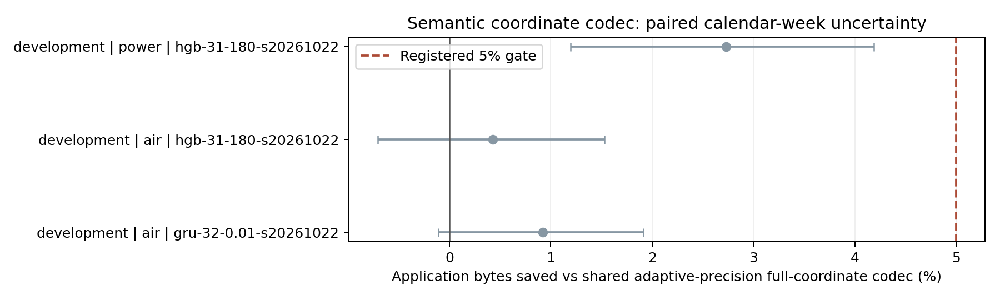
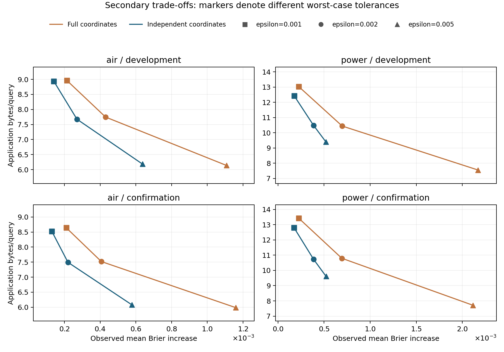
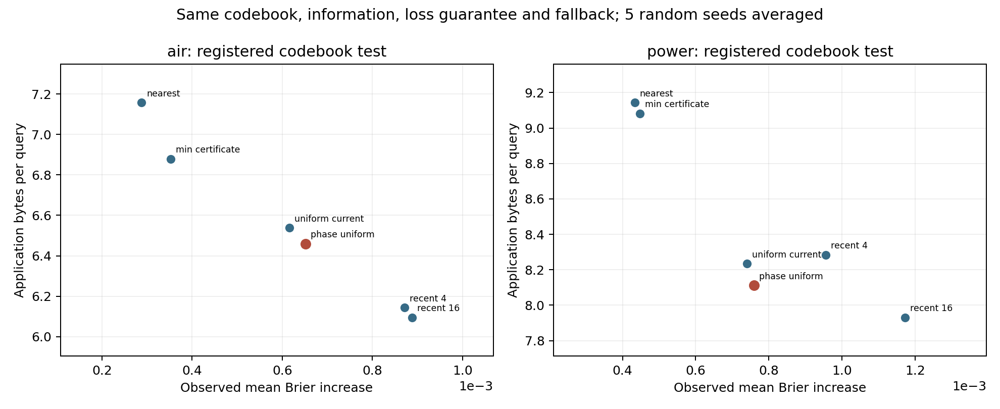

# 研究结果与论文证据审查

## 当前判断

**尚不足以声称提出了显著优于同信息强基线的新方法。** 四个候选机制均未通过预先登记的开发门槛。已有完整实现、可复现数据与模型、跨年份和未见站点诊断、可核验的数学边界；这些可以形成研究报告与失败分析稿，但不等于新方法论文已经具备充分新颖性或录用把握。

本结论来自保留所有失败后的比较。没有通过挑选确认年份、随机种子、模式或容忍量来改写主要结论。阶段记录见 [RESEARCH_LOG](RESEARCH_LOG.md)，新颖性边界见 [RELATED_WORK](RELATED_WORK.md)。

## 实际完成的证据

- 三个模式族：嵌套循环 11 个联合状态，反向/重叠查询 15 个状态，双传感器分支联合 6 个状态。三族的作者 Wayeb CLI 共 36 次逐端点对照全部零差异；原 `upstream/` 子模块未改动。
- 同信息预测器：HGB 离散风险率（discrete hazard）、ExtraTrees、注意力 GRU 删失事件分布（censored event distribution），统一当前业务状态、八步遥测历史和训练查询预算；另做仅业务和去显式状态消融。共保存 90 份训练模型。
- 两个确认领域：空气质量 2016 年 12 站点，其中 6 个训练时未见；家庭用电 2009 年。所有模型与解释在打开这两个时期前冻结。MetroPT 为已曝光诊断数据，不能算新的独立确认。
- 三族确认集的完整标签均属于编译可行集合。双传感器主实验共有 199,555 个完整可评分查询，独立坐标候选观察到 0 次证书/epsilon 违反。
- 三个预测种子、多个预先声明的容忍量、强量化/稀疏/静态/零值参照；统计按日历周配对重抽样，所有空气站点同周一起处理。区间为逐比较 95%，没有同时置信声明。
- 新安全码本候选使用五个策略种子及五类同码本参照，开发门槛失败后没有打开新储备。

这些是离线实流重放（offline replay）与实际字节编解码实验；不是无线设备能耗测试，也不是工业故障预测验收。公开传感器数据上的固定研究模式不能冒充外部标注的事故标签。

## 独立确认：同信息预测基线

下表是登记种子 20261022、短窗口、共同可行凸包投影后的平均 Brier，越小越好。HGB/ExtraTrees/GRU 各配置由开发集选择；确认表不会反向更换主模型。GRU 为 Dynamic-DeepHit 风格任务适配，不是其原论文数据复现。`去显式状态` 只移除状态 one-hot，仍保留事件历史和状态年龄。

| 模式族 | 确认领域 | HGB | ExtraTrees | 注意力 GRU | 仅业务 | 去显式状态 |
|---|---|---:|---:|---:|---:|---:|
| nested | air | 0.008572 | 0.008499 | 0.008860 | 0.009380 | 0.008605 |
| nested | power | 0.002367 | 0.002407 | 0.002298 | 0.002421 | 0.002435 |
| directional | air | 0.028605 | 0.030120 | 0.030890 | 0.032319 | 0.028861 |
| directional | power | 0.016394 | 0.016610 | 0.017014 | 0.017030 | 0.016447 |
| multisignal | air | 0.017396 | 0.017609 | 0.017478 | 0.018112 | 0.017541 |
| multisignal | power | 0.019570 | 0.019583 | 0.019543 | 0.020042 | 0.019757 |

没有一个模型在全部模式和领域都最好。这正是固定同一完整预测器、单独比较通信机制的原因，不能把换了预测器的收益记到编码器头上。

## 独立确认：主要编码比较

ε=0.002，完整坐标基线与候选共享当前自动机状态、全量输入、同一 GRU、完整一致性投影、损失证书、8/16/32/64 位量化、贪心部分更新与真实头部成本。负的 Brier 差值表示候选评分较低。

| 确认领域 | 完整坐标基线 B/query | 独立坐标 B/query | 字节节省及配对 95% 区间 | Brier 差值 |
|---|---:|---:|---:|---:|
| air | 7.518 | 7.493 | 0.34% [-0.32%, 1.00%] | -0.000187 |
| power | 10.795 | 10.726 | 0.64% [-1.18%, 2.37%] | -0.000306 |

两领域均未达到 5% 字节节省门槛，主区间均包含零。另两个登记种子空气节省约 2.57%/2.95%，用电约 4.47%/3.15%；也不替代原主比较。空气未见站点的主字节节省约 0.23%，并非强泛化通信收益。

候选总体 Brier 相对完整坐标基线改善约 1.05%/1.51%；这是次要评分权衡。不能把“压缩附加误差下降约一半”改写成“预测准确率提高一半”。不同 epsilon 之间的实际均值前沿亦不代表相同最坏保证。

## 第四候选：闭环安全码本

根据闭环缓存失败，登记自动机条件解码加上经典随机阶段交集（uniform MSS）的组合。M=64，只用训练时期构造码本。基线获得同一码本和误差保证，包括当前最近、最小证书、当前安全集合随机抽样、最近 4/16 步 minimax。每次更新实际序列化 28 字节；没有可行码字时使用所有策略共同的量化退路。

| 开发领域 | 阶段策略 B/query | 最强同码本历史参照 | 候选额外字节 | 码本覆盖率 |
|---|---:|---:|---:|---:|
| air | 6.460 | 6.095 | 5.98% | 88.72% |
| power | 8.111 | 7.931 | 2.27% | 89.35% |

候选相对最强同码本参照使用更多字节，同时实际 Brier 更低，因此属于未被统一支配的权衡；它没有通过登记的通信优势门槛。相对无阶段记忆的随机选择，仅节省 1.19%/1.50%。共同退路占候选字节约 59%/47%，限制了仅改索引选择的收益。

相对原完整坐标编码少用 16.61%/22.32% 在线字节，但普通同码本参照也能得到这种压缩收益，空气的实际 Brier 还增加了约 0.000221。不得把这些比例归因于新阶段机制。计入首次码本分发后，候选成本是 6.744/8.133 字节/查询。MSS 随机策略和调和竞争比都有直接先例；没有新增的通用在线算法理论。

## 失败解释与理论边界

1. **结构可能很快失去约束力。** 较长期限上，嵌套族全部状态的未来标签集合相同；动态自动机证书退化为强静态逻辑参照。缩短期限和换为反向/分支模式后，动态证书的实用收益仍不足。
2. **概率秩下降不等于总字节下降。** 双传感器短期限可行矩阵秩为 2/4/6、非零坐标为 3/6/9，但固定头部、量化、部分更新和后续缓存轨迹一起决定总通信。方向族的秩等于非零坐标数，独立坐标与零值省略完全相同，是预期负对照。
3. **单步最优不能推出闭环最优。** 精确有理数反例证明点态更紧证书可产生任意更大的闭环包数；全部预测都位于共同可行概率三角形内。一般警示已有事件触发控制文献先例，见 [CLOSED_LOOP](CLOSED_LOOP.md)，不能将它单独称为首次发现。
4. **历史信息本身是强替代解释。** 经典阶段记忆仅比无记忆随机选择略好，被普通历史 minimax 在通信指标上超过。码本压缩、随机阶段算法与其理论保证均为已有工具。

以上第 1、2 项由结构诊断和实测支持，第 3 项有形式反例，第 4 项由同信息消融支持。没有把这些局部证据外推为所有数据、模式或网络的普遍因果定律。

理论保证仅为：在正确且同步的业务自动机、同模型/码本版本、因果查询顺序、辅助消息在评分前可靠交付等条件下，相对同一完整预测器的 Brier 增量有界。它不是概率校准、绝对预测准确率、延迟/丢包鲁棒性或节能保证。最大加自动机见证编译避免枚举全部时间标签，但产品状态及匹配掩码仍可能指数增长；运行时一致性投影仍用显式凸包。

## 文献与可主张的范围

PSR 的核心未来测试概率、POMDP 信念压缩、proper scoring 下的一致性修正、事件触发学习、目标导向通信、MSS 和历史窗口触发均已有来源。当前可以准确主张的是一个可复现的实验与编译框架、特定证书和反例的推导、以及在明确成本模型和强基线下得到的有限/负面结果。尚不能主张首创上下文事件预测、首创独立概率压缩、首创非短视触发，或通用显著性能提升。

拟稿应围绕“语义结构为何未必带来通信收益”组织；是否足以作为经验/负结果论文仍需相关领域研究者和目标刊会评审判断。[论文论点审查](PAPER_READINESS.md) 将每个声明与证据及缺口对应。它不是投稿或录用承诺。

## 复现与保留的独立数据

[复现命令](REPRODUCTION.md)、[模型下载清单](../reports/MODEL_ARTIFACT.json)、[完整证据索引](../reports/evidence-index.json)、[码本比较](../reports/safe-codebook-comparisons.json)。90 模型研究快照已经实际从公开 GitHub Release 下载到空目录，并逐文件核对 SHA；独立重训空气 GRU 的 2,000 个开发预测逐位相同。

空气 2017 年 1–2 月和家庭用电 2010 年 1–11 月保持未用。原确认源代码/模型/阈值哈希再次核验一致。下一项研究不能把已打开的 2016/2009 改称新测试集，也不能通过不断试新种子来消耗储备直至出现好结果。
