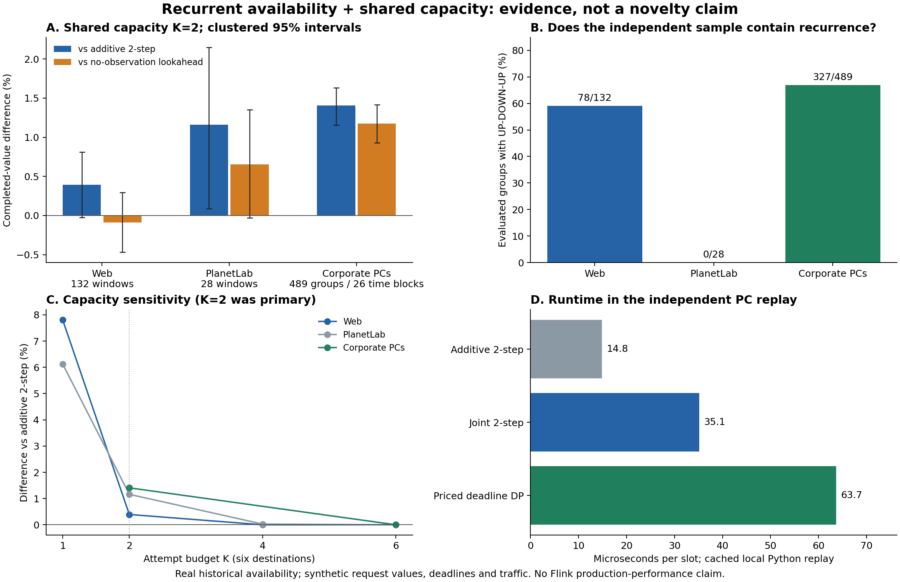

# 共享容量与反复中断：R2 / R2B / R2C 结果

2026-10-23。本轮得到一个较可信的机制信号：在有反复中断的独立企业PC轨迹中，把请求响应可能改变的下一次共享分配计入决策，比同信息可加对照提高加权完成价值1.41%，减少失败尝试7.12%。但实现仍是已有的两步Bellman前瞻，新颖性尚未建立；真实生产收益也未验证。因此现在不把它作为可以投稿的新算法。

## 本轮改变的内容

从 ACN 的单次恢复CDF与吸收态假设，转为 **反复可达性（recurrent availability）＋生产性尝试（productive attempts）＋共享分配后的观测价值（value of information）**。所有方法只看到自己的请求反馈。一个失败请求既消耗当槽额度，也提供下一次决策的信息；成功请求也提供状态信息，但不永久恢复可用资格。共同训练模型是仅由网站训练段拟合的二态CTMC，没有用独立域重新校准。

新机制的研究对象是“这次观测会不会改变下一次共享分配”，而不是一个车辆/目的地单独有多大恢复概率。当前程序用标准Bellman计算作为机制探针，不能将问题表述、马尔可夫模型、影子价格或前瞻本身当作原创。详见[文献排除和设计依据](DESIGN.md)、[数学反例与上界](STRUCTURAL_RESULTS.md)。

## 场景和数据资格

|场景|原始节点数|有效测试窗口/组|包含同节点UP→DOWN→UP|用途|
|---|---:|---:|---:|---|
|CMU网站HTTP测量|129|132 / 预选188|78|时间留出主场景|
|PlanetLab多数ping|669|28 / 预选316|0|跨测量域调度诊断；不能确认反复恢复|
|企业PC每小时测量|51,663行|489 / 预选520|327|额外冻结的独立反复中断验证|

企业PC原始说明称51,662台；固定归档实际包含51,663条节点记录，其中116条没有可用区间，代码保留并报告差异，不人为删一条凑数。该实验覆盖2,856个不同节点、26个不相交时间块、15,550个可评价时槽，包含1,016次恢复和1,029次中断。20组同时间块共享的故障风险被保留在聚类bootstrap中。476组完整，31组初始状态未知，13组在窗口内删失；删失组只评价所有节点都有观测的共同前缀，不补选节点。

这是1999–2005年前后的历史可用性，不是现代服务端吞吐数据。请求到达、价值、截止期、缓冲上限均为合成工作负载。原始数据及许可边界、Flink源码对应、测量删失见[SOURCE_AUDIT.md](SOURCE_AUDIT.md)。代码核查表明Flink的逻辑未完成记录容量与网络尝试预算不同；R2分别限制二者，未运行Flink内核或生产系统。

## 主容量 K=2 的结果

每组6个目的地、每槽最多2次尝试、每目的地最多2条待处理记录。每条请求价值1/2/4，到期2/4/8槽。所有控制器共用相同数据、队列上限和观察接口。

|对照|网站：联合方法差异|PlanetLab：联合方法差异|企业PC：联合方法差异|
|---|---:|---:|---:|
|开发集选中的可加两步DP|+0.393%|+1.161%|**+1.408%**|
|不计前瞻观测更新的联合方法|**−0.089%**|+0.651%|**+1.173%**|
|覆盖可见截止期的容量价格DP|+0.421%|+2.503%|+3.203%|

网站/PlanetLab的容量价格DP比较是R2B事后反证审计，不作为新增留出确认。企业PC R2C 在读取该文件前冻结全部策略、数据选择、指标和门槛，没有在该域拟合或选策略。

企业PC上，联合方法完成价值59,583，对照可加DP为58,756；失败尝试5,411 vs 5,826，减少415次（7.12%）。相对可加DP，每组价值差异1.691，按26个时间块聚类的95%区间 **[1.390,1.963]**；相对无观测前瞻版本，差异1.413，区间 **[1.118,1.702]**。预设的覆盖、调度差异、观测贡献三个门槛均通过。

这不意味着“失败尝试越少越好”：指数退避只有3,901次失败，比联合方法还少，但完成价值为57,771，低于59,583。研究目标是受限额度下完成工作，失败数必须连同交付价值评价，不能单独择优报告。

## 为何仍不能宣布论文机制成立

**信息价值不普遍稳定。** 网站域去掉前瞻观测分支反而略好；PlanetLab该对比按一天块聚类的区间也跨零。企业PC确认的是该场景下的条件性价值，不是跨所有场景的统一优势。网站原窗口bootstrap下主对照区间略高于零，但一天块聚类变成[-0.0343,1.0940]价值单位；3/7天分组为正，分组只有15/7块，不能只挑有利区间。

**转移模型明显失配。** PlanetLab900秒实际恢复率约0.00561，而网站模型预测0.16850。企业PC一小时实际恢复率约0.07015，模型预测0.50801；其Brier为0.05391，简单沿用上一状态为0.02261。共同模型的排序决策仍可能有用，但这不是准确预测恢复的证据，也没有证明它优于所有预测模型。未来工作不能通过只报告大多数上线节点的总体分数来掩盖此问题。

**容量必须真的紧张。** K=6足以对每个目的地尝试时，各不强制退避策略完成价值完全相同；联合观察没有交付增益。K=1网站/PlanetLab有更大差别，但它是次要容量扫描，不换成事后主结果。

**回报来自多种因素。** 全上线负对照仍能出现普通队列调度增益。两步和完整截止期目标不同：明确的三请求反例使两步选择最终只得6，而三步最优可得8。容量定价DP在数据上未抹去联合方法收益，但它只是有限价格网格的拉格朗日启发式，不是完整联合最优策略，不能说已击败所有强基线。

**新颖性没有通过。** 信道探测、POMDP、restless bandits、知识梯度、组合信息价值已覆盖这些基本机制。首次恢复CDF不足的反例说明必须改变预测对象；它不证明我们的求解器首创。已验证的是值得研究的决策问题，未验证的是可区分于既有文献的新算法、复杂度改进或保证。

## 关键可复核结论

1. 两种模型有完全相同的首次恢复CDF `1-2^(-r)`，仅改变恢复后的持续性，就会反转最优共享分配。数值为[3.7875,3.6]与[4.235,4.48]，由独立状态枚举验证。
2. 共同代价不能等同于单个目的地的失败次数；必须与被挤占服务的价值比较，并计入观察后的共同分配。
3. 纯健康探测若和只读请求同代价、同反馈、成功请求收益非负，则可以被带业务负载的尝试替代。真实产品若不同成本/副作用/可靠性，不可直接套用。
4. 独立数据必须真的包含目标机制。PlanetLab调度上有正差异，但0个UP→DOWN→UP循环不能支撑反复恢复结论；R2C弥补了这一特定缺口。

## 实现、测试和复现

累计检查24,936条回放结果（含开发集、负对照、补充审计，不是24,936个独立现实样本）。记录守恒、价值守恒、共享请求上限与12条缓冲上限均通过；12种策略在固定输入上重复输出相同动作与结果。15个语义测试覆盖独立穷举Bayes树、时域上界、观测因果性、CTMC物理时间换算、删失与不替补抽样等。

校验时修正了诊断性当前状态oracle仍会填满空额度并尝试已知失败节点的问题：现在跳过已知失败节点。修正前后24,296条主/独立回放的完成价值逐条完全相同，学习方法及其排名没有变化；oracle的失败次数正确为0。该oracle只知道当前状态并做即时选择，不是全局最优上界。

企业PC K=2的本机平均决策/回放耗时约：可加两步15微秒、联合两步35微秒、容量价格DP64微秒。包含缓存及Python队列开销，是本机原型测量，不是Flink端到端延迟承诺。

[复现步骤](REPRODUCIBILITY.md)；[主表](../reports/r2/test_summary.json)；[R2B审计](../reports/r2/baseline_audit.json)；[R2C独立结果](../reports/r2/independent_r2c.json)；[验证记录](../reports/r2/verification.json)。

图A将价值差异的聚类区间除以该对照的观测平均价值，显示为百分比；网站与PlanetLab采用一天块，企业PC采用预设32小时时间块。图C中K=1/4为次要分析；原始数值和所有分组敏感性都在JSON中。

## 研究结论与边界

保留的方向是**由实际待处理任务和共享容量决定观测价值，并显式允许反复中断**。被淘汰的是“只预测首次恢复”“给局部探测目标加一个固定代价”“把标准前瞻更名为新算法”三种路线。

下一项可发表贡献必须在上述既有方法之外找到结构或算法保证，并接受当前这些对照；同时还需要现代、足够时间分辨率的请求/失败/重试/缓冲占用联动数据，或在真实开源流系统中做受控实验。本轮不以继续调窗口或价格网格来替代这两项缺口。当前证据可以支持研究选题和机制假设，不能支持论文首创性或生产收益声明。
