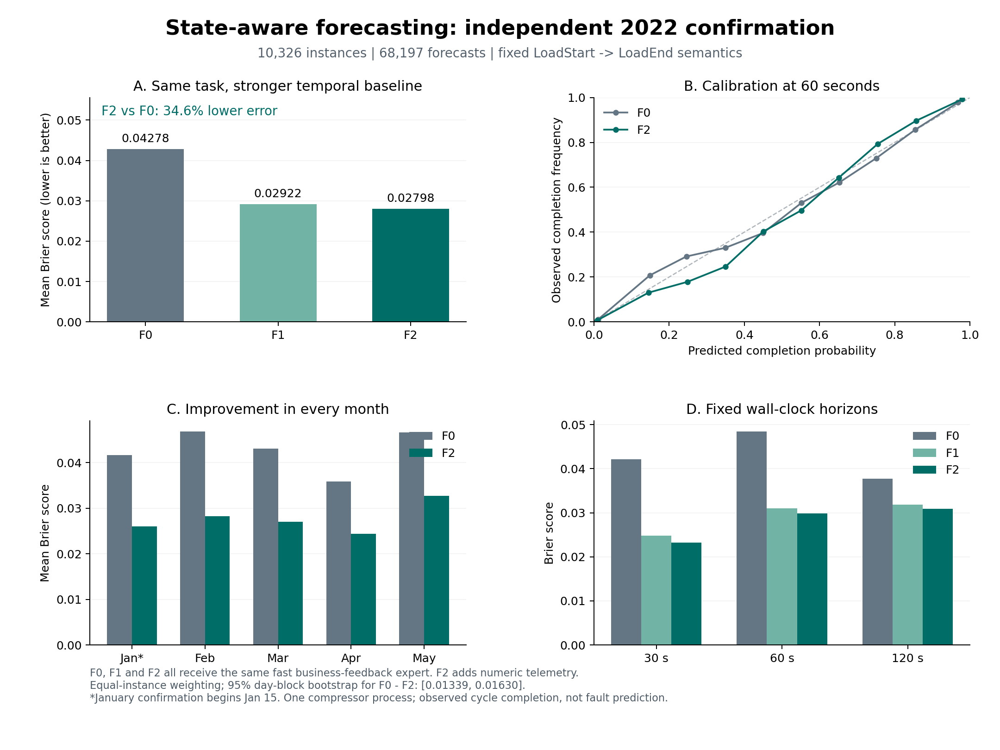

# 状态增强的复杂事件预测 / State-aware complex event forecasting

独立研究目录：保持作者 Wayeb 的匹配语义，研究连续遥测与离散小事件对真实时间预测的价值。实现、失败诊断和新数据确认均已完成。

- [架构依据 / Design](docs/DESIGN.md)
- [预先固定的评估协议 / Protocol](configs/PROTOCOL.json)
- [实验决策记录 / Research log](docs/RESEARCH_LOG.md)
- **[完整结论与结果 / Results](docs/RESULTS.md)**
- [一键复现 / Reproduction](docs/REPRODUCIBILITY.md)
- [最终确认协议 / New confirmation protocol](configs/CONFIRMATION_2022.json)

最终架构是“原 Wayeb 识别器 + 日级状态危险率模型 + 事件级快速业务反馈 + 延迟反馈专家组合”。2022 新确认段共 10,326 个实例、68,197 次预测：相对同样获得快速反馈能力的基线，平均 Brier 从 **0.042777 降到 0.027982（降低 34.59%）**；五个月均改善。60 秒 ECE 为 0.012288。同机复跑逐条预测完全一致；等价批量推理的本机 p95 约 **1.96 ms**，全部确认概率与冻结原路径完全相同。



在仓库根目录运行：

```bash
./state_forecasting/reproduce_2022.sh
```

它创建独立环境、下载并校验作者 2022 数据、执行因果测试、冻结模型确认、原 Wayeb 匹配验证、压力测试和在线回放。2022 原始 CSV 约 1.6 GB，保存在忽略目录。旧 2020 实验可用 `./state_forecasting/reproduce.sh` 重现；旧方案未达到优秀门槛，不能把“程序完成”误读成“性能达标”。

关键代码：

| 文件 | 用途 |
|---|---|
| [online_fast.py](src/stateforecast/online_fast.py) | 最终双流在线接口；只接收真实事件和实际到达的反馈 |
| [serving.py](src/stateforecast/serving.py) | 同一树模型的区间输入批量执行；不改变预测函数 |
| [model.py](src/stateforecast/model.py) | 残余时间危险率和共享保序校准 |
| [fast_feedback.py](src/stateforecast/fast_feedback.py) | 快速业务结果专家与因果反馈回放 |
| [rolling.py](src/stateforecast/rolling.py) | 标签按更新时刻截断的滚动训练 |
| [metro2022.py](src/stateforecast/metro2022.py) | 独立确认数据校验与因果特征提取 |
| [ExportDFA.scala](scala/ExportDFA.scala) | 调用作者转移函数导出当前模式的精确状态表 |

作者代码保持固定；本目录是新增研究扩展，不是作者已有功能或已发表结果。优秀结果的范围是所定义的周期完成任务；状态被延迟或打乱时收益会消失，详见报告。
