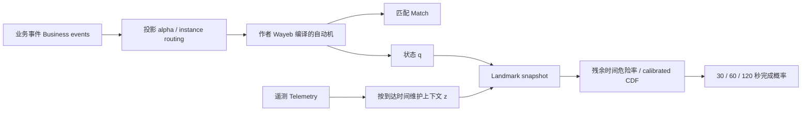

# 保留模式语义的状态预测架构 / Semantics-preserving state forecasting

日期：2026-10-22。本文记录可检查的设计依据、假设、取舍和实验决策；实验结论另见报告。

## 研究问题与来源

用户建议的关键是把**识别充分性（recognition sufficiency）**和**预测充分性（predictive sufficiency）**分开。同一模式状态可以对应不同压力、进度、速度，因此匹配规则相同不意味着未来分布相同。我们检验：在相同业务模式、预测时刻和真实时间窗口下，额外的数值状态是否比业务历史、以及离散化的状态更有预测价值。

来源和边界：

1. [PMC / Wayeb 2018](https://arxiv.org/abs/1901.01826)，本地作者 PDF 第 2–3 页：自动机识别、状态扩充、首次到达（first passage），等待量是转移次数。符号谓词可读属性，但预测分辨率仍受谓词划分限制。
2. [PST 2021/2022](https://arxiv.org/abs/2109.00287)，作者扩展报告第 2–4 页：保留有信息的历史、支持复杂事件预测并考察提前量。它不直接证明连续上下文一定优于离散历史。
3. [van Houwelingen 2007](https://doi.org/10.1111/j.1467-9469.2006.00529.x)：地标分析（landmarking）在仍未完成的实例上，用当前可获得信息重新预测。这里借用统计思想，不复现其医学模型。
4. [Gensheimer & Narasimhan 2019](https://arxiv.org/abs/1805.00917)：离散时间生存分析（discrete-time survival）把区间条件危险率组合成生存曲线，并处理右删失（right censoring）。我们用梯度提升树参数化危险率，不声称实现该文神经网络。
5. [Verenich et al. 2019](https://doi.org/10.1145/3331449)：业务过程剩余时间预测已经有广泛研究。因此“使用上下文预测完成”本身不构成新颖性声明。
6. [UCI MetroPT-3](https://archive.ics.uci.edu/dataset/791/metropt+3+dataset)，DOI [10.24432/C5VW3R](https://doi.org/10.24432/C5VW3R)：真实列车压缩机遥测，CC BY 4.0。本文研究正常加载周期完成时间，不把它称作故障预测。UCI 描述同时出现 1 Hz 与 0.1 Hz，我们以文件实际时间戳计算秒数。

## 架构与不变式

业务模式不增加必需的遥测步骤。辅助报告通过投影 `alpha` 被剔除，业务时间戳和实例标识保持原样。因此对任意细流 `w`，要求 `Matches_new(w) = Matches_Wayeb(alpha(w))`。证明是对输入长度归纳：业务事件执行同一转移函数，辅助事件对识别状态是恒等操作。必须比较匹配端点，单纯比较匹配数量不够。

实现使用作者编译器生成有限状态自动机，再从作者 `SDFAInterface.getNextState` 导出业务字母表上的精确转移表。Python 侧执行这张表；同时以真实 Wayeb CLI 做差分检验（differential testing）。适用边界明确限制为本实验的纯事件类型谓词、确定性自动机、无寄存器/时间窗模式；不能把有限标签导出器冒充通用符号自动机执行器。

每个实例分开维护 `(q, context, history)`。遥测按到达时间接入；未来报告不可见；旧报告不得覆盖更新的状态。缺失值保留为缺失，并保留报告年龄。跨缺测长间隔的周期被删失、识别状态重置，不能假设停采期间没有完成事件。真实数据未记录网络到达时间，所以正常实验采用 event time = arrival time；延迟只在明确标注的压力测试中注入。

## 为什么选择地标危险率

在查询时刻 `t`，令 `R = T_match - t`，输入 `x_t = (q_t, business_history_t, z_t)`。将未来秒数分成边界 `0 = b_0 < ... < b_K`：

\[
h_k(x_t)=P(b_{k-1}<R\le b_k\mid R>b_{k-1},\mathcal F_t),\qquad
F(b_k\mid x_t)=1-\prod_{j\le k}(1-h_j(x_t)).
\]

`F_t` 表示截至查询时真正收到的信息。乘积自然保证 CDF 非递减，最后保留“超过最大范围”的概率质量，不强迫模式一定完成。

训练时仅把实际观察到的风险区间放入损失。若在边界内完成，前面的区间标为 0，完成区间标为 1；若删失，只使用边界不晚于删失时刻的区间，不能把未知未来记成负样本。同一查询的上下文不会被解释成未来物理状态恒定：危险率是给定当前信息后，对未来未观察状态演化边际化的直接条件模型。它没有显式生成未来遥测，也不要求增广状态严格满足马尔可夫性。

选择理由：比直接独立训练多个概率更容易保证概率随窗口增长；比联合生成整个未来状态流更容易先隔离“新增信息有没有用”。代价是需要逐模式、逐风险状态的数据；跨业务模式迁移和复杂重叠实例不在本轮验证范围。

校准（calibration）采用独立时间段上、所有 horizon 共享的保序映射（isotonic map）：单调映射保留每条 CDF 的单调性。它不提供时间漂移下的覆盖率保证。每个窗口单独报告 Brier、对数损失和校准误差；共享映射并不自动保证每个窗口都校准。

删失似然依赖条件非信息删失（conditionally non-informative censoring）等统计假设；工业停采也可能与工况有关，不能据此宣称无偏或分布无关的保证。M2 所用直方图梯度提升树内部同样会离散化数值特征；这里的“连续状态”意指保留原始数值输入，相比 M1 的显式 16 档更细，不是无限精度模型。

## 公平对照

| 模型 | 输入 | 检验 |
|---|---|---|
| M0 | 原模式状态、已运行秒数、已经结束的历史周期时长 | 强时间基线，避免把“有时钟”误当作“有遥测”的收益 |
| M1 | M0 + 训练集分位数离散化后的传感器值和变化率 | 4/8/16 档由开发前选择集确定；全部模型容量相当 |
| M2 | M0 + 同一组未经分箱的传感器值和变化率 | 连续精度的增益，不能偷偷增加 M1 没有的传感器 |

原 PMC 在只剩一个业务 `Finish` 的情况下预测的事件步数接近退化分布，不能直接拿它与 60 秒概率比较。因此 M0 是新增的时间基线，报告绝不把这项实验写成“打败原论文算法”。保留作者识别器，使原模式语义可检查。

压力测试包括延迟、丢失遥测、上下文打乱（permutation control）、无信息上下文、不同采样频率、按时间块评估。模型选择与校准仅访问训练/选择/校准段；开发实验可以重复，但保留集在冻结后才打开。

## 真实任务与可证伪判断

MetroPT 的 `COMP` 在不加载时为 1，加载时为 0。仅在已观测到 `1 -> 0` 时产生 `LoadStart`，在 `0 -> 1` 时产生 `LoadEnd`。固定模式 `LoadStart -> LoadEnd`。预测时只使用仍在该周期中的观测，不使用完成行的传感器值、最终周期长度、未来平滑或全周期归一化。

压力、温度、电流以及过去差分可能包含剩余运行信息。其是否优于年龄和历史周期不是预设结论。若连续状态不优于足够细的离散状态，就保留这一结果；若在时间漂移或缺失下失效，就记录其失效边界并测试可靠性门控。若所有状态模型都没有信息增益，就接受“该任务没有证据”的结论，不能调换目标或泄漏保留集追求好看分数。

验收条件在 [PROTOCOL.json](../configs/PROTOCOL.json) 固定。它定义本轮研究原型的优秀标准，不代表新理论、论文可接收性或工业部署保证。

## 根据失败实验形成的最终架构

开发集揭示了两种失败：固定分布模型失效；每日重训仍不能及时应对日内工况突变。因此增加业务历史与状态专家的**延迟反馈组合（delayed-feedback expert aggregation）**。参考 [Freund & Schapire 1997](https://www.sciencedirect.com/science/article/pii/S002200009791504X) 的指数加权思想和 [Kolter & Maloof 2007](https://www.jmlr.org/beta/papers/v8/kolter07a.html) 的漂移专家组合思路；这里是特定工程组合，不宣称发明加权多数算法，也不照搬 DWM 的增删专家机制。

两个专家输出整条 CDF。对一个已真正揭晓的二元结果 `y`，先用 Brier 损失更新权重：

\[
\widetilde w_j\propto w_j\exp[-\eta(p_j-y)^2],\quad
w_j'=(1-\rho)\widetilde w_j+\rho/2.
\]

固定 `eta=2`、`rho=0.02`，没有对这两个参数做搜索。保留少量权重使专家可在工况恢复后重新参与。全部 horizon 共享同一权重，凸组合保留 CDF 单调性。正反馈仅在实际观测完成时到达，负反馈要等整个 horizon 过去；删失窗口没有反馈。开发集上连续专家组合 G2 略优于离散专家组合 G1，因此冻结 G2 为主方法。

滚动训练每个自然日一次：过去 14 天，最近 2 天仅校准；在各自训练截止时对仍未完成实例截断标签。新数据先预测，结果可知后再用于后续更新，称为**先测后训评估（prequential evaluation）**。最终保留集允许按冻结规则利用先前已揭晓的保留段结果更新后续日期；它不是四个月始终固定参数的测试。

上线侧代码 `StateSidecar` 可以接收独立业务和遥测流、输出概率、在到达实际完成/窗口终点时更新专家权重。缺失或超过 30 秒的关键遥测退回业务专家。当前支持有序、及时的业务事件；遥测允许延迟与乱序。晚到业务事件的事件时间预测需要水位线（watermark），当前明确拒绝，不假装已经解决。

## 第二代修正：专家一起失败时必须增加新的预测来源

第一代在 2020 保留集没有达标，见研究记录。若所有专家都只给 0.1 左右的概率，则任何凸组合仍然至多约为 0.1，重新分配权重无法表达新的 0.98 完成率。新增专家的动机来自这个表达能力限制。

最终 F2 使用五个专家输出：原始业务危险率、已校准业务危险率、原始状态危险率、已校准状态危险率，以及快速业务结果专家。最后一个直接依据已经揭晓的结果维护分组计数：分组仅由当前年龄和上一周期时长的固定档位构成，不读传感器。对组 `s` 的第 `k` 个窗口，收到实际标签 `y` 时：

\[
A_{s,k}\leftarrow0.98 A_{s,k}+y,\quad
N_{s,k}\leftarrow0.98 N_{s,k}+1,\quad
p_{s,k}=(A_{s,k}+1)/(N_{s,k}+2).
\]

这是带 Beta(1,1) 平滑和遗忘的经验预测，不是新增马尔可夫性证明。不同窗口反馈成熟时间不同，输出做前缀最大化以保持 CDF 非递减。潜在代价是统计校准不自动成立，因此独立检查 ECE。比较用 F0 同样含快速业务专家和原始/校准业务版本；F1 与 F2 只在状态表示的分辨率上不同。

`FastStateSidecar` 是这套结构的可执行接口。在线更新只需要实际事件与定时器，不需要读取离线残余时长；离线 `adaptive_forecast` 的评估调度器只负责在完成/窗口终点释放反馈。日级训练负责复杂状态关系，事件级计数负责快速适应，两个时间尺度（two timescales）的作用分别测试。额外算法组合本身不构成已被证明的新颖性。
