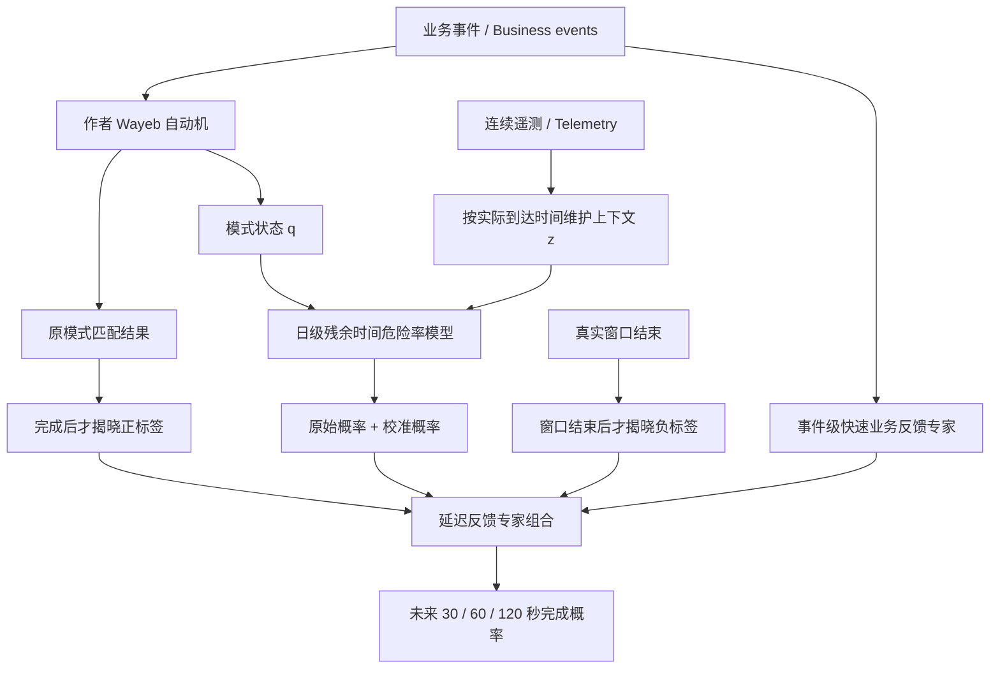

# 研究结论与实验结果 / Research findings

本轮已经完成“设计 → 实现 → 失败诊断 → 改进 → 新数据确认”。最终架构在事先冻结的 **2022 确认集（confirmation cohort）** 上通过了设定的预测性能标准。原始 Linux 推理延迟超标后，增加了保持逐条概率完全相同的批量执行适配器。早期 2020 保留实验没有通过，完整保留在仓库中。

## 最重要的结论

1. **保留业务模式、增加预测信息是可行的。** 新增遥测不会成为模式的必需步骤。作者 Wayeb 编译自动机仍决定什么算一次完成；预测器可以在匹配状态不变时更新概率。
2. **额外状态有价值，但更复杂的状态模型也可能一起失效。** 固定模型、仅每日重训、仅两专家加权，都在某些真实工况变化中失败。若两个模型都只预测 10% 左右，任何二者的加权平均都无法表达新的约 98% 完成率。
3. **最后有效的是两个更新速度的组合。** 日级危险率模型学习进度与传感器关系；事件级业务反馈专家快速跟上新工况。基线也获得相同快速更新能力，然后再比较状态信息的额外价值。
4. **连续数值比 16 档离散化更好，但优势大小要准确表达。** 2022 年连续方案相对离散方案约降低 4.24% 的平均 Brier；主要的 34.59% 改善是相对加强的业务历史基线，不能把两个数字混淆。

## 最终架构



模式固定为 `LoadStart → LoadEnd`，从实际可观察的 `COMP` 信号跃迁产生业务事件。这里只预测压缩机加载周期何时结束，不是故障或剩余寿命预测。数学定义、危险率似然、删失、投影不变式、文献来源及取舍见 [DESIGN.md](DESIGN.md)。可执行实现是 `FastStateSidecar`；它独立处理业务流、遥测流和反馈。

## 新确认数据上的结果

使用 [作者发布的 MetroPT 2022 数据](https://zenodo.org/records/6854240)，原文件 10,773,588 行，中位采样间隔 1 秒。文件 MD5 与作者发布值相同，并记录 SHA256。前 14 天预热，2022-01-15 至 2022-05-31 为确认段；**冻结模型结构、更新规则和源码后才计算这一段的结果**。

确认段含 **10,326 个实例、68,197 次查询、137 个自然日**。按完整实例计权，每个实例内所有查询总权重为 1。所有方法使用相同查询、原模式、真实秒数目标和因果反馈规则。

| 方法 | 输入与相同适应能力 | 平均 Brier ↓ | 60 秒 ECE ↓ |
|---|---|---:|---:|
| F0 加强基线 | 业务历史、年龄、原始/校准版本、快速业务反馈 | 0.042777 | 0.008131 |
| F1 离散状态 | F0 + 同一组状态的 16 档表示 | 0.029222 | 0.012796 |
| F2 最终方案 | F0 + 数值状态、变化率 | **0.027982** | **0.012288** |

F2 相对 F0 的平均 Brier 降低 **34.59%**。差值 `Brier(F0) - Brier(F2)` 的按天成块 bootstrap 95% 区间为 **[0.013386, 0.016295]**，高于零。这里是概率误差降低，不是“准确率提高 34.59%”。F0 的 ECE 更低；F2 的校准符合门槛，但不声称在每个指标都最好。

F2 相对 F1 的差值为 0.001240，95% 区间 **[0.001038, 0.001439]**，相对降低约 **4.24%**。离散状态已经捕捉到大部分有用信息；保留数值精度还有较小但稳定的附加收益。

| 真实时间窗口 | F0 Brier | F2 Brier | F2 AUROC |
|---|---:|---:|---:|
| 30 秒 | 0.042123 | 0.023246 | 0.992416 |
| 60 秒 | 0.048473 | 0.029816 | 0.992694 |
| 120 秒 | 0.037734 | 0.030883 | 0.961578 |

| 月份 | F0 平均 Brier | F2 平均 Brier |
|---|---:|---:|
| 1 月 15 日起 | 0.041659 | 0.026033 |
| 2 月 | 0.046881 | 0.028267 |
| 3 月 | 0.043045 | 0.027032 |
| 4 月 | 0.035877 | 0.024402 |
| 5 月 | 0.046666 | 0.032687 |


最终等价批量推理的本机单查询 p95 约 **1.96 ms**，两个保存的危险率模型合计约 **0.662 MiB**；快速计数与组合权重另占少量运行状态。计时包括两个危险率预测、原始/校准版本和组合，不包含网络、每日训练或外部消息系统。耗时会随机器负载变化，不能与作者原论文的不同吞吐任务直接比较。原路径两次 p95 为 10.88 和 19.23 ms，均保留在复现记录中。

所有预先设定的性能条件通过：相对改进 ≥20%、改善区间高于零、60 秒 ECE ≤0.05、至少四个月改善、p95 ≤20 ms、模型 ≤25 MiB。事实是五个月都改善。完整数值见 [confirmation-2022.json](../reports/confirmation-2022.json)，协议和源码哈希见 [CONFIRMATION_2022.json](../configs/CONFIRMATION_2022.json) 与 [FROZEN_2022.json](../configs/FROZEN_2022.json)。

## 失败过程没有被隐藏

| 阶段 | 发现 | 处理 |
|---|---|---|
| R1 固定模型 | 2020 年 4 月大量短周期，旧模型与旧校准失效 | 采用因果滚动训练 |
| R2 每日重训 | 多数日改善，但突变日比业务基线差很多 | 增加延迟反馈的专家组合 |
| R3 两专家组合 | 4 月开发集改善 37.85%；5–8 月保留集仅改善 9.76%，ECE 0.161，未达标 | 保留失败，重新诊断；不把旧保留集继续称作独立证据 |
| R4 原始/校准版本组合 | 原始与校准模型也可能同时失败，改善约 11.17%，仍未达标 | 增加新的快速结果专家，而非只调权重 |
| R5 快速业务反馈 | 在已看过的 2020 数据上改善 35.15% | 只称诊断结果，再冻结并验证另一采集期 |
| 2022 确认 | 改善 34.59%，校准与各月检查达标 | 完成本轮研究原型 |

每次结果、具体异常日、诊断依据、代码边界修复及提交顺序见 [RESEARCH_LOG.md](RESEARCH_LOG.md)。2020 原冻结实现和报告仍可单独复现；没有为了成功删除失败天或改掉匹配目标。

## 验证边界

作者识别器差分验证：2020 真实投影 16,738 次匹配；2022 预热与确认段投影 11,247 次匹配；随机业务流 1,076 次匹配，全部端点相同，插入预测用遥测后也相同。2022 的 11,247 是识别验证总数，包含预热，不能与确认段实例数 10,326 混用。

因果测试覆盖未来信息不能改变前缀、晚到遥测不能提前使用、旧报告不能覆盖新报告、实例隔离、缺口删失、标签实际成熟时间、单调概率、分箱只拟合训练数据、在线与离线特征一致、快速专家不读取传感器。保留了合成有信息/无信息对照，避免仅靠为新模型设计的样例获得好看结果。

27 项单元测试全部通过。同一台机器从每日训练重新执行第二次确认实验后，三个原始模型、三个校准模型、F0/F1/F2 的 68,197 × 3 条概率以及全部组合权重均逐元素完全一致；两次性能条件均通过。计时不同，不能把耗时也称作确定性结果。详细核对见 [reproducibility.json](../reports/reproducibility.json)。

[GitHub Linux 完整复现](https://github.com/roy-pyke/wayeb-event-forecasting/actions/runs/39861854411) 执行成功，F2 相对 F0 改善 34.60%，各模型平均 Brier 与本机的绝对差均小于 0.000005。逐条预测存在数值差异，不声称跨平台逐位相同；原始数据校验、样本数和匹配端点一致。Linux 原始推理 p95 为 38.87 ms，因此原始 Linux 报告的 `quality_pass=false`，不能只因 CI 显示绿色就称其全部达标。该报告独立保存在 [confirmation-2022-linux-original.json](../reports/confirmation-2022-linux-original.json)。

速度诊断发现每个模型对 9 个危险率区间逐个调用树模型 API。新增 `BatchedSurvival` 把这些输入组成一批，使每个查询从 18 次树模型调用变为 2 次；没有修改训练、树、校准或反馈规则。逐条验证全部 137 天、411 个日模型的原始和校准概率，最大差值为 0。同进程计时原路径 p95 12.55 ms，批量路径 1.96 ms；原始失败与修复后证据分开记录，见 [serving-2022.json](../reports/serving-2022.json)。

最终压力测试也保留了明显边界：全部遥测缺失时逐条退回 F0，Brier 恰为 0.042777；把状态快照延迟一个查询间隔后为 0.042220，主要收益几乎消失；日内打乱状态后为 0.043773，略差于基线。这说明**收益依赖新鲜且正确关联的遥测**，不能声称任意噪声或延迟下仍然优秀。压力参数没有用来重新调整确认模型。完整结果见 [stress-final-2022.json](../reports/stress-final-2022.json)。

在线回放的实际例子：自动机持续处在状态 2（等待完成）时，60 秒完成概率随新报告从约 0.106、0.116、0.366 上升到 0.929；直到真正收到结束事件才产生匹配。回放前三个真实周期得到 3 次匹配、20 次预测、60 个成熟反馈，示例历史从空开始，不混作主基准的逐行预测。

这是一种有证据支持的研究原型。2022 是新的采集期，属于同一压缩机应用领域；没有证明对其他设备、复杂重叠模式、故障预警或所有数据分布都有效。数据没有网络到达时间，真实实验采用采样即到达；晚到业务事件、生产级故障恢复和分布式背压尚未实现。增加上下文、地标生存分析、在线专家加权都有既有文献，本项目没有凭组合就宣称论文级新颖性。

## 运行

```bash
cd /Users/ruiwang/Desktop/Library/research/projects/Wayeb
./state_forecasting/reproduce_2022.sh
```

已生成本地模型时可直接运行在线回放：

```bash
./state_forecasting/run.sh state_forecasting/scripts/demo_fast.py --run runs/state-confirmation-2022
```

环境、数据校验、旧实验复现及接口说明见 [REPRODUCIBILITY.md](REPRODUCIBILITY.md)。
